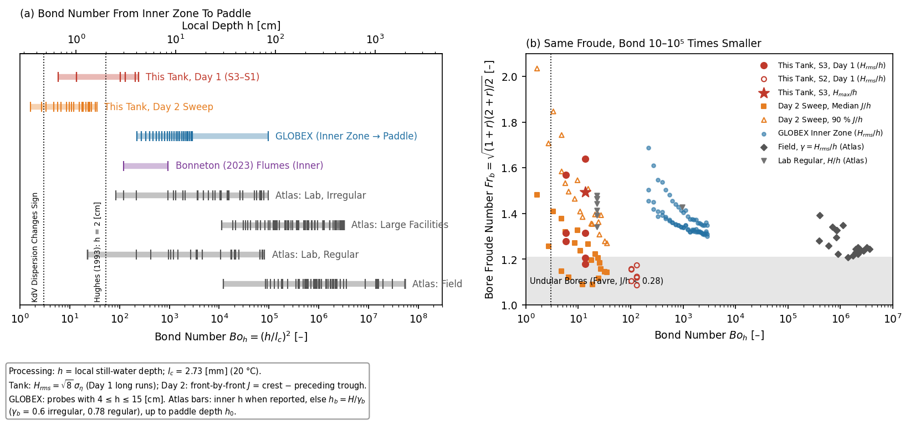
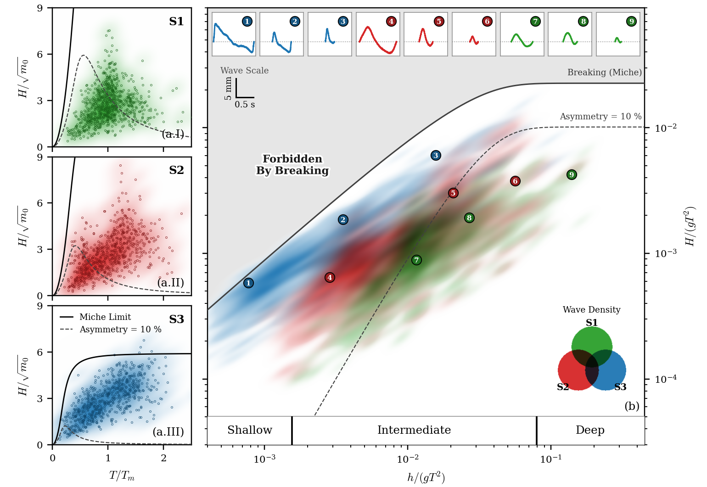
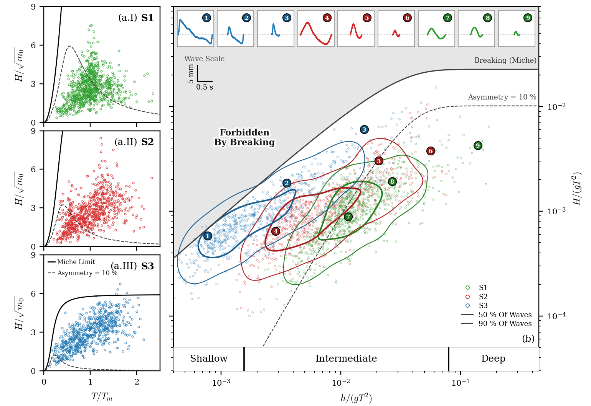

#+TITLE: Journal Week 46
#+OPTIONS: toc:2
#+BIBLIOGRAPHY: ../../../references.bib
#+CITE_EXPORT: csl chicago-author-date.csl

* Table of Contents :TOC:noexport:

* Referencias
#+PRINT_BIBLIOGRAPHY:

* 2026-11-12
** [09:22] Día 12: funciones de estructura con signo (S_p^+ y S_p^-)
- Antes de escribir: repaso de las funciones de estructura con signo a partir de Sreenivasan, Iyer & Vinodh (2022, Phys. Rev. Research 4, L042002). Revisé un apunte sobre ese paper hecho por otra IA: las cuentas están bien. Tiene errores menores (el recuadro de su Fig. 2 es la raíz p-ésima del cociente, la cota ζ_p ≤ p/3 no vale para las partes, un argumento corrido en la sección de bores) y todo está planteado en el espacio.
- Versión nueva, en prosa y con la serie principal (JONSWAP, S3): [[file:../../../Assets/2026/11/Day_12/funciones_con_signo.pdf][funciones_con_signo.pdf]] (12 p.). Códigos y figuras en =Tercera iteración/Día 12/Apunte funciones con signo/=.
- Lo central: en una serie temporal el lado de los choques es el positivo (un frente llega al sensor como una subida). En S3, ζ_p^+ ≈ 0,3–0,47 (satura) y ζ_p^- va de 1,0 a 2,6 (p = 2–7); el ζ_p de siempre es su promedio pesado por la parte de cada uno. El 99 % de S_7^+ sale de ventanas con un frente.
- Γ_p = (S_p^+ − S_p^-)/(S_p^+ + S_p^-) mide la irreversibilidad a todo orden: 0,4–0,95 en el dato a 129 ms, ≈ 0 en los subrogados IAAFT. Posible figura para el manuscrito.
** [09:33] ¿Tiene sentido medir intermitencia sin separación de escalas? (búsqueda bibliográfica)
- Sí, pero como fenómeno que depende de la escala y no como exponentes universales. La intermitencia definida como deformación de la PDF de los incrementos al achicar la escala (aplanamiento que crece, colas) no necesita rango inercial: Castaing, Gagne & Hopfinger (1990), Chevillard et al. (2012), y existe también en el rango disipativo (Frisch & Vergassola 1991). Delour, Muzy & Arneodo (2001): el cumulante C2 = Var ln|δ| tiene comportamiento universal con la escala aun cuando el primer cumulante depende de Re y del montaje.
- Los exponentes universales sí piden escala o un atajo. Ni a Rλ ~ 10⁴ hay scaling limpio (Sreenivasan & Dhruva 1998). ESS (Benzi et al. 1993) falla a orden alto (Stolovitzky & Sreenivasan 1993). Schumacher, Sreenivasan & Yakhot (2007) sacan exponentes anómalos de flujos sin rango inercial (Rλ 10–63) escalando momentos de gradientes con Re; Yakhot & Donzis (2017) ubican la aparición de la anomalía en Rλ ≈ 9.
- En tanques con estructuras coherentes los exponentes se leen como geometría: Lukaschuk, Nazarenko et al. (2009) interpretan los ζ_p en un canal finito como firma del tipo de cresta singular y recomiendan el grado de incremento mínimo; Ricard & Falcon (2023) comparan S_p(τ) completo con un modelo de choques de ancho finito; Mitra, Bec, Pandit & Frisch (2005) advierten que un rango finito puede fabricar multiscaling aparente.
- Para la cuba (T_m/t_r ≈ 13) es defendible: incrementos intermitentes e irreversibles, localizados en los frentes, y ausentes en un subrogado con el mismo espectro y la misma PDF (comparaciones a τ fijo, como los titulares actuales del manuscrito). Los ζ_p, solo como exponentes efectivos en un rango declarado. No: exponentes universales ni cascada.
- Dos pruebas propuestas: C2(τ) de magnitud (Delour et al.) y escalar los momentos a τ chico con R_B entre mediciones (vía Schumacher). Las hago a continuación.
** [09:48] Intermitencia sin separación de escalas: Falcon y dos pruebas
- Mini informe: [[file:../../../Assets/2026/11/Day_12/pruebas_sin_separacion.pdf][pruebas_sin_separacion.pdf]] (6 p.). Códigos y resultados en =Tercera iteración/Día 12/Pruebas sin separación/=.
- Falcon: ningún trabajo suyo con funciones de estructura tiene nuestra separación en régimen de choques. El más parecido, Ricard & Falcon (2023, PRE), mide choques en el tiempo con 863 frentes, pero su separación es ≈ 83 contra nuestros ≈ 13, y compara con un modelo de frente de ancho finito. Falcon, Fauve & Laroche (2007, PRL) tiene τ_c/τ_min ≈ 13, pero es otra cuenta y su rango de ajuste cubre una década.
- Cumulante de magnitud (c2 de Delour et al.): no sirve con estas series. Cambia con el estimador (0,20–0,79 en JONSWAP), con el ruido (descartar el 2 % de incrementos más chicos lo baja a la mitad) y entre mediciones (−0,17 a +0,54), y en GLOBEX da lo mismo con y sin rotura.
- Momentos a escala chica contra separación (vía Schumacher): señal limpia. En la zona interna de GLOBEX, M4 ∝ (T_m/t_ν)^0,81 y M6 ∝ (T_m/t_ν)^1,5–1,6 (133 sondas, Spearman 0,96); la cuba (7 mediciones del Día 1) cae sobre la misma nube; el tren de choques da 1,08 y 2,10; IAAFT y olas sin romper, gaussianos.
- Γ3 = 0 sin rotura y crece con la separación en GLOBEX (0,09–0,68); la cuba ya tiene 0,55–0,72 con separación 9–25.
** [12:18] PDF definitivo de figuras: Figs. 1–7 revisadas
- Nuevo PDF con el estilo del manuscrito: [[file:../../../Assets/2026/11/Day_12/manuscrito_definitivo.pdf][manuscrito_definitivo.pdf]] (fuentes en =Tercera iteración/Día 12/Manuscrito/=). Se revisa figura por figura; el cambio grande va a ser la parte de intermitencia.
- Figs. 1–5 quedan como están (falta el render nuevo de la Fig. 1a en Fusion). Los recuadros de pendientes se reemplazaron por recuadros "Para el texto o el epígrafe definitivo"; lo importante: el video de la Fig. 2 es de una prueba preliminar, el forzado se diseñó para 20 cm de profundidad, el origen de las líneas en 0,77 y 1,00 Hz de la Fig. 4 sigue abierto y faltan sensores y calibración en Métodos.
- Fig. 6 nueva: H contra T (S1–S3) combinada con el diagrama de Le Méhauté, con nueve olas como recuadros numerados y zonas por tipo de onda (lineal, Stokes de 2.º orden y órdenes superiores con el borde η3/η1 = 1 % de Fenton, cnoidal, prohibida por rotura). La vieja Fig. 10 desaparece.
- Desde hoy la dispersión estándar es la de gravedad con profundidad finita (Miche 0,142): S3 tiene 5 olas sobre Miche. Iribarren con la misma dispersión: σ_lnξ 0,237 ± 0,005, μ_lnξ −1,049 ± 0,006, χ²_ν 3,2, R² 0,994; la cola real (ξ > 0,52) es más pesada que la log-normal.
- Pendiente: decidir qué hacer con la línea H = H_b/4 (no separa ninguna zona) y seguir con la Fig. 8.
** [cierre] Le Méhauté: antecedentes y pendiente de cruces
- Búsqueda bibliográfica: no hay antecedente directo de olas individuales de un campo irregular en el diagrama de Le Méhauté (ni con densidades). Lo más cercano: Eldrup & Lykke Andersen (2019, JMSE 7, 14; un punto por estado de mar) y Mizuguchi (1982, ICCE 18; análisis ola por ola entre sondas). Para citar y comparar con nuestro borde η3/η1 = 1 %: Zhao, Wang & Liu (2024, Coastal Eng. 188, 104432), que redefinen las fronteras con un criterio cuantitativo de órdenes de Stokes.
- Pendiente: chequear qué pasa con el otro criterio de elección de los cruces (descendente, que Mizuguchi recomienda en aguas someras; usamos ascendente): H, T, Fig. 6, Iribarren y crestas/alturas, sobre todo en S3.
- Próxima sesión: seguir el PDF definitivo por la Fig. 8.

* 2026-11-13
** [14:55] Día 13: números de Bond y Froude de la cuba frente al atlas
- Antes de seguir con las figuras definitivas: ¿cómo quedan Bond y Froude contra los canales del atlas, y qué objeciones abren? Código y resultados en =Tercera iteración/Día 13/= (=Códigos/bond_froude.py=, =Resultados/bond_froude.json=).
#+ATTR_ORG: :width 700

- Bond, Bo_h = (h/l_c)², l_c = 2,73 mm: en la zona interna (S3) da 6–14 (JONSWAP 395: 14), en S1 204–243 y en el barrido del Día 2 1,6–35. Los canales chicos del atlas llegan a 23–970 en sus sondas más someras (Svendsen 1978: h = 1,3 cm; MK93: 2,5 cm), los de Bonneton (2023) 120–950, GLOBEX 220–2900, los canales grandes y el campo 10⁴–10⁶. Quedamos 10–100 veces por debajo de los canales chicos y 10³–10⁵ veces por debajo de los grandes.
- Froude del bore, Fr_b = √((1+r)(2+r)/2) con r = H/h (Rankine–Hugoniot): S3 1,35 con H_rms/h (Día 1: 1,18–1,64; con H_max/h = 0,67, 1,49), Día 2 1,09–1,48 con la mediana de J/h y 1,27–2,03 con el percentil 90. Atlas: campo 1,21–1,39 (γ de Thornton & Guza y otros), labs regulares 1,34–1,48, GLOBEX 1,30–1,69. El Froude coincide; el Bond no. Es lo esperable en semejanza de Froude: con λ = h0/h0_cuba (vN03: 16,5; labs 7–20; canales grandes 60–115), Bo y We escalan como λ² y Re como λ^1,5.
- Weber del frente, We = ρU²J/σ = Fr² (J/h) Bo_h: 4–32 en S3 (JONSWAP: 10), contra 10⁴–10⁶ en los canales grandes. La tensión superficial es comparable a la inercia a la escala de la altura del frente: sin aire atrapado, rodillos tipo "capillary roller" (a verificar: Longuet-Higgins 1992; Duncan et al. 1999).
- Lo nuevo: con tensión superficial, el coeficiente dispersivo de KdV va como (1/3 − 1/Bo_h). En S3 la dispersión baja 21 %, y para h < 4,7 mm (Bo_h < 3) cambia de signo: les pasa a los dos niveles más bajos del Día 2 (h = 3,5 y 4,5 mm). Las ondulaciones del Día 2 tienen un período de ≈ 0,22 s, independiente de h, que es 1,05–6,4 veces T_KdV; la corrección capilar explica a lo sumo un factor 1,1–1,6, así que no las explica (coincide con el cierre del 2/11: la "solitaria" no es KdV).
- Objeciones que esto abre y respuesta corta: (1) "la zona interna está dominada por capilaridad" → presión capilar ≈ 2 % en el frente, Fr, H/h, R_B y espectro como en los canales; marcar los casos del Día 2 con h < 6 mm (Bo < 5). Revisar que ω_ν ∝ h^−1/2 se mantenga sin ellos. (2) "no son bores turbulentos": Re_h ≈ 3×10³ y We ≈ 10, sin aireación; responder con la celeridad de los frentes contra H/h (Rankine–Hugoniot), pendiente (3) del atlas. (3) "Fr ≈ 1,2–1,4 está en el umbral de bore ondular (Favre)": el campo está en el mismo rango, así que es propio de la zona interna y no de la escala.
- Propuesta para el manuscrito: sumar Fr_b, We y 1 − 3/Bo_h a la Tabla 1; el panel (b) como figura de escala ("mismo Froude, Bond 10–10⁵ veces menor").
** [15:40] Día 13: ¿con qué canales es comparable la cuba? (PDF para revisar)
- Planteo del usuario: la cuba es un montaje que permite medir la dinámica de olas rotas; la pregunta es hasta qué punto esa dinámica es comparable, y con qué canales. PDF en revisión: [[file:../../../Assets/2026/11/Day_13/comparacion_canales.pdf][comparacion_canales.pdf]] (7 p.; fuentes en =Tercera iteración/Día 13/Comparación canales/=, bibliografía verificada en =Día 13/Bibliografía/escala_rotura.md=).
- Resumen: los números de Froude (ξ0, H_rms/h, R_B) coinciden; los de escala (Bo, Re, We) no. En dinámica, la cuba es un modelo 1:8,5–1:16,5 de los canales clásicos de la zona interna (vN03, BK94, MK93, Ting & Kirby, Svendsen 1978). Prueba interna con el barrido del Día 2: el ancho del frente en unidades de h no depende de Bo (b = 0,002 ± 0,014), así que no lo fijan ni la capilaridad ni la viscosidad. Abierto: el nivel de f_ν√(h/g) (0,12 contra 0,19–0,26 en GLOBEX). La objeción más seria es Diephuis (1958) y Stagonas (2007): efectos capilares con T ≤ 0,55 s y h ≤ 25 mm; para responderla hay que variar el período del forzado.
** [15:40] Fig. 6: alternativas de densidad al diagrama de Le Méhauté
- Pedido del usuario: evitar la objeción de que Le Méhauté vale solo para ondas periódicas. Se mantienen los ejes normalizados, las olas individuales, la zona prohibida (Miche), la franja de profundidades y los insets; se sacan Ursell, H_b/4, η2/η1, η3/η1 y los tipos de onda. La figura actual quedó guardada (=Día 13/Le Mehaute alternativas/Original guardada/=).
- Seis opciones (A–F: densidad suave, hexbin con mezcla, RGB aditivo; D–F con los paneles H–T también en densidad y con los puntos encima) en [[file:../../../Assets/2026/11/Day_13/alternativas_fig6.pdf][alternativas_fig6.pdf]], con la original en la hoja 1.
- Borde de linealidad: el usuario eligió la teoría de 2.º orden para oleaje irregular (Longuet-Higgins 1963; Tayfun 1980). La línea es asimetría cresta–valle k(H/2)G₊(kh) = 10 % (ola por ola es la fórmula de η2/η1, con otra justificación); sin regiones ni etiquetas lineal/no lineal: se discute en el texto. La asimetría estadística de esa teoría (con set-down) da negativa para kh < 1,5: no sirve en nuestras profundidades. La mediana medida sigue a la predicha hasta ≈ 0,1 y después satura.
#+ATTR_ORG: :width 700

- Para el texto: la ola 8 (S1) es claramente asimétrica (0,57 medida contra 0,04 de 2.º orden), igual que la 6 y la 9, todas cortas; hipótesis: son pedazos del perfil de olas más largas que corta el cruce por cero.
- Pendientes: elegir la alternativa; criterio Shallow/Intermediate/Deep (hoy: Le Méhauté kh = 0,25 ≈ 1 % de error en √(gh), y h/L0 = 1/2 ≈ 0,2 %; opción simétrica al 1 %: kh < 0,247 y kh > 2,30); trayectorias de cada ola de sonda en sonda con GLOBEX; repetir todo con cruces descendentes.
** [15:49] Fig. 6: revisión de las alternativas, dos nuevas (G y H) y la línea de asimetría
- Revisión de A–F: lo que responde la objeción de Le Méhauté es haber sacado los tipos de onda, no pasar de puntos a densidad. En A, C, D y F las rayas diagonales son un artefacto: el núcleo de la KDE escalaba la covarianza de los datos y estiraba cada ola aislada; además cada sensor iba normalizado a su máximo con γ = 0,55, que infla las colas. En B y E el color mezcla dos variables y no se puede leer. En D–F la densidad de los paneles H–T es redundante (un solo sensor por panel).
- Dos opciones nuevas en [[file:../../../Assets/2026/11/Day_13/alternativas_fig6.pdf][alternativas_fig6.pdf]] (hojas 8 y 9). G: puntos tenues en orden aleatorio más, por sensor, los contornos que encierran el 50 % y el 90 % de sus olas (núcleo isótropo en log–log, σ = 0,10 décadas). H: la A corregida (núcleo isótropo, densidad lineal, puntos encima). En las dos, el rótulo (a.I–III) va junto al nombre del sensor (abajo lo tachaba la línea).
#+ATTR_ORG: :width 700

- Línea de asimetría, números por sensor (=fig6_densidad.py=, tabla que imprime): olas bajo la línea S1 63 %, S2 25 %, S3 2 %; asimetría de 2.º orden predicha (mediana) 0,08, 0,23 y 2,19; medida (2η_c/H − 1, mediana [p25, p75]) 0,06 [−0,13, 0,26], 0,13 [−0,09, 0,34] y 0,26 [0,01, 0,45]. La tendencia S1 → S3 se sostiene con la predicha y con la medida. "La mayor parte de S1 es lineal" no: la línea corta por el medio la nube de S1 (mediana predicha 0,08 contra un umbral de 0,10), y ola por ola solo el 27 % de S1 tiene |asimetría medida| < 0,1.
- A confirmar con el usuario: (1) el rótulo "Asymmetry" se presta a confusión, porque en la literatura de zona de rompientes "asymmetry" es la adelante–atrás (diente de sierra) y la cresta–valle es "skewness"; (2) presentar la línea como límite de validez de la teoría débilmente no lineal (corrección de 2.º orden = 10 %), no como medida de la asimetría observada; en S3 la predicción (2,19) ya no tiene sentido.
- En S3 el contorno del 90 % pasa apenas la línea de Miche abajo a la izquierda: son las 5 olas sobre Miche más el ancho del núcleo.
