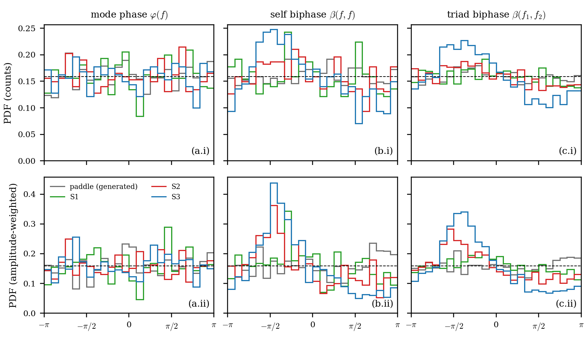
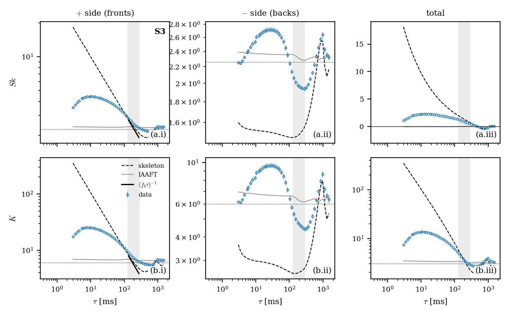
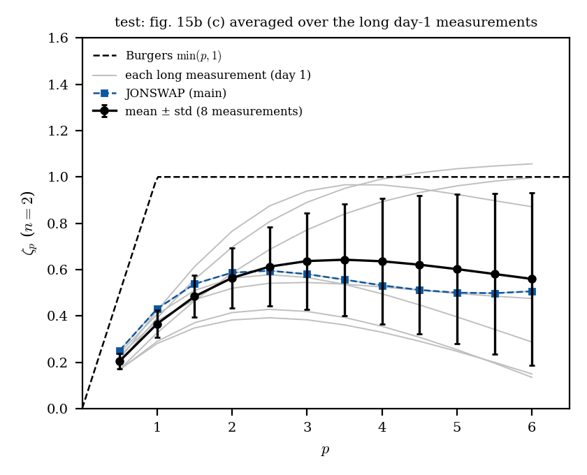
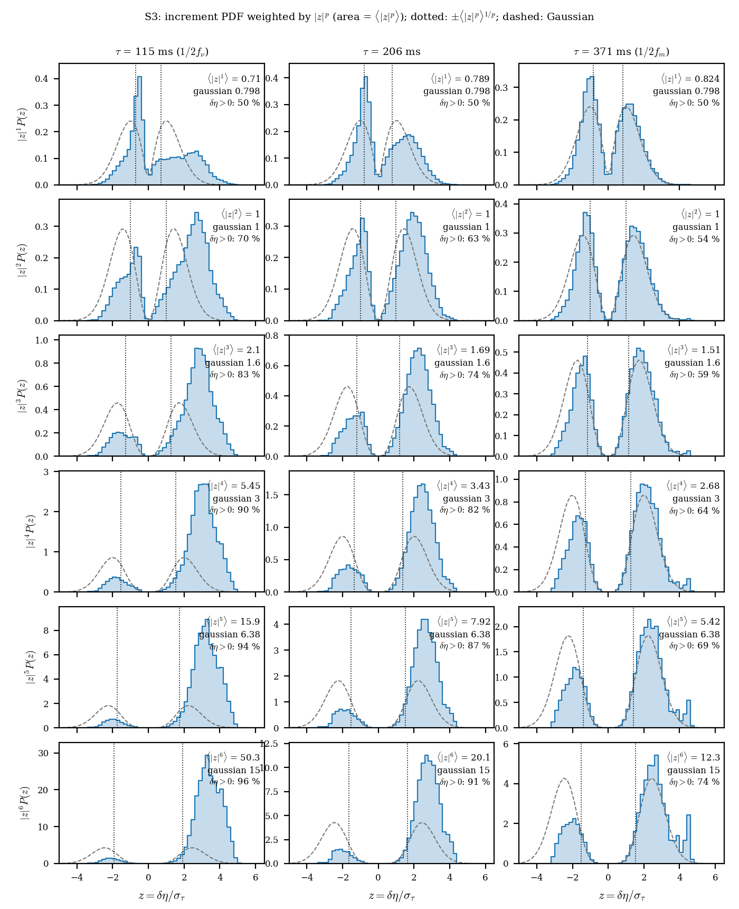
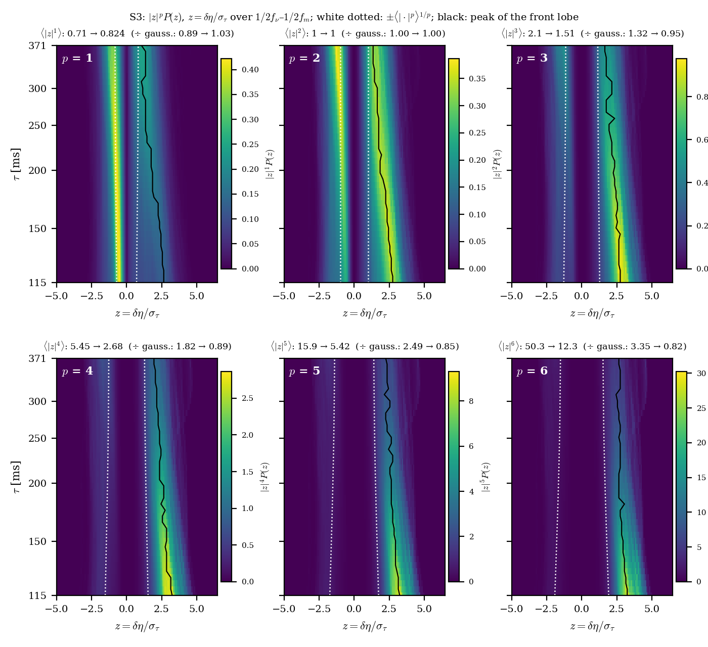
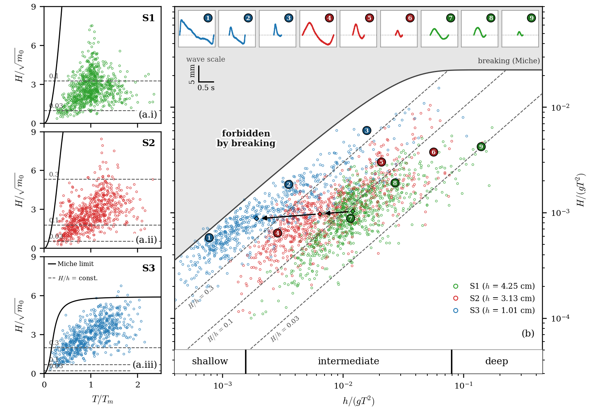
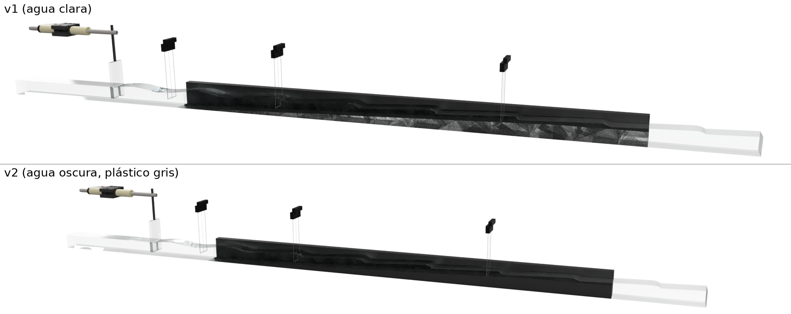
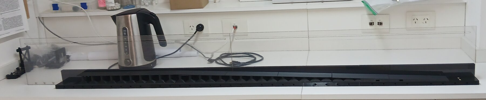

#+TITLE: Journal Week 47
#+OPTIONS: toc:2
#+BIBLIOGRAPHY: ../../../references.bib
#+CITE_EXPORT: csl chicago-author-date.csl

* Table of Contents :TOC:noexport:

* Referencias
#+PRINT_BIBLIOGRAPHY:

* 2026-11-16
** [09:10] Día 14: seguimos con las figuras del manuscrito
- =Tercera iteración/Día 14/Manuscrito/= = copia del Día 13 (sin build/); el PDF definitivo compila ahora a [[file:../../../Assets/2026/11/Day_16/manuscrito_definitivo.pdf][Day_16/manuscrito_definitivo.pdf]].
- Figs. 8+9 combinadas (propuesta, todavía fuera del PDF): se mantiene la normalización con $\sqrt{m_0}$ y el eje x de las alturas es el doble que el de las crestas (0–5,5 y 0–11), así Rayleigh se ve igual en las dos filas. Eje y hasta $3\times10^{-4}$ para que las etiquetas de panel no tapen las últimas olas. Falta el okay.

** [09:40] Fases: de lo generado (aleatorio) a las olas triangulares
- Idea del usuario (fin de semana): PDFs de las fases, para mostrar que pasan de aleatorias (lo generado) a algo no aleatorio en las olas triangulares.
- Script =Día 14/Manuscrito/Códigos/extra_fases.py= → =Figuras/extra_fases.png= (exploración, fuera del PDF). Paleta (CSV del LinMot) y S1–S3 de JONSWAP_BONNETON_395; tramos de 6,4 s con Hann y 50 % de solape, dentro de los bloques de 30 s del lock-in.
- La fase de cada modo, $\varphi(f)$, es uniforme en todas las señales: no sirve, porque el origen de tiempo de cada tramo es arbitrario. Lo que mide el acople es la bifase $\beta(f_1,f_2)=\arg[X(f_1)X(f_2)X^*(f_1+f_2)]$.
- Bifase ponderada por amplitud: la paleta es plana (fases aleatorias), S1 está cerca de 0 (tipo Stokes) y S2–S3 tienen un pico en $-\pi/2$ (diente de sierra, Elgar & Guza 1985). Bifase del biespectro: S1 −34°, S2 −81°, S3 −67° (todas las tríadas). Largo del vector medio R: paleta 0,02, S1 0,03, S2 0,06, S3 0,17 (ruido $1/\sqrt{N}\approx 0,03$).
- El usuario: queda solo en el Journal (no va al manuscrito).
#+ATTR_ORG: :width 700

** [10:05] Asimetría y curtosis con signo de los incrementos (S3, JONSWAP)
- Pedido del usuario: "calcular como hicimos S_p^± la kurtosis y skewness ±. ¿Debería ir como τ^{-1} alguna?"
- =Día 14/Momentos con signo/Códigos/momentos_signo.py= (misma serie y definiciones que el apunte del Día 12). $Sk^\pm = S_3^\pm/(S_2^\pm)^{3/2}$ y $K^\pm = S_4^\pm/(S_2^\pm)^2$, promediando sobre todas las ventanas. Comparo con el esqueleto (diente de sierra con los J y T medidos) y con IAAFT. Números en =Resultados/momentos_signo.txt=.
- Teoría: si solo las ventanas que contienen un frente dan $\delta^+$ grande (probabilidad $f_b\tau$, $\delta\approx J$), entonces $K^+ \approx \frac{\langle J^4\rangle}{\langle J^2\rangle^2}(f_b\tau)^{-1}$ y $Sk^+ \approx \frac{\langle J^3\rangle}{\langle J^2\rangle^{3/2}}(f_b\tau)^{-1/2}$. El esqueleto cumple exactamente −1 y −1/2 entre 3 y ~90 ms.
- Dato: la pendiente local más empinada de $K^+$ es −0,66 (en 118 ms) y la de $Sk^+$ es −0,32 (en 136 ms). Nunca llega a −1: por debajo de ~10 ms el frente tiene ancho finito y $K^+$ se aplana, y arriba de ~300 ms vuelve al valor gaussiano. El nivel sí sale sin parámetros libres: en $1/2f_\nu$, $K^+$ medido 9,4 contra 8,3 predicho y $Sk^+$ 2,88 contra 2,79. IAAFT da pendiente ≈ 0.
- El usuario: queda solo en el Journal (no va al manuscrito).
- Lado −: tiene un máximo en 20–40 ms ($K^-$ ≈ 9,6, por encima del gaussiano 6), que el esqueleto no tiene. Candidato: la caída rápida después de la punta solitaria (a confirmar).
#+ATTR_ORG: :width 700

** [11:00] Mini presentación para la reunión de grupo
- 5 min, 6 diapositivas, Beamer: montaje, rotura ola por ola (Fig. 6), espectro contra GLOBEX y $f_\nu(h)$, intermitencia (Fig. 15), estado del manuscrito.
- Carpeta nueva para las reuniones (pedido del usuario): =~/Documentos/Reuniones de Labo/= (al lado de =Presentaciones/=), una subcarpeta autocontenida por reunión con copias de las figuras, más =Plantilla/= (estilo =labo.sty=) y README.
- Hoy: =Reuniones de Labo/2026-11-17/labo_2026-11-17.pdf= (la reunión es el 17/11).
- [09:35] Título: "Rompimiento de olas en una playa a escala de laboratorio". Diapo 2 = GIF del video del Día 1 (13/10) + Fig. 1b + Fig. 3; diapo 3 = GIF del video de prueba del 24/08 (el de la Fig. 2) + Fig. 2b. Applet para elegir segmento y ROI y exportar GIF: =Reuniones de Labo/Herramientas/elegir_gif.py=. La carpeta se llama "Reuniones de Labo" (las reuniones de grupo más grandes irían aparte).
- [10:00] Videos que se reproducen solos en la diapositiva: =animate= no anduvo en xreader; se instaló pdfpc y los GIFs pasaron a clips webm (=\clip= con pdfpc-movie). Diapo del montaje: video + esquema a la izquierda; forzado JONSWAP (serie y espectro, eje a la izquierda) a la derecha.
- [10:30] Diapositivas nuevas: "La evolución de la ola" (video de la prueba → Fig. 2b + Fig. 4 apaisada con los recuadros), "Ola por ola" (Figs. 5 y 6) y "El tipo de rompimiento" (Fig. 7 + anatomía nueva).
- Anatomía nueva para el manuscrito: =Día 14/Manuscrito/Códigos/fig_anatomia_top10.py= → =AN_top10.pdf=. S3, 10 % de olas con mayor salto J (69 olas, J ≥ 5,9 mm), alineadas en el frente: promedio ± std y zonas valle / frente (≈ 80 ms) / punta (≈ 80 ms) / espalda (≈ 740 ms). J medio = 0,59 h.
- [11:00] Presentación completa (pedido del usuario): espectro (barrido con solo f_ν libre + ecuación de Bonneton; clic: colapso, clic: GLOBEX), saturación y análisis dimensional (Fig. 11 b–c con ecuaciones), incrementos (Fig. 15, fila de arriba), S_p con n = 2, separación de escalas (Fig. 18 + R_B, t_ν, T_m/t_ν) y S_p^± + IAAFT (nueva: serie, espectro, PDF y ζ_p dato contra IAAFT). Las diapositivas del primer borrador quedaron en =descartadas_2026-11-16.tex=. Falta reordenar con el usuario.
- [11:50] Anatomía de la ola (para la reunión y el manuscrito): promedio ± std del 10 % de olas más grandes (S3, 69 olas), zonas valle/frente/punta/espalda, frente tanh con t* = 22,8 ms (subida 10–90 % ≈ 50 ms, igual al t_ν = 51 ms del espectro) y rectas en el valle y la espalda que muestran la concavidad. Reemplaza la sección de anatomía del manuscrito definitivo (Day_16); la vieja quedó guardada.
- [12:40] Manuscrito definitivo podado a las figuras de la presentación (Day_16/manuscrito_definitivo.pdf); la versión completa quedó en Day_16/manuscrito_completo_16-11.pdf. Figuras nuevas: S_p de dos puntos y ESS, S_p± con ζ⁺/ζ⁻/total, IAAFT (series, espectro, PDF y exponentes). Sin la recta monofractal p/2 (un gaussiano da p ζ₂/2).
- [13:30] Cierre del día: (1) todo el análisis pasó a "solo f_ν libre" (amplitud fijada por Ẽ): f_ν = 4,35 Hz, R_B = 127, 1/2f_ν = 115 ms; barrido f_ν ∝ h^−0,47±0,04, κ = 0,58 ± 0,09; intermitencia y GLOBEX recalculados (T_m/t_ν: cuba 14, GLOBEX 13). (2) Presentaciones de la reunión del 17/11 (larga, corta y una copia con todas las animaciones) en =~/Documentos/Reuniones de Labo/2026-11-17/=. (3) Manuscrito definitivo podado + copia del estado (Day_16/manuscrito_definitivo_estado_16-11.pdf) + versión final limpia (Day_16/manuscrito_final.pdf, 35 p.: solo figuras, resultados, procedimiento y notas para el texto). (4) Directorio autocontenido =Día 14/Figuras del manuscrito/= con un script por figura (=Por figura/=) y el texto final.

** [15:00] Prueba: ζ_p de dos puntos promediado sobre las mediciones largas del Día 1 (solo Journal)
- Panel (c) de la Fig. 15b con las 8 mediciones largas del Día 1 (S3, ~510 s), cada una con su f_m, su f_ν (solo f_ν libre) y su rango 1/2f_ν–1/2f_m. Script =Día 14/Manuscrito/Códigos/extra_zeta_largas.py=.
- Promedio ± desvío entre mediciones: ζ_1 0,37 ± 0,06; ζ_2 0,56 ± 0,13; ζ_3 0,64 ± 0,21; ζ_4 0,64 ± 0,27; ζ_5 0,60 ± 0,32; ζ_6 0,56 ± 0,37. Satura en ~0,6 (la principal, en ~0,5).
- Dos grupos: "muchos forzados" con ζ_6 ≈ 0,9–1,1 (cerca de Burgers) y Bonneton custom/h3_5 con ζ_6 ≈ 0,13–0,15 (f_m ≈ 2,3 Hz, rango corto 133–219 ms, poco confiable). Promediar mezcla forzados y separaciones de escala distintos: mejor separar por familia o contra T_m/t_ν. Queda fuera del manuscrito por ahora.
#+ATTR_ORG: :width 600

* 2026-11-17
** [17:50] PDF de los incrementos pesadas por |δη|^p: ¿está bien determinado S_p?
- Apunte: [[file:../../../Assets/2026/11/Day_17/pdf_pesadas.pdf][Day_17/pdf_pesadas.pdf]] (fuente en =Tercera iteración/Día 15/PDF pesadas/=; scripts =Día 14/Figuras del manuscrito/Códigos/extra_pdf_pesadas.py= y =extra_pdf_pesadas_error.py=).
- S3, filas p = 1–6, columnas τ = 115 / 206 / 371 ms (1/2f_ν, centro, 1/2f_m). El integrando |z|^p P(z) tiene área ⟨|z|^p⟩ y muestra qué incrementos ponen cada momento; versión en mm (área = S_p).
- En 115 ms los momentos altos son los frentes: ⟨|z|^6⟩ = 50 ± 5 contra 15 gaussiano, 96 % desde δη > 0. En 371 ms, bimodal y casi gaussiano (12,3 ± 1,6 contra 15, marginal).
- Determinación: hasta p = 4 error ≲ 7 % y cola no medida < 2 %; p = 5–6 al ±10–15 % (el 1 % de las ventanas pone la mitad del momento; cola no medida hasta 6 % hacia abajo). δζ_6 ≈ 0,09: no se distingue "satura" de "decrece" para p ≥ 4 sin un registro ~4 veces más largo.
#+ATTR_ORG: :width 600

- [18:10] Mapas por p de |z|^p P(z) en todo el rango 115–371 ms (sección nueva del apunte): el lóbulo de los frentes se corre al centro de forma continua (p = 6: z ≈ 3,3 → 2,7) y en mm queda en δη ≈ 3,6–6 mm (el salto del frente, no depende de τ); el cociente con la gaussiana cruza 1 en τ ≈ 250–265 ms (cerca de 1/f_ν = 230 ms). Sin rango de forma invariante. Script =extra_pdf_pesadas_mapa.py=.
#+ATTR_ORG: :width 600

** [19:30] Apéndice del manuscrito: respuesta y ruido del sensor (Parte V de manuscrito_final.pdf, Día 14/Figuras del manuscrito)
- Fig. 20 (calibración del Día 1 + PDF del nivel instantáneo): recta con residuo 0,11–0,13 mm; el 11–18 % de las muestras (los valles) queda debajo del rango calibrado (37,9–44,1 mm); en todo el rango medido la fase cambia ≤ 40 mrad (S1) y 19 mrad (S2, S3), lejos de 0,1 rad (ángulos pequeños). Cuadro 3 (en inglés) con las fracciones.
- La curvatura de S1 (+1,5e-4 rad/mm² el Día 1) tiene signo opuesto el Día 2: deriva durante el vaciado, no no linealidad. Cota pesimista: S_k de S1 0,18 → 0,45 si fuera real; S3 robusto.
- Fig. 21: el espectro de la Fig. 10 (S3) con el ruido medido con agua quieta (plateaus de la calibración): 3,3 décadas sobre el ruido en f_m, 3,8 en f_ν, 2,4 en 11 Hz; lo cruza en 40 Hz.
- PENDIENTE: calibración nueva con escalones en todo 33,4–48,6 mm o más (rango amarillo), bajando y subiendo, escalones cortos, incerteza horizontal bien estimada.
- [20:30] Apéndice cerrado por ahora (aprobado): Fig. 20 con PDF > 1e-4 y banda amarilla ±4,5 mm (|Δφ| < 40/19/19 mrad), Fig. 21 con panel señal/ruido (10³–10⁴ entre f_m y f_ν, 10 en ~20 Hz, 1 en 40 Hz).
** [20:45] Prueba (tiempo libre, NO va al manuscrito): Fig. 6 con H/h constante en lugar de la asimetría de 2.º orden = 10 %
- Rectas H/h = 0,1, 0,3 y 0,78 (McCowan) en el plano de Le Méhauté (pendiente 1) y mediana de cada sensor con flechas S1 → S2 → S3. Script =Día 14/Figuras del manuscrito/Códigos/extra_f6_HsobreH.py= (importa el script único de la Fig. 6).
- H/h mediana [p25, p75]: S1 0,078 [0,057, 0,102]; S2 0,144 [0,100, 0,196]; S3 0,44 [0,31, 0,56] (máx 1,02; 77 % de las olas con H/h > 0,3). La no linealidad crece ×2 de S1 a S2 y ×3 de S2 a S3, sin umbral elegido; S3 queda entre 0,3 y McCowan.
- Detalles a pulir si se adopta: en (a) las rectas horizontales necesitan rótulo propio (0,1 vs 0,3), y el rótulo de H/h = 0,1 choca con "breaking (Miche)".
#+ATTR_ORG: :width 600

- [21:15] Versión 2 (le gusta al usuario; candidata a Fig. 6 definitiva con retoques): rectas H/h = 0,03, 0,1 y 0,3 (sin McCowan; 0,03 encierra la nube de S1 por abajo: 4 % de S1 debajo) y la saturación espectral H_c = 0,49 h (violeta; κ del ajuste con solo f_ν libre en S3). En (a) la saturación cae dentro del eje en S2 (8,7 √m0, justo en el techo de la nube) y en S3 (3,3 √m0, cerca de la mediana: H_c es una altura típica de frente, no la de las olas más grandes). Rombos = medianas por sensor. Recuadros desde Resultados/insets_seleccion.json (applet elegir_insets.py; respaldo de la selección anterior en insets_seleccion_respaldo_17-11.json); falta elegir un 7 que no choque con el rombo de S1.
- [21:15] GitHub Pages "no carga": no es un commit (todos los builds OK). Uno de los cuatro servidores de Pages, 185.199.110.153, no responde desde la red de la casa (timeouts de 30–137 s cuando el DNS cae en él); los otros tres responden en < 0,1 s.
#+ATTR_ORG: :width 600

- [21:45] *Fig. 6 nueva en el manuscrito* (aprobada por el usuario): rectas H/h = 0,03 / 0,1 / 0,3 y medianas por sensor (rombos chicos, flechas S1 → S2 → S3) en lugar de la asimetría de 2.º orden del 10 %; recuadros originales. Script: =Por figura/F06_altura_periodo.py= (=Códigos/extra_f6_HsobreH.py=). Texto de la sección actualizado (versión anterior en =Texto/sec_f04_10_con_asimetria_17-11.tex.bak=). Applet nuevo para elegir recuadros: =Códigos/elegir_insets_v2.py= (diagrama actualizado, alternativas y cualquier punto). Manuscrito de hoy: [[file:../../../Assets/2026/11/Day_17/manuscrito_final.pdf][Day_17/manuscrito_final.pdf]] (36 p., con la Parte V del sensor).
* 2026-11-19
** [09:30] Render nuevo de Fusion para la Fig. 1a (Día 16)
- Dos renders de la cuba en Fusion (Wine; guarda en =drive_c/users/ignacio/Documents/<uuid>.PNG=, fondo transparente). v1 (agua clara): la zona de la rampa sale ruidosa (reflejos/refracción del agua sin converger). v2 (agua oscura, plástico gris): sin ruido, pero rampa y agua se funden en un bloque negro.
- Elegida la v2: fondo blanco, recortada arriba y abajo (1919 × 328 px) → =Día 14/Figuras del manuscrito/Figuras/F1a_render.png= (el del póster queda como =F1a_render_poster.pdf=). Manuscrito recompilado. Re-renderizar desde el modelo 3D es fácil si hace falta.
#+ATTR_ORG: :width 700

- PENDIENTE (semana del 23/11): volver a filmar la ola rompiendo → rehacer Fig. 2a (collage sin fondo) y 2b (perfiles). Filmar también agua quieta, cámara en la misma posición.
** [10:00] Papers: =~/Documentos/Papers/Olas rompientes en escala de laboratorio/=
- Carpeta nueva para el paper, al nivel de Presentaciones; se comparte en el Nextcloud del DF solo esa carpeta (no Papers completa). =CLAUDE.md= con el traspaso para la sesión nueva que se abre desde ahí.
** [12:30] Paper: Nube del DF, carpeta reorganizada y esqueleto para PRF
- *Nube del DF* (=nube.df.uba.ar=, Nextcloud 15; acceso habilitado por compu@df). Sincronización con =nextcloudcmd= solo mientras hay una sesión de Claude Code abierta en la carpeta del paper (hooks de inicio y fin de sesión, cada 5 min); =CLAUDE.md= y =.claude/= no se suben. Compartida con Pablo Cobelli (edición).
- *Carpeta reorganizada* (=~/Documentos/Papers/Olas rompientes en escala de laboratorio/=): =main.tex= + =Secciones/= (REVTeX 4.2, =prfluids=; esqueleto, texto por escribir), =Figuras/= (solo las 24 del PDF de preparación), =Códigos/= (un script por figura con el mismo nombre, estilo común en =comun/estilo.py=, =generar_todas.py=; el PDF de preparación, ex =manuscrito_final=, en =Códigos/Preparación_de_Figuras/=) y =Datos/= (JONSWAP + preprocesados chicos: PSD del barrido del Día 2 y del colapso, espectros de GLOBEX, calibración del Día 1, ζ_p).
- Autocontenida: un clon sin acceso al proyecto de origen regenera las 24 figuras (2,5 min) idénticas píxel a píxel a las del Día 14, y compilan los dos PDF. 442 archivos obsoletos fuera de la copia; el Día 14 queda como estaba.
- Formato: PRF no exige dos columnas para enviar; en =reprint= las figuras anchas van en =figure*= (APS: 8,6 cm una columna, 17,2 cm dos). PENDIENTE: reorganizar paneles de las figuras alargadas y bajar el ancho de 17,8 a 17,2 cm; bibliografía como colección de Zotero exportada con Better BibTeX.
** [12:35] Montaje: rampa nueva en el setup nuevo
- Ya está montada la rampa nueva en el setup nuevo, para filmar videos más lindos de la ola rompiendo (rehacer Figs. 2a y 2b). Filmar también el agua quieta (fondo) con la cámara en la misma posición.

#+ATTR_ORG: :width 700

