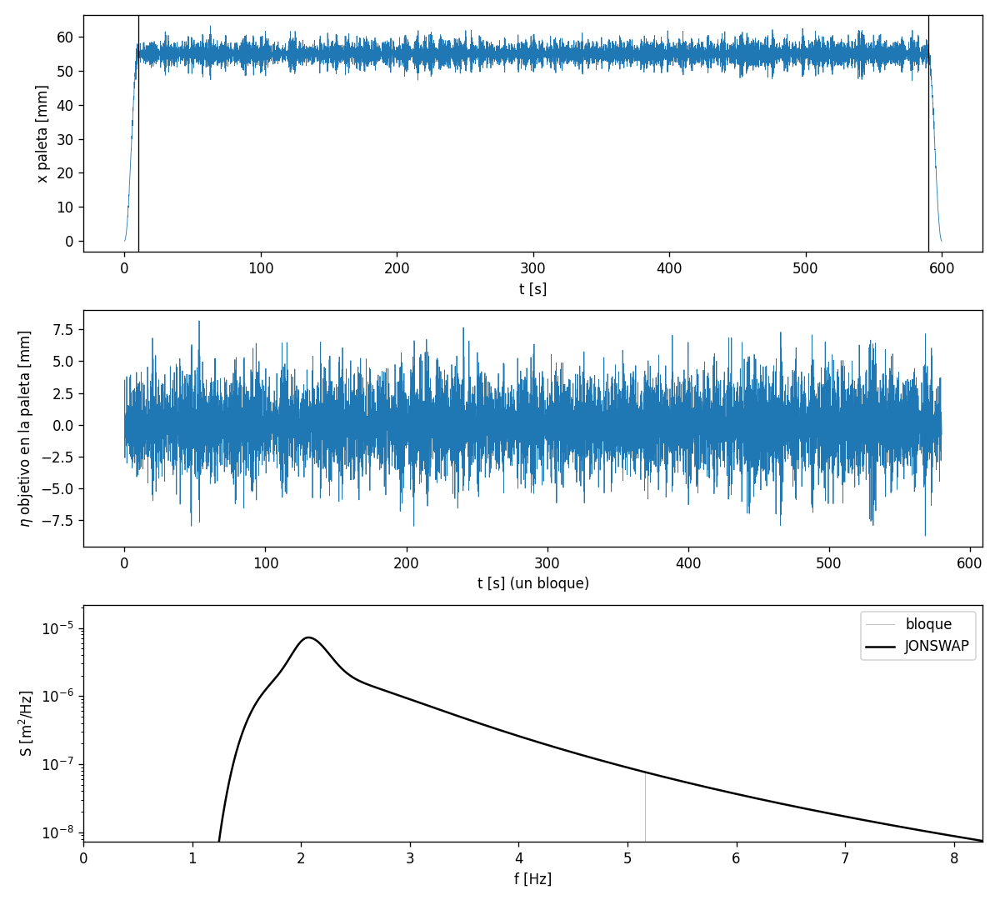
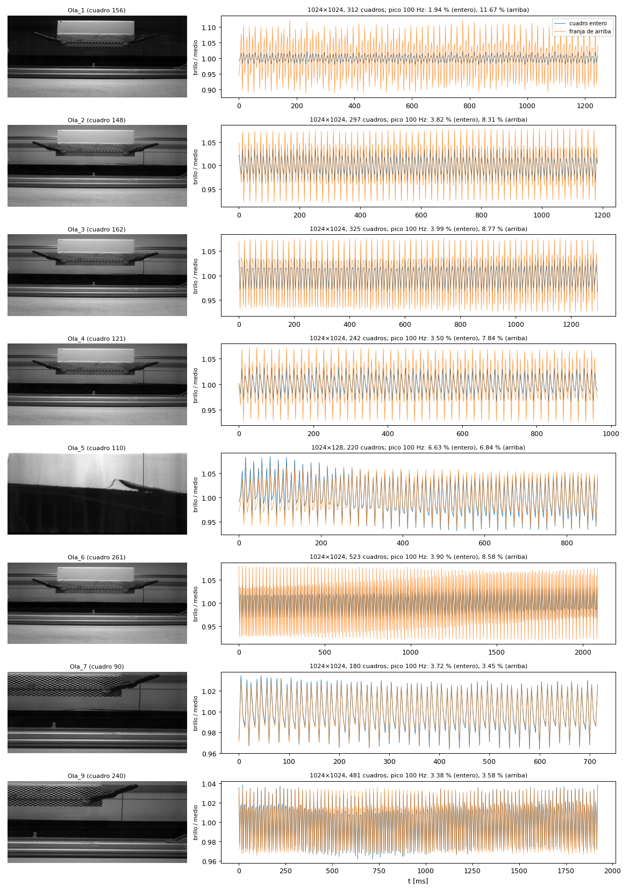
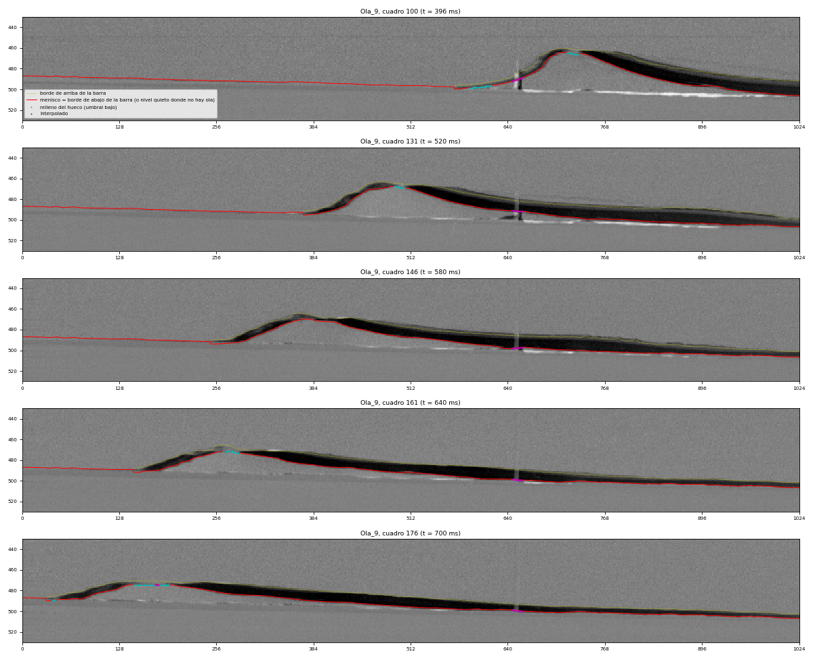

#+TITLE: Journal Week 48
#+OPTIONS: toc:2
#+BIBLIOGRAPHY: ../../../references.bib
#+CITE_EXPORT: csl chicago-author-date.csl

* Table of Contents :TOC:noexport:

* Referencias
#+PRINT_BIBLIOGRAPHY:

* 2026-11-24
** [09:45] Reunión de Labo de hoy: PDF de los incrementos y cumulantes
- Pedido del usuario: solo los gráficos de las PDF, prolijos, y lo de los cumulantes. Presentación en =~/Documentos/Reuniones de Labo/2026-11-24/labo_2026-11-24.pdf= (6 diapositivas).
- Paneles nuevos, hechos a la medida de la diapositiva, en =Códigos/= (=pdfs_panel.py=, =cumulantes_panel.py=). Son versiones limpias de las figuras del 17/11 (Día 15, PDF pesadas) y del 20/11 (Día 17), con los mismos datos (S3, JONSWAP principal) y los mismos números.
- Diapositivas: (1) P(z) en log en 1/2f_ν, centro y 1/2f_m, dato contra IAAFT y gaussiana; (2) |z|^p P(z) para p = 2, 4, 6, con la fracción que ponen los frentes; (3) convergencia: integrandos normalizados, |z| máximo y eventos con |z| > 4,5 (9 / 0 / 1); (4) κ3–κ6 contra τ y tabla en los tres τ; (5) log-cumulantes C2, C3 y ζ_p (c2 = −0,23 ± 0,02 en el dato contra 0,00 ± 0,02 en el IAAFT).
** [11:25] Integral parcial de la PDF pesada, sin normalizar
- Pedido del usuario, sobre la integral acumulada del 20/11 (=Tercera iteración/Día 17/Figuras/integral_acumulada.pdf=): la misma integral, pero sin dividir por ⟨|z|^p⟩. Script =~/Documentos/Reuniones de Labo/2026-11-24/Códigos/integral_panel.py= → =Figuras/P_integral_sin_normalizar.pdf= (todavía no está en la presentación).
- Arriba M_p(Z) = ∫_{|z|<Z} |z|^p P(z) dz, que llega a la meseta ⟨|z|^p⟩ = S_p/σ_τ^p; abajo lo que falta, ⟨|z|^p⟩ − M_p(Z). Gris: la gaussiana exacta, ⟨|z|^p⟩_G · P((p+1)/2, Z²/2). Punteada: |z| máximo medido. S3, JONSWAP principal; τ = 115 / 206 / 371 ms.
- Así se ven directamente las mesetas contra la gaussiana. En 1/2f_ν: p = 6 llega a 50 (gaussiana 15) y p = 4 a 5,5 (gaussiana 3). En 206 ms: 20 y 3,4. En 1/2f_m quedan por debajo de la gaussiana (12 contra 15; 2,7 contra 3), con el escalón del evento único en |z| ≈ 4,5.
#+ATTR_ORG: :width 700
[[file:../../../Assets/2026/11/Day_24/integral_sin_normalizar.png]]
** [11:27] Cuarta iteración, Día 2: llenado de la cuba para los videos
- Se está llenando la cuba con *agua destilada* (el plan del Día 1 decía agua de la canilla). Arrancamos temprano; el llenado tarda aproximadamente una hora más (lista hacia las 12:30).
- Hoy se filma la ola rompiendo con la rampa nueva (plan en =Cuarta iteración/Día 1/README.md=). Todo lo de hoy va en =Cuarta iteración/Día 2/= (=Videos/=, =Códigos/=, =Figuras/=; registro en el README).
** [11:35] Curvas de forzado para los videos, en el pendrive
- En =KINGSTON/Posgrado/Pruebas rampa impresa 3D cuba grande/Cuarta iteración/Día 2 (24-11) Videos/= (verificadas byte a byte; una columna en mm, sin encabezado):
  1. =639960ms_bonneton_C3_h_20cm_Tp_1.07_Hm0_42.9mm_seed_1_una_curva.csv=: JONSWAP principal ("h20"), el mismo del 20/11.
  2. =599962ms_bonneton_C3_h_3.5cm_Tp_0.45_Hm0_7.5mm_seed_1_fhi_2.5fp_una_curva.csv=: JONSWAP con la profundidad real (el de =Bonneton_bien_profundidad_360=, 13/10). Se escaló para h = 3,5 cm en la paleta, que era el nivel 3,60 cm en el punto de referencia de ese montaje. *A confirmar* con el nivel de hoy.
  3. =14940ms_un_salto_random_3_curva_04.csv=: *un solo salto* de los muchos forzados (curva 04 de Curvas_random_3: A = 96,6 mm, subida en ~0,7 s, vuelta lineal). Empieza y termina en x = 0, así que se puede repetir en loop (período 14,94 s). =119520ms_…_x8.csv= es el mismo ciclo 8 veces (≈ 2 min). Generador: =Cuarta iteración/Día 2/Curvas forzado/generador_un_salto.py=.
  4. =267740ms_quieto_90s_triangulares_random_3_177s.csv=: 90 s quieto (sirve de fondo para el video) + 177 s de muchos forzados (12 triangulares), la curva corta del 14/10.
- Plan de tomas: un video por cada JONSWAP, uno de muchos forzados y después varios solo del rompimiento del salto único, a más resolución, para ahorrar espacio y tiempo.
#+ATTR_ORG: :width 600
[[file:../../../Assets/2026/11/Day_24/un_salto_control.png]]
** [11:50] Disco externo para los videos: DEX5
- Se probaron los discos externos del Labo (catálogo DEX). Espacio libre y escritura secuencial medida con 1 GB (=dd= con =conv=fdatasync=, archivo temporal borrado):
  | Disco | Modelo                         | Libre   | Escritura [MB/s] |
  |-------+--------------------------------+---------+------------------|
  | DEX1  | Seagate Expansion 1 TB         | 170 GB  |             37,6 |
  | DEX2  | Seagate Backup+ SL 1 TB        | 40 GB   |  no confiable    |
  | DEX3  | Seagate Backup Plus Slim 2 TB  | 405 GB  |             46,6 |
  | DEX5  | WD Elements 2 TB               | 1,3 TB  |             43,4 |
- Los cuatro son HDD con NTFS y USB 3.0; ninguno informa la velocidad por sí mismo. DEX4 estaba en uso.
- DEX2 se desconectó del USB durante la prueba (errores de escritura y reset). Se desmontó, se volvió a montar (limpio) y se borró el archivo de prueba; sin errores nuevos.
- *Elegido: DEX5* (el que tiene más espacio; la velocidad es parecida a la de DEX3).
** [11:58] Salto único con meseta y bajada lineal
- Pedido del usuario: el frente tal cual, pero que una vez arriba la paleta quede quieta un rato y después baje linealmente, sin el ruido sumado. La interfaz periodiza sola, así que alcanza con un ciclo.
- =17920ms_un_salto_random_3_curva_04_meseta_3s_bajada_lineal.csv=: frente de la curva 04 original (con su ruido) hasta su máximo (96,4 mm a los 0,68 s, donde la velocidad pasa por cero), *3 s quieta* y bajada lineal sin ruido hasta 0 en 13,92 s (6,9 mm/s, la misma pendiente que la original). Período 17,92 s; |v| ≤ 525 mm/s.
- En el pendrive (=Cuarta iteración/Día 2 (24-11) Videos/=) reemplaza a la versión anterior. Generador: =generador_un_salto.py --meseta 3=.
#+ATTR_ORG: :width 600
[[file:../../../Assets/2026/11/Day_24/un_salto_meseta_control.png]]
** [12:10] Montaje de la Cuarta iteración (lo que contó el usuario)
- *Nivel:* faltaba llenar ~1 cm (iba en ~4,8–4,9 cm). El setup tiene una base de *1,5 cm* y encima la rampa con *2 mm* de piso, así que el nivel equivalente a 3,95 cm es *3,95 + 1,7 = 5,65 cm* desde el piso original. Lista en media hora a una hora.
- *Paleta:* la del motor nuevo, de *4,5 cm de ancho*, entra adentro del canal (antes era la paleta grande). El canal ocupa casi todo el ancho de la cuba. Con la paleta lo más estirada posible queda al borde de la rampa. Queda a ~1 cm del piso nuevo, o sea a *2,5 cm del piso original*.
- *Canal y playas:* hay una playa extra de *20 cm* y el canal llega hasta el otro extremo de la cuba (antes quedaba abierto). El final de la segunda playa queda a *~29,2–30 cm* de la pared opuesta.
- *Cámara:* cuando se sepa dónde rompen las olas, el usuario pasa qué sección filma y la calibración: foto de un patrón de cuadrados blancos y negros de *4 mm*, pegado a la cara interna de la pared de acrílico más cercana a la cámara.
** [12:20] JONSWAP con la profundidad correcta para este montaje
- Con el piso nuevo a 1,7 cm y nivel 5,65 cm, la profundidad en la paleta es *3,95 cm* (a confirmar: si debajo de la paleta el piso está a 1,5 cm, serían 4,15 cm). La curva de 3,5 cm que estaba en el pendrive era la del montaje de octubre.
- Nueva: =Cuarta iteración/Día 2/Curvas forzado/Curvas_jonswap/bonneton_C3_h_3.95cm_Tp_0.48_Hm0_8.5mm_seed_1_fhi_2.5fp_una_curva/599962ms_…csv= (escalada de vN03-C3: *T_p = 0,475 s, H_m0 = 8,5 mm*, k_p h = 0,951, ξ0 = 0,226; 600 s; x de 0 a 63 mm, |v| ≤ 109 mm/s). Generador copiado del Día 1 de la Tercera iteración, sin cambios.
- *Falta copiarla al pendrive* (estaba desconectado); va en lugar de la de 3,5 cm.
#+ATTR_ORG: :width 600
[[file:../../../Assets/2026/11/Day_24/jonswap_h3.95_control.png]]
** [12:24] Corrección: la paleta se mueve sobre la base de 1,5 cm → JONSWAP de 4,15 cm
- El usuario da las alturas desde el piso original, por consistencia, pero la paleta, adentro del canal, se mueve sobre la base de *1,5 cm* (no sobre el piso de 2 mm de la rampa). Con nivel 5,65 cm, la profundidad en la paleta es *4,15 cm*, no 3,95 (la entrada de las 12:20 queda corregida; esa curva se borró).
- Curva: =bonneton_C3_h_4.15cm_Tp_0.49_Hm0_8.9mm_seed_1_fhi_2.5fp_una_curva= (*T_p = 0,487 s, H_m0 = 8,9 mm*, k_p h = 0,951, ξ0 = 0,226). Regenerada hoy en =Cuarta iteración/Día 2/Curvas forzado/=: es idéntica byte a byte a la de 4,15 cm del 13/10, que ya está en el pendrive en =Tercera iteración/Curvas forzado/Curvas_jonswap/= (la que en octubre quedó como "obsoleta" porque el punto de referencia estaba del otro lado).
- Falta pasarla a =Cuarta iteración/Día 2 (24-11) Videos/= del pendrive, en lugar de la de 3,5 cm. Si el nivel final no es 5,65 cm, la profundidad en la paleta es nivel − 1,5 cm y hay que regenerarla.
** [12:32] Esquema del montaje nuevo y por qué el JONSWAP de 4,15 cm
- Esquema (=Cuarta iteración/Día 2/Códigos/esquema_montaje.py=): vista lateral (escala vertical ×9, alturas desde el piso original) y planta (ancho ×3). En negro, lo que contó el usuario; en *naranja, lo supuesto o deducido, a confirmar*: cuba de 198 cm y 5 cm de ancho, rampa de 99 cm con tan β = 0,035 y primera playa plana de 18 cm (como en octubre), segunda playa plana. Con eso, el pie de la rampa (= paleta estirada al máximo) queda a ~31 cm de la pared del lado de la paleta.
- Profundidades con nivel 5,65 cm: *4,15 cm en la paleta* (sumergida 3,15 cm, 1 cm libre abajo), 3,95 cm sobre el piso de la rampa (= el 3,95 de la Tercera iteración), ~0,5 cm sobre la playa, 4,15 cm entre el fin de la segunda playa y la pared.
#+ATTR_ORG: :width 800
[[file:../../../Assets/2026/11/Day_24/esquema_montaje.png]]
- *Por qué el JONSWAP "con h correcta" es el de 4,15 cm:* el generador escala vN03-C3 (h = 0,70 m en la paleta, T_p = 2 s) por Froude con la profundidad *en la paleta*: conserva k_p h = 0,951 (cuán somera es la ola donde se genera) y ξ0 = 0,226 (Iribarren con la pendiente). De ahí T_p = 2 s·√(h/0,70 m) y H_m0 sale de ξ0. Además, la carrera de la paleta se calcula con la transferencia de Biésel (pistón), que depende de k h en la paleta. La paleta se mueve sobre la base de 1,5 cm, así que h = 5,65 − 1,5 = 4,15 cm.
  | Curva     | T_p [s] | H_m0 [mm] | k_p h con h = 4,15 cm | H_m0/h |
  |-----------+---------+-----------+-----------------------+--------|
  | h 3,5 cm  |   0,447 |       7,5 |                  1,06 |   0,18 |
  | h 3,95 cm |   0,475 |       8,5 |                  0,98 |   0,21 |
  | h 4,15 cm |   0,487 |       8,9 |              *0,951* |   0,21 |
  | h 20 cm   |   1,069 |      42,9 |                  0,39 |   1,03 |
  - La de 3,5 cm era la del montaje de octubre con nivel 3,60 (=Bonneton_bien_profundidad_360=). La de 3,95 cm suponía el piso de 2 mm de la rampa también debajo de la paleta (equivocado). ξ0 da 0,226 en todas porque H_m0 se elige para conservarlo; lo que cambia es k_p h.
  - La "h 20 cm" (la principal del manuscrito) es otro diseño: escalada como si la paleta estuviera en 20 cm de agua.
  - Salvedad: Biésel supone un pistón que llega al fondo. Acá la paleta deja 1 cm libre abajo, así que las olas salen algo más chicas que lo nominal (igual que en octubre).
** [13:34] Llenado: faltan 0,25 cm
- Nivel ≈ *5,40 cm* desde el piso original (4,0 cm en la paleta); el objetivo es 5,65 cm. A las 12:10 faltaba ~1 cm, así que sube ≈ 0,5 cm/h: llega hacia las *~14:05*.
** [13:46] Cuba llena: nivel 5,70 cm → JONSWAP de 4,20 cm
- Nivel final *5,70 cm* desde el piso original (el objetivo era 5,65). Profundidades: *4,20 cm en la paleta* (sumergida 3,20 cm), 4,00 cm sobre el piso de la rampa (en la Tercera iteración, 3,95 cm), ~0,54 cm sobre la playa.
- JONSWAP regenerado con h = nivel − 1,5 = 4,20 cm: =Cuarta iteración/Día 2/Curvas forzado/Curvas_jonswap/bonneton_C3_h_4.2cm_Tp_0.49_Hm0_9.0mm_seed_1_fhi_2.5fp_una_curva/599962ms_…csv= (*T_p = 0,490 s, H_m0 = 9,0 mm*, k_p h = 0,951, ξ0 = 0,226; x de 0 a 63,4 mm). Frente a la de 4,15 cm cambia ~1 % (T_p 0,487 → 0,490 s, H_m0 8,9 → 9,0 mm), del orden de la precisión con que se lee el nivel.
- Falta copiarla al pendrive (desconectado), en =Cuarta iteración/Día 2 (24-11) Videos/= en lugar de la de 3,5 cm.
#+ATTR_ORG: :width 600
[[file:../../../Assets/2026/11/Day_24/jonswap_h4.20_control.png]]
- Esquema del montaje (entrada de las 12:32) actualizado con el nivel 5,70 cm.
** [13:58] Nivel bajado 1 mm: 5,60 cm → JONSWAP de 4,10 cm
- El usuario bajó el nivel 1 mm: *5,60 cm* desde el piso original. Profundidades: *4,10 cm en la paleta* (sumergida 3,10 cm), 3,90 cm sobre el piso de la rampa, ~0,43 cm sobre la playa.
- JONSWAP para h = 4,10 cm: =Cuarta iteración/Día 2/Curvas forzado/Curvas_jonswap/bonneton_C3_h_4.1cm_Tp_0.48_Hm0_8.8mm_seed_1_fhi_2.5fp_una_curva/599962ms_…csv= (*T_p = 0,484 s, H_m0 = 8,8 mm*, k_p h = 0,951, ξ0 = 0,226; x de 0 a 63,2 mm). La de 4,20 cm (13:46) queda sin usar. Entre 4,10, 4,15 y 4,20 cm la diferencia es ≤ 1 %.
- Falta copiarla al pendrive (desconectado). Esquema del montaje (entrada de las 12:32) actualizado con el nivel 5,60 cm.
#+ATTR_ORG: :width 600

** [14:04] Configuración del motor
- Posición del homing: *−25 mm*. Distancias A/B del wizard: *20 / 168 mm*. Con el motor y la paleta anteriores el homing estaba en 130–140 mm (mayo y junio).
- Recorrido de las curvas del pendrive, todas desde x = 0: muchos forzados 0–111 mm, salto único 0–96 mm, JONSWAP h20 0–96 mm, JONSWAP de 4,10 cm 0–63 mm.
** [14:10] Cámara conectada
- Cámara Photron por Ethernet, con IP fija en la compu de Windows. El LED *IF LINK/TRANS* está en rojo, pero *PFV4 la abrió e hizo el shading* (referencia de negro).
- A chequear: velocidad del enlace (1 Gbps o 100 Mbps), que define cuánto tarda en bajar cada video al disco (DEX5).
** [14:58] CAMBIO DE PROFUNDIDAD DE LA PALETA (~2 mm más sumergida); el JONSWAP h20 da poca amplitud
- El usuario sumergió la paleta *~2 mm más*: borde inferior a ~2,3 cm del piso original, *~0,8 cm libre abajo*, ~3,3 cm sumergida. Esquema del montaje actualizado.
- *JONSWAP h20: muy poca amplitud* (el usuario). Estimación lineal con Biésel para un pistón que no llega al fondo, aplicada a toda la curva, con h = 4,1 cm en la paleta:
  | Curva            | diseño (pistón completo) | h 4,1, pistón completo | h 4,1, hueco 1 cm | h 4,1, hueco 0,8 cm |
  |------------------+--------------------------+------------------------+-------------------+---------------------|
  | h20 (T_p 1,07 s) | 42 mm                    | 17,5 mm                | 13,4 mm           | 14,2 mm             |
  | h 4,1 (T_p 0,48 s) | 8,6 mm                 | 8,6 mm                 | 6,9 mm            | 7,3 mm              |
  - El 42,9 mm del nombre de la h20 es para 20 cm de agua en la paleta; acá k_p h = 0,38 y la eficiencia de la paleta cae de 0,91 a ~0,3, así que daría ~14 mm (el doble que la de 4,1, en teoría).
  - Si se ve más chica que eso, el hueco de abajo no alcanza para explicarlo. A revisar: que el motor siga la curva (posición real contra consigna, en el osciloscopio del LinMot) y la fuga por los costados de la paleta, que es más angosta que el canal y afecta más a las ondas largas.
#+ATTR_ORG: :width 800
[[file:../../../Assets/2026/11/Day_24/esquema_montaje.png]]
** [15:10] Condiciones por horario (para asignar cada video)
- Horas = cuando el usuario avisó del cambio (el cambio fue en ese momento o un poco antes). Alturas desde el piso original.
  | Desde   | Hasta     | Nivel                  | Borde inferior de la paleta | Libre abajo | Sumergida | Agua en la paleta |
  |---------+-----------+------------------------+-----------------------------+-------------+-----------+-------------------|
  | —       | 13:46     | llenándose (< 5,70 cm) | 2,5 cm                      | 1,0 cm      | —         | —                 |
  | 13:46   | 13:58     | 5,70 cm                | 2,5 cm                      | 1,0 cm      | 3,2 cm    | 4,2 cm            |
  | 13:58   | *14:58*   | 5,60 cm                | 2,5 cm                      | 1,0 cm      | 3,1 cm    | 4,1 cm            |
  | *14:58* | —         | 5,60 cm                | *~2,3 cm*                   | *~0,8 cm*   | *~3,3 cm* | 4,1 cm            |
- *A las 14:58 cambió la profundidad de la paleta*: los videos de antes son con la paleta a 2,5 cm del piso original; los de después, a ~2,3 cm.
** [15:31] Videos en el DEX5
- Cámara: *Photron FASTCAM SA3 model 60K-M2* (IP 192.168.0.10), PFV 4.6. Secuencias TIFF de 12 bit + =.cihx=, en =DEX5:/Ignacio/Cuarta iteracion/=. Todas a *250 fps*, obturador 1/250 s (4 ms). Hora = la del =.cihx= (al guardar).
  | Toma                  | Guardada | Resolución | Cuadros | Duración | Peso    | Paleta             |
  |-----------------------+----------+------------+---------+----------+---------+--------------------|
  | Una ola/Ola_1         | 14:38    | 1024×1024  |     312 | 1,25 s   | 491 MB  | 2,5 cm             |
  | Una ola/Ola_2         | 14:41    | 1024×1024  |     297 | 1,19 s   | 468 MB  | 2,5 cm             |
  | Una ola/Ola_3         | 14:44    | 1024×1024  |     325 | 1,30 s   | 512 MB  | 2,5 cm             |
  | Una ola/Ola_4         | 14:49    | 1024×1024  |     242 | 0,97 s   | 381 MB  | 2,5 cm             |
  | Una ola/Ola_5         | 14:51    | 1024×128   |     220 | 0,88 s   | 43 MB   | 2,5 cm             |
  | JONSWAP/H20_1         | 15:05    | 1024×128   |   21813 | 87,3 s   | 4,3 GB  | ~2,3 cm (confirmar) |
  | Muchos forazad/primer | 15:12    | 1024×128   |   21250 | 85,0 s   | 4,2 GB  | ~2,3 cm            |
  | Una ola/Ola_6         | 15:17    | 1024×1024  |     523 | 2,09 s   | 823 MB  | ~2,3 cm            |
  | JONSWAP/h3_5          | 15:20    | 1024×128   |    2239 | 8,96 s   | 441 MB  | ~2,3 cm            |
  | Una ola/Ola_7         | 15:27    | 1024×1024  |     180 | 0,72 s   | 283 MB  | ~2,3 cm            |
  | Una ola/Ola_9         | 15:29    | 1024×1024  |     481 | 1,92 s   | 757 MB  | ~2,3 cm            |
- "Una ola": 8 tomas, *3,76 GB* en total (no hay Ola_8). Un cuadro de 1024×1024 pesa 1,57 MB; uno de 1024×128, 0,20 MB.
- H20_1 se empezó a copiar a las 15:00, así que se grabó entre ~14:58 y 15:00, justo alrededor del cambio de la paleta: a confirmar. =h3_5= sería el JONSWAP de 3,5 cm (el de 4,1 cm no llegó al pendrive): a confirmar.
** [15:40] Todas las mediciones del día (videos)
- Cámara Photron FASTCAM SA3 60K-M2, 250 fps, obturador 1/250 s, TIFF de 12 bit. Originales en =DEX5:/Ignacio/Cuarta iteracion/=. Hora = la del =.cihx= (al guardar). Paleta: ver la tabla de condiciones por horario (14:58: cambio de 2,5 a ~2,3 cm). Nivel 5,60 cm en todas.
  | Toma                  | Guardada | Forzado (curva)                      | Resolución | Cuadros | Duración | Peso   | Paleta  | Encuadre                  | Brillo medio | Parpadeo 100 Hz |
  |-----------------------+----------+--------------------------------------+------------+---------+----------+--------+---------+---------------------------+--------------+-----------------|
  | Una ola/Ola_1         | 14:38    | salto único con meseta (17920 ms)    | 1024×1024  |     312 | 1,25 s   | 491 MB | 2,5 cm  | patrón arriba al centro   |          339 | 1,9 %           |
  | Una ola/Ola_2         | 14:41    | salto único con meseta               | 1024×1024  |     297 | 1,19 s   | 468 MB | 2,5 cm  | patrón arriba al centro   |          631 | 3,8 %           |
  | Una ola/Ola_3         | 14:44    | salto único con meseta               | 1024×1024  |     325 | 1,30 s   | 512 MB | 2,5 cm  | patrón arriba al centro   |          624 | 4,0 %           |
  | Una ola/Ola_4         | 14:49    | salto único con meseta               | 1024×1024  |     242 | 0,97 s   | 381 MB | 2,5 cm  | patrón arriba al centro   |          612 | 3,5 %           |
  | Una ola/Ola_5         | 14:51    | salto único con meseta               | 1024×128   |     220 | 0,88 s   | 43 MB  | 2,5 cm  | franja sobre el frente    |          255 | 6,6 %           |
  | JONSWAP/H20_1         | 15:05    | JONSWAP h20 (639960 ms)              | 1024×128   |   21813 | 87,3 s   | 4,3 GB | ~2,3 cm (confirmar) | franja        |              |                 |
  | Muchos forazad/primer | 15:12    | muchos forzados (¿267740ms_quieto_90s_triangulares?) | 1024×128 | 21250 | 85,0 s | 4,2 GB | ~2,3 cm | franja        |              |                 |
  | Una ola/Ola_6         | 15:17    | salto único con meseta               | 1024×1024  |     523 | 2,09 s   | 823 MB | ~2,3 cm | patrón arriba al centro   |          616 | 3,9 %           |
  | JONSWAP/h3_5          | 15:20    | ¿JONSWAP de 3,5 cm? (a confirmar)    | 1024×128   |    2239 | 8,96 s   | 441 MB | ~2,3 cm | franja                    |              |                 |
  | Una ola/Ola_7         | 15:27    | salto único con meseta               | 1024×1024  |     180 | 0,72 s   | 283 MB | ~2,3 cm | patrón arriba a la izq.   |          348 | 3,7 %           |
  | Una ola/Ola_9         | 15:29    | salto único con meseta               | 1024×1024  |     481 | 1,92 s   | 757 MB | ~2,3 cm | patrón arriba a la izq.   |          356 | 3,4 %           |
- No hay Ola_8. Forzado de las "Una ola": supuesto el salto único con meseta del pendrive (a confirmar).
- *Copia local* de las de una ola (pedido del usuario, para procesar y refinar la técnica): =Cuarta iteración/Día 2/Videos/Una ola/= (2588 archivos, 3,76 GB, verificada por nombres y tamaños). Las JONSWAP y la de muchos forzados quedan solo en el DEX5.
- *Iluminación:* según el usuario, algunas tomas tienen LED y otras incandescente, que parpadea. Medido (=Códigos/inventario_tomas.py=): *todas* parpadean a 100 Hz (red de 50 Hz), entre 2 y 7 % del brillo medio del cuadro. Hay dos grupos de brillo: ~340–360 (Ola_1, 7, 9) y ~610–630 (Ola_2, 3, 4, 6). Falta saber cuál es cuál. En el análisis se corrige normalizando cada cuadro por el brillo de una zona fija sin agua.
- *Altura del agua:* se va a sacar de las propias fotos (el usuario).
- Herramientas: =Códigos/photron.py= lee los TIFF de 12 bit; =~/.local/bin/visor-tif= es el visor con flechas (predeterminado para TIFF; xviewer no los abre).
#+ATTR_ORG: :width 800

** [16:10] Idea a verificar: ¿el frente roto se ensancha como √t?
- El usuario: estaría bien verificar si el frente, una vez roto, se ensancha tipo √t, como un proceso difusivo. Aunque eso vale para su propagación a lo largo.
- Con η(x, t) del detector de menisco: medir el ancho del frente en cada cuadro (p. ej. la distancia entre el 10 % y el 90 % de la altura local) y graficarlo contra el tiempo desde la rotura, en log-log, buscando pendiente 1/2.
** [16:13] Detector de menisco (Ola_9), video de control y espectros
- =Cuarta iteración/Día 2/Códigos/menisco.py= (v3). Se resta el cuadro 1, compensando el parpadeo *fila por fila* (la luz no cambia igual en toda la imagen), y el menisco es el *borde de abajo de la barra negra* de la imagen sin fondo (el usuario: "el mínimo de la barra negra ancha").
- Agregados después de revisar con el usuario: relleno de la cresta (ahí la barra se afina), la varilla vertical interpolada, nivel quieto del cuadro 1 donde no hay ola, *continuidad y suavidad* de la línea (pedido del usuario), mediana de 3 cuadros en los puntos rellenados y nivel quieto antes de que llegue la ola.
- Resultado: =Resultados/menisco_Ola_9.npz= (481 cuadros × 1024 px). La ola va de derecha a izquierda y η máx baja de ~38 a ~15 px. Cerca del nivel quieto, ±2 px.
#+ATTR_ORG: :width 900

#+ATTR_ORG: :width 800
[[file:../../../Assets/2026/11/Day_24/menisco_Ola_9_xt.png]]
- Video de control (pedido del usuario): =Día 2/Videos/control/menisco_Ola_9.mp4=, la franja de la ola con el menisco en rojo (escala vertical ×3) y abajo el diagrama x–t. El usuario: "dentro de todo bastante decente; alguna cosa en el punto de máxima amplitud" → se agregó la continuidad y suavidad.
- *Evolución del espectro* (pedido del usuario): E(k) de η(x) un cuadro cada 10, coloreado por tiempo (Blues), y el mapa E(k, t). También E(f) en una columna cada 10 px. La energía en k chico cae a medida que la ola avanza y se achica. Por encima de k ≈ 0,1 ciclos/px manda el suavizado de la línea. Todo en px: falta calibrar con el patrón de 4 mm.
#+ATTR_ORG: :width 900
[[file:../../../Assets/2026/11/Day_24/evolucion_espectro_Ola_9.png]]
#+ATTR_ORG: :width 900
[[file:../../../Assets/2026/11/Day_24/espectros_menisco_Ola_9.png]]
- Tomas nuevas: Ola_10 (1024×256, 500 fps, 15:49), Ola_11 (1024×1024, 250 fps, 15:52) y Ola_12 (1024×256, 250 fps, 15:54), copiadas a la carpeta local. "Medio horribles sin fondo": era sobre todo un error del visor (al abrir en el cuadro 1 el contraste quedaba en ±1 cuenta), corregido. La cámara no se movió (< 0,15 px). Lo que sí: parpadeo de 100 Hz de ±2,4 a ±5,4 % (más fuerte con obturador 1/500 s), distinto según la zona de la imagen. Sugerido: apagar la luz conectada a la red de 220 V y usar solo luz que no parpadee.
** [16:17] Calibración con el damero y evolución del espectro en una ventana que sigue a la ola
- *Calibración:* damero de 4 mm en la pared de adelante (mismo plano que el menisco), cuadro 1 de Ola_9: 2 cuadros = 28,78 px en x y 28,24 px en y → *3,56 px/mm* (0,281 mm/px). La imagen tiene 288 mm de ancho. η máx de Ola_9 ≈ 10,6 mm. La cresta avanza a 0,49 m/s, así que la profundidad en la zona filmada es de ~14–25 mm (√(g(h + A))). Se usa h = 20 mm hasta saber en qué parte de la rampa está la cámara.
- *Evolución del espectro*, rehecha a pedido del usuario ("hay que suavizarlo; zoom alrededor de la ola; un segundo eje arriba con la frecuencia de gravedad con profundidad finita"): ventana de 72 mm (256 px) que sigue a la ola (un poco más ancha que la franja roja del diagrama x–t), promedio de 10 cuadros (40 ms) y 12 bandas por década; eje de arriba f = √(g k tanh(k h))/2π con h = 20 mm. =Códigos/evolucion_espectro.py=.
#+ATTR_ORG: :width 900
[[file:../../../Assets/2026/11/Day_24/evolucion_espectro_Ola_9.png]]
** [16:31] Encuadres, collage tipo Fig. 2a, videos crudos y JONSWAP h20
- *Dos encuadres de cámara* (por correlación del cuadro 1): A, más lejos (Ola_1–6, Ola_11, H20_1, muchos forzados, h3_5), *2,20 px/mm* (465 mm de ancho); B (Ola_7, 9, 10, 12), *3,56 px/mm* (288 mm). Ambos calibrados con el damero.
- *Collage tipo Figura 2a con Ola_9* (pedido del usuario): misma receta que el del manuscrito (sin fondo, rotado 1,08° ≈ 1,047° del manuscrito, espejado, CLAHE). Replica el aspecto, pero en Ola_9 la ola no se da vuelta mientras está en cuadro: falta la etapa de rotura. Se limpió el grano y las manchas del parpadeo (el usuario: "¿por qué la resolución es tan fea?": la tira tiene 1024 px contra 1666 en el manuscrito y la resta deja grano).
#+ATTR_ORG: :width 900
[[file:../../../Assets/2026/11/Day_24/F2a_collage_Ola_9.png]]
- *Videos crudos* de cada rompimiento (pedido del usuario: 60 fps, ROI alrededor de la ola, sin compensar la luz): =Día 2/Videos/crudo/Ola_*.mp4= (11 tomas).
- *JONSWAP h20 (H20_1)*: las olas acá son de décimas de mm, así que se sigue el borde claro→oscuro del menisco con precisión subpíxel (ruido ±0,03 mm) en las 21 813 imágenes. Welch como en el manuscrito (Hann 12 s, solapamiento 6 s), una columna cada 25 px: pico en *0,93 Hz* (T_p de diseño 1,07 s) y armónico en ~1,9 Hz; *H_m0 ≈ 2,1 mm en la entrada y cae al ruido (~0,1 mm) a ~330 mm*: en el último tercio de la imagen ya no queda ola. La línea de 100 Hz es el parpadeo.
#+ATTR_ORG: :width 900
[[file:../../../Assets/2026/11/Day_24/welch_H20_1.png]]
- Animación de la PSD a lo largo de x (pedido del usuario): =Día 2/Videos/control/psd_espacio_H20_1.mp4=.
#+ATTR_ORG: :width 800
[[file:../../../Assets/2026/11/Day_24/psd_espacio_H20_1_cuadro.png]]
