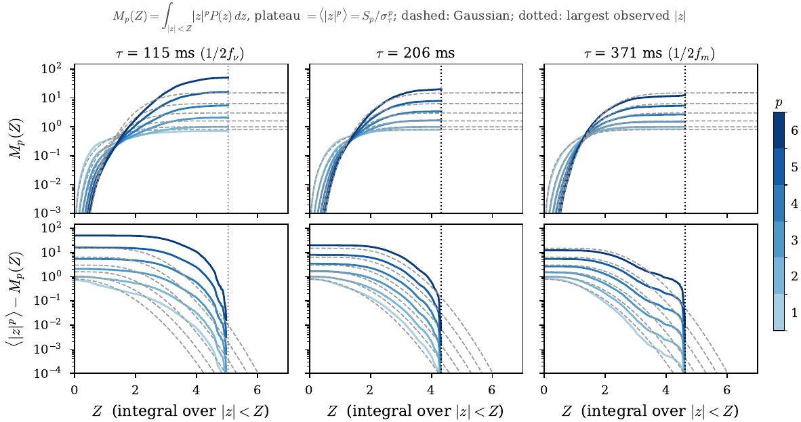

#+TITLE: Journal Week 48
#+OPTIONS: toc:2
#+BIBLIOGRAPHY: ../../../references.bib
#+CITE_EXPORT: csl chicago-author-date.csl

* Table of Contents :TOC:noexport:

* Referencias
#+PRINT_BIBLIOGRAPHY:

* 2026-11-24
** [09:45] Reunión de Labo de hoy: PDF de los incrementos y cumulantes
- Pedido del usuario: solo los gráficos de las PDF, prolijos, y lo de los cumulantes. Presentación en =~/Documentos/Reuniones de Labo/2026-11-24/labo_2026-11-24.pdf= (6 diapositivas).
- Paneles nuevos, hechos a la medida de la diapositiva, en =Códigos/= (=pdfs_panel.py=, =cumulantes_panel.py=). Son versiones limpias de las figuras del 17/11 (Día 15, PDF pesadas) y del 20/11 (Día 17), con los mismos datos (S3, JONSWAP principal) y los mismos números.
- Diapositivas: (1) P(z) en log en 1/2f_ν, centro y 1/2f_m, dato contra IAAFT y gaussiana; (2) |z|^p P(z) para p = 2, 4, 6, con la fracción que ponen los frentes; (3) convergencia: integrandos normalizados, |z| máximo y eventos con |z| > 4,5 (9 / 0 / 1); (4) κ3–κ6 contra τ y tabla en los tres τ; (5) log-cumulantes C2, C3 y ζ_p (c2 = −0,23 ± 0,02 en el dato contra 0,00 ± 0,02 en el IAAFT).
** [11:25] Integral parcial de la PDF pesada, sin normalizar
- Pedido del usuario, sobre la integral acumulada del 20/11 (=Tercera iteración/Día 17/Figuras/integral_acumulada.pdf=): la misma integral, pero sin dividir por ⟨|z|^p⟩. Script =~/Documentos/Reuniones de Labo/2026-11-24/Códigos/integral_panel.py= → =Figuras/P_integral_sin_normalizar.pdf= (todavía no está en la presentación).
- Arriba M_p(Z) = ∫_{|z|<Z} |z|^p P(z) dz, que llega a la meseta ⟨|z|^p⟩ = S_p/σ_τ^p; abajo lo que falta, ⟨|z|^p⟩ − M_p(Z). Gris: la gaussiana exacta, ⟨|z|^p⟩_G · P((p+1)/2, Z²/2). Punteada: |z| máximo medido. S3, JONSWAP principal; τ = 115 / 206 / 371 ms.
- Así se ven directamente las mesetas contra la gaussiana. En 1/2f_ν: p = 6 llega a 50 (gaussiana 15) y p = 4 a 5,5 (gaussiana 3). En 206 ms: 20 y 3,4. En 1/2f_m quedan por debajo de la gaussiana (12 contra 15; 2,7 contra 3), con el escalón del evento único en |z| ≈ 4,5.
#+ATTR_ORG: :width 700

