#+TITLE: Journal Week 48
#+OPTIONS: toc:2
#+BIBLIOGRAPHY: ../../../references.bib
#+CITE_EXPORT: csl chicago-author-date.csl

* Table of Contents :TOC:noexport:

* Referencias
#+PRINT_BIBLIOGRAPHY:

* 2026-11-24
** [09:45] Reunión de Labo de hoy: PDF de los incrementos y cumulantes
- Pedido del usuario: solo los gráficos de las PDF, prolijos, y lo de los cumulantes. Presentación en =~/Documentos/Reuniones de Labo/2026-11-24/labo_2026-11-24.pdf= (6 diapositivas).
- Paneles nuevos, hechos a la medida de la diapositiva, en =Códigos/= (=pdfs_panel.py=, =cumulantes_panel.py=). Son versiones limpias de las figuras del 17/11 (Día 15, PDF pesadas) y del 20/11 (Día 17), con los mismos datos (S3, JONSWAP principal) y los mismos números.
- Diapositivas: (1) P(z) en log en 1/2f_ν, centro y 1/2f_m, dato contra IAAFT y gaussiana; (2) |z|^p P(z) para p = 2, 4, 6, con la fracción que ponen los frentes; (3) convergencia: integrandos normalizados, |z| máximo y eventos con |z| > 4,5 (9 / 0 / 1); (4) κ3–κ6 contra τ y tabla en los tres τ; (5) log-cumulantes C2, C3 y ζ_p (c2 = −0,23 ± 0,02 en el dato contra 0,00 ± 0,02 en el IAAFT).
** [11:25] Integral parcial de la PDF pesada, sin normalizar
- Pedido del usuario, sobre la integral acumulada del 20/11 (=Tercera iteración/Día 17/Figuras/integral_acumulada.pdf=): la misma integral, pero sin dividir por ⟨|z|^p⟩. Script =~/Documentos/Reuniones de Labo/2026-11-24/Códigos/integral_panel.py= → =Figuras/P_integral_sin_normalizar.pdf= (todavía no está en la presentación).
- Arriba M_p(Z) = ∫_{|z|<Z} |z|^p P(z) dz, que llega a la meseta ⟨|z|^p⟩ = S_p/σ_τ^p; abajo lo que falta, ⟨|z|^p⟩ − M_p(Z). Gris: la gaussiana exacta, ⟨|z|^p⟩_G · P((p+1)/2, Z²/2). Punteada: |z| máximo medido. S3, JONSWAP principal; τ = 115 / 206 / 371 ms.
- Así se ven directamente las mesetas contra la gaussiana. En 1/2f_ν: p = 6 llega a 50 (gaussiana 15) y p = 4 a 5,5 (gaussiana 3). En 206 ms: 20 y 3,4. En 1/2f_m quedan por debajo de la gaussiana (12 contra 15; 2,7 contra 3), con el escalón del evento único en |z| ≈ 4,5.
#+ATTR_ORG: :width 700
[[file:../../../Assets/2026/11/Day_24/integral_sin_normalizar.png]]
** [11:27] Cuarta iteración, Día 2: llenado de la cuba para los videos
- Se está llenando la cuba con *agua destilada* (el plan del Día 1 decía agua de la canilla). Arrancamos temprano; el llenado tarda aproximadamente una hora más (lista hacia las 12:30).
- Hoy se filma la ola rompiendo con la rampa nueva (plan en =Cuarta iteración/Día 1/README.md=). Todo lo de hoy va en =Cuarta iteración/Día 2/= (=Videos/=, =Códigos/=, =Figuras/=; registro en el README).
** [11:35] Curvas de forzado para los videos, en el pendrive
- En =KINGSTON/Posgrado/Pruebas rampa impresa 3D cuba grande/Cuarta iteración/Día 2 (24-11) Videos/= (verificadas byte a byte; una columna en mm, sin encabezado):
  1. =639960ms_bonneton_C3_h_20cm_Tp_1.07_Hm0_42.9mm_seed_1_una_curva.csv=: JONSWAP principal ("h20"), el mismo del 20/11.
  2. =599962ms_bonneton_C3_h_3.5cm_Tp_0.45_Hm0_7.5mm_seed_1_fhi_2.5fp_una_curva.csv=: JONSWAP con la profundidad real (el de =Bonneton_bien_profundidad_360=, 13/10). Se escaló para h = 3,5 cm en la paleta, que era el nivel 3,60 cm en el punto de referencia de ese montaje. *A confirmar* con el nivel de hoy.
  3. =14940ms_un_salto_random_3_curva_04.csv=: *un solo salto* de los muchos forzados (curva 04 de Curvas_random_3: A = 96,6 mm, subida en ~0,7 s, vuelta lineal). Empieza y termina en x = 0, así que se puede repetir en loop (período 14,94 s). =119520ms_…_x8.csv= es el mismo ciclo 8 veces (≈ 2 min). Generador: =Cuarta iteración/Día 2/Curvas forzado/generador_un_salto.py=.
  4. =267740ms_quieto_90s_triangulares_random_3_177s.csv=: 90 s quieto (sirve de fondo para el video) + 177 s de muchos forzados (12 triangulares), la curva corta del 14/10.
- Plan de tomas: un video por cada JONSWAP, uno de muchos forzados y después varios solo del rompimiento del salto único, a más resolución, para ahorrar espacio y tiempo.
#+ATTR_ORG: :width 600
[[file:../../../Assets/2026/11/Day_24/un_salto_control.png]]
** [11:50] Disco externo para los videos: DEX5
- Se probaron los discos externos del Labo (catálogo DEX). Espacio libre y escritura secuencial medida con 1 GB (=dd= con =conv=fdatasync=, archivo temporal borrado):
  | Disco | Modelo                         | Libre   | Escritura [MB/s] |
  |-------+--------------------------------+---------+------------------|
  | DEX1  | Seagate Expansion 1 TB         | 170 GB  |             37,6 |
  | DEX2  | Seagate Backup+ SL 1 TB        | 40 GB   |  no confiable    |
  | DEX3  | Seagate Backup Plus Slim 2 TB  | 405 GB  |             46,6 |
  | DEX5  | WD Elements 2 TB               | 1,3 TB  |             43,4 |
- Los cuatro son HDD con NTFS y USB 3.0; ninguno informa la velocidad por sí mismo. DEX4 estaba en uso.
- DEX2 se desconectó del USB durante la prueba (errores de escritura y reset). Se desmontó, se volvió a montar (limpio) y se borró el archivo de prueba; sin errores nuevos.
- *Elegido: DEX5* (el que tiene más espacio; la velocidad es parecida a la de DEX3).
** [11:58] Salto único con meseta y bajada lineal
- Pedido del usuario: el frente tal cual, pero que una vez arriba la paleta quede quieta un rato y después baje linealmente, sin el ruido sumado. La interfaz periodiza sola, así que alcanza con un ciclo.
- =17920ms_un_salto_random_3_curva_04_meseta_3s_bajada_lineal.csv=: frente de la curva 04 original (con su ruido) hasta su máximo (96,4 mm a los 0,68 s, donde la velocidad pasa por cero), *3 s quieta* y bajada lineal sin ruido hasta 0 en 13,92 s (6,9 mm/s, la misma pendiente que la original). Período 17,92 s; |v| ≤ 525 mm/s.
- En el pendrive (=Cuarta iteración/Día 2 (24-11) Videos/=) reemplaza a la versión anterior. Generador: =generador_un_salto.py --meseta 3=.
#+ATTR_ORG: :width 600
[[file:../../../Assets/2026/11/Day_24/un_salto_meseta_control.png]]
** [12:10] Montaje de la Cuarta iteración (lo que contó el usuario)
- *Nivel:* faltaba llenar ~1 cm (iba en ~4,8–4,9 cm). El setup tiene una base de *1,5 cm* y encima la rampa con *2 mm* de piso, así que el nivel equivalente a 3,95 cm es *3,95 + 1,7 = 5,65 cm* desde el piso original. Lista en media hora a una hora.
- *Paleta:* la del motor nuevo, de *4,5 cm de ancho*, entra adentro del canal (antes era la paleta grande). El canal ocupa casi todo el ancho de la cuba. Con la paleta lo más estirada posible queda al borde de la rampa. Queda a ~1 cm del piso nuevo, o sea a *2,5 cm del piso original*.
- *Canal y playas:* hay una playa extra de *20 cm* y el canal llega hasta el otro extremo de la cuba (antes quedaba abierto). El final de la segunda playa queda a *~29,2–30 cm* de la pared opuesta.
- *Cámara:* cuando se sepa dónde rompen las olas, el usuario pasa qué sección filma y la calibración: foto de un patrón de cuadrados blancos y negros de *4 mm*, pegado a la cara interna de la pared de acrílico más cercana a la cámara.
** [12:20] JONSWAP con la profundidad correcta para este montaje
- Con el piso nuevo a 1,7 cm y nivel 5,65 cm, la profundidad en la paleta es *3,95 cm* (a confirmar: si debajo de la paleta el piso está a 1,5 cm, serían 4,15 cm). La curva de 3,5 cm que estaba en el pendrive era la del montaje de octubre.
- Nueva: =Cuarta iteración/Día 2/Curvas forzado/Curvas_jonswap/bonneton_C3_h_3.95cm_Tp_0.48_Hm0_8.5mm_seed_1_fhi_2.5fp_una_curva/599962ms_…csv= (escalada de vN03-C3: *T_p = 0,475 s, H_m0 = 8,5 mm*, k_p h = 0,951, ξ0 = 0,226; 600 s; x de 0 a 63 mm, |v| ≤ 109 mm/s). Generador copiado del Día 1 de la Tercera iteración, sin cambios.
- *Falta copiarla al pendrive* (estaba desconectado); va en lugar de la de 3,5 cm.
#+ATTR_ORG: :width 600
[[file:../../../Assets/2026/11/Day_24/jonswap_h3.95_control.png]]
** [12:24] Corrección: la paleta se mueve sobre la base de 1,5 cm → JONSWAP de 4,15 cm
- El usuario da las alturas desde el piso original, por consistencia, pero la paleta, adentro del canal, se mueve sobre la base de *1,5 cm* (no sobre el piso de 2 mm de la rampa). Con nivel 5,65 cm, la profundidad en la paleta es *4,15 cm*, no 3,95 (la entrada de las 12:20 queda corregida; esa curva se borró).
- Curva: =bonneton_C3_h_4.15cm_Tp_0.49_Hm0_8.9mm_seed_1_fhi_2.5fp_una_curva= (*T_p = 0,487 s, H_m0 = 8,9 mm*, k_p h = 0,951, ξ0 = 0,226). Regenerada hoy en =Cuarta iteración/Día 2/Curvas forzado/=: es idéntica byte a byte a la de 4,15 cm del 13/10, que ya está en el pendrive en =Tercera iteración/Curvas forzado/Curvas_jonswap/= (la que en octubre quedó como "obsoleta" porque el punto de referencia estaba del otro lado).
- Falta pasarla a =Cuarta iteración/Día 2 (24-11) Videos/= del pendrive, en lugar de la de 3,5 cm. Si el nivel final no es 5,65 cm, la profundidad en la paleta es nivel − 1,5 cm y hay que regenerarla.
** [12:32] Esquema del montaje nuevo y por qué el JONSWAP de 4,15 cm
- Esquema (=Cuarta iteración/Día 2/Códigos/esquema_montaje.py=): vista lateral (escala vertical ×9, alturas desde el piso original) y planta (ancho ×3). En negro, lo que contó el usuario; en *naranja, lo supuesto o deducido, a confirmar*: cuba de 198 cm y 5 cm de ancho, rampa de 99 cm con tan β = 0,035 y primera playa plana de 18 cm (como en octubre), segunda playa plana. Con eso, el pie de la rampa (= paleta estirada al máximo) queda a ~31 cm de la pared del lado de la paleta.
- Profundidades con nivel 5,65 cm: *4,15 cm en la paleta* (sumergida 3,15 cm, 1 cm libre abajo), 3,95 cm sobre el piso de la rampa (= el 3,95 de la Tercera iteración), ~0,5 cm sobre la playa, 4,15 cm entre el fin de la segunda playa y la pared.
#+ATTR_ORG: :width 800
[[file:../../../Assets/2026/11/Day_24/esquema_montaje.png]]
- *Por qué el JONSWAP "con h correcta" es el de 4,15 cm:* el generador escala vN03-C3 (h = 0,70 m en la paleta, T_p = 2 s) por Froude con la profundidad *en la paleta*: conserva k_p h = 0,951 (cuán somera es la ola donde se genera) y ξ0 = 0,226 (Iribarren con la pendiente). De ahí T_p = 2 s·√(h/0,70 m) y H_m0 sale de ξ0. Además, la carrera de la paleta se calcula con la transferencia de Biésel (pistón), que depende de k h en la paleta. La paleta se mueve sobre la base de 1,5 cm, así que h = 5,65 − 1,5 = 4,15 cm.
  | Curva     | T_p [s] | H_m0 [mm] | k_p h con h = 4,15 cm | H_m0/h |
  |-----------+---------+-----------+-----------------------+--------|
  | h 3,5 cm  |   0,447 |       7,5 |                  1,06 |   0,18 |
  | h 3,95 cm |   0,475 |       8,5 |                  0,98 |   0,21 |
  | h 4,15 cm |   0,487 |       8,9 |              *0,951* |   0,21 |
  | h 20 cm   |   1,069 |      42,9 |                  0,39 |   1,03 |
  - La de 3,5 cm era la del montaje de octubre con nivel 3,60 (=Bonneton_bien_profundidad_360=). La de 3,95 cm suponía el piso de 2 mm de la rampa también debajo de la paleta (equivocado). ξ0 da 0,226 en todas porque H_m0 se elige para conservarlo; lo que cambia es k_p h.
  - La "h 20 cm" (la principal del manuscrito) es otro diseño: escalada como si la paleta estuviera en 20 cm de agua.
  - Salvedad: Biésel supone un pistón que llega al fondo. Acá la paleta deja 1 cm libre abajo, así que las olas salen algo más chicas que lo nominal (igual que en octubre).
** [13:34] Llenado: faltan 0,25 cm
- Nivel ≈ *5,40 cm* desde el piso original (4,0 cm en la paleta); el objetivo es 5,65 cm. A las 12:10 faltaba ~1 cm, así que sube ≈ 0,5 cm/h: llega hacia las *~14:05*.
** [13:46] Cuba llena: nivel 5,70 cm → JONSWAP de 4,20 cm
- Nivel final *5,70 cm* desde el piso original (el objetivo era 5,65). Profundidades: *4,20 cm en la paleta* (sumergida 3,20 cm), 4,00 cm sobre el piso de la rampa (en la Tercera iteración, 3,95 cm), ~0,54 cm sobre la playa.
- JONSWAP regenerado con h = nivel − 1,5 = 4,20 cm: =Cuarta iteración/Día 2/Curvas forzado/Curvas_jonswap/bonneton_C3_h_4.2cm_Tp_0.49_Hm0_9.0mm_seed_1_fhi_2.5fp_una_curva/599962ms_…csv= (*T_p = 0,490 s, H_m0 = 9,0 mm*, k_p h = 0,951, ξ0 = 0,226; x de 0 a 63,4 mm). Frente a la de 4,15 cm cambia ~1 % (T_p 0,487 → 0,490 s, H_m0 8,9 → 9,0 mm), del orden de la precisión con que se lee el nivel.
- Falta copiarla al pendrive (desconectado), en =Cuarta iteración/Día 2 (24-11) Videos/= en lugar de la de 3,5 cm.
#+ATTR_ORG: :width 600
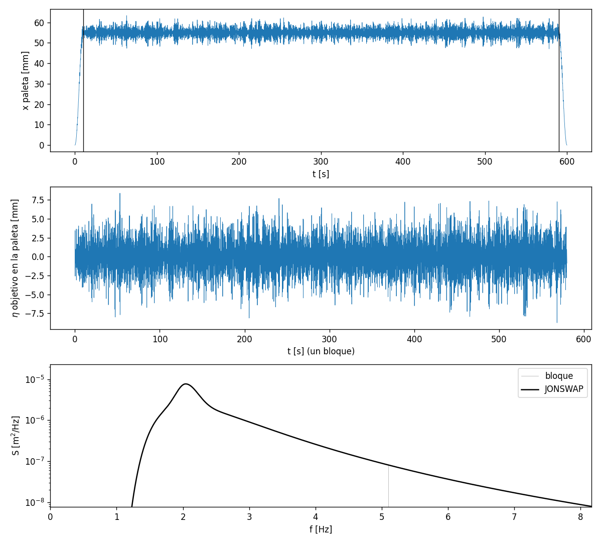
- Esquema del montaje (entrada de las 12:32) actualizado con el nivel 5,70 cm.
** [13:58] Nivel bajado 1 mm: 5,60 cm → JONSWAP de 4,10 cm
- El usuario bajó el nivel 1 mm: *5,60 cm* desde el piso original. Profundidades: *4,10 cm en la paleta* (sumergida 3,10 cm), 3,90 cm sobre el piso de la rampa, ~0,43 cm sobre la playa.
- JONSWAP para h = 4,10 cm: =Cuarta iteración/Día 2/Curvas forzado/Curvas_jonswap/bonneton_C3_h_4.1cm_Tp_0.48_Hm0_8.8mm_seed_1_fhi_2.5fp_una_curva/599962ms_…csv= (*T_p = 0,484 s, H_m0 = 8,8 mm*, k_p h = 0,951, ξ0 = 0,226; x de 0 a 63,2 mm). La de 4,20 cm (13:46) queda sin usar. Entre 4,10, 4,15 y 4,20 cm la diferencia es ≤ 1 %.
- Falta copiarla al pendrive (desconectado). Esquema del montaje (entrada de las 12:32) actualizado con el nivel 5,60 cm.
#+ATTR_ORG: :width 600
[[file:../../../Assets/2026/11/Day_24/jonswap_h4.10_control.png]]
** [14:04] Configuración del motor
- Posición del homing: *−25 mm*. Distancias A/B del wizard: *20 / 168 mm*. Con el motor y la paleta anteriores el homing estaba en 130–140 mm (mayo y junio).
- Recorrido de las curvas del pendrive, todas desde x = 0: muchos forzados 0–111 mm, salto único 0–96 mm, JONSWAP h20 0–96 mm, JONSWAP de 4,10 cm 0–63 mm.
** [14:10] Cámara conectada
- Cámara Photron por Ethernet, con IP fija en la compu de Windows. El LED *IF LINK/TRANS* está en rojo, pero *PFV4 la abrió e hizo el shading* (referencia de negro).
- A chequear: velocidad del enlace (1 Gbps o 100 Mbps), que define cuánto tarda en bajar cada video al disco (DEX5).
** [14:58] CAMBIO DE PROFUNDIDAD DE LA PALETA (~2 mm más sumergida); el JONSWAP h20 da poca amplitud
- El usuario sumergió la paleta *~2 mm más*: borde inferior a ~2,3 cm del piso original, *~0,8 cm libre abajo*, ~3,3 cm sumergida. Esquema del montaje actualizado.
- *JONSWAP h20: muy poca amplitud* (el usuario). Estimación lineal con Biésel para un pistón que no llega al fondo, aplicada a toda la curva, con h = 4,1 cm en la paleta:
  | Curva            | diseño (pistón completo) | h 4,1, pistón completo | h 4,1, hueco 1 cm | h 4,1, hueco 0,8 cm |
  |------------------+--------------------------+------------------------+-------------------+---------------------|
  | h20 (T_p 1,07 s) | 42 mm                    | 17,5 mm                | 13,4 mm           | 14,2 mm             |
  | h 4,1 (T_p 0,48 s) | 8,6 mm                 | 8,6 mm                 | 6,9 mm            | 7,3 mm              |
  - El 42,9 mm del nombre de la h20 es para 20 cm de agua en la paleta; acá k_p h = 0,38 y la eficiencia de la paleta cae de 0,91 a ~0,3, así que daría ~14 mm (el doble que la de 4,1, en teoría).
  - Si se ve más chica que eso, el hueco de abajo no alcanza para explicarlo. A revisar: que el motor siga la curva (posición real contra consigna, en el osciloscopio del LinMot) y la fuga por los costados de la paleta, que es más angosta que el canal y afecta más a las ondas largas.
#+ATTR_ORG: :width 800
[[file:../../../Assets/2026/11/Day_24/esquema_montaje.png]]
** [15:10] Condiciones por horario (para asignar cada video)
- Horas = cuando el usuario avisó del cambio (el cambio fue en ese momento o un poco antes). Alturas desde el piso original.
  | Desde   | Hasta     | Nivel                  | Borde inferior de la paleta | Libre abajo | Sumergida | Agua en la paleta |
  |---------+-----------+------------------------+-----------------------------+-------------+-----------+-------------------|
  | —       | 13:46     | llenándose (< 5,70 cm) | 2,5 cm                      | 1,0 cm      | —         | —                 |
  | 13:46   | 13:58     | 5,70 cm                | 2,5 cm                      | 1,0 cm      | 3,2 cm    | 4,2 cm            |
  | 13:58   | *14:58*   | 5,60 cm                | 2,5 cm                      | 1,0 cm      | 3,1 cm    | 4,1 cm            |
  | *14:58* | —         | 5,60 cm                | *~2,3 cm*                   | *~0,8 cm*   | *~3,3 cm* | 4,1 cm            |
- *A las 14:58 cambió la profundidad de la paleta*: los videos de antes son con la paleta a 2,5 cm del piso original; los de después, a ~2,3 cm.
** [15:31] Videos en el DEX5
- Cámara: *Photron FASTCAM SA3 model 60K-M2* (IP 192.168.0.10), PFV 4.6. Secuencias TIFF de 12 bit + =.cihx=, en =DEX5:/Ignacio/Cuarta iteracion/=. Todas a *250 fps*, obturador 1/250 s (4 ms). Hora = la del =.cihx= (al guardar).
  | Toma                  | Guardada | Resolución | Cuadros | Duración | Peso    | Paleta             |
  |-----------------------+----------+------------+---------+----------+---------+--------------------|
  | Una ola/Ola_1         | 14:38    | 1024×1024  |     312 | 1,25 s   | 491 MB  | 2,5 cm             |
  | Una ola/Ola_2         | 14:41    | 1024×1024  |     297 | 1,19 s   | 468 MB  | 2,5 cm             |
  | Una ola/Ola_3         | 14:44    | 1024×1024  |     325 | 1,30 s   | 512 MB  | 2,5 cm             |
  | Una ola/Ola_4         | 14:49    | 1024×1024  |     242 | 0,97 s   | 381 MB  | 2,5 cm             |
  | Una ola/Ola_5         | 14:51    | 1024×128   |     220 | 0,88 s   | 43 MB   | 2,5 cm             |
  | JONSWAP/H20_1         | 15:05    | 1024×128   |   21813 | 87,3 s   | 4,3 GB  | ~2,3 cm (confirmar) |
  | Muchos forazad/primer | 15:12    | 1024×128   |   21250 | 85,0 s   | 4,2 GB  | ~2,3 cm            |
  | Una ola/Ola_6         | 15:17    | 1024×1024  |     523 | 2,09 s   | 823 MB  | ~2,3 cm            |
  | JONSWAP/h3_5          | 15:20    | 1024×128   |    2239 | 8,96 s   | 441 MB  | ~2,3 cm            |
  | Una ola/Ola_7         | 15:27    | 1024×1024  |     180 | 0,72 s   | 283 MB  | ~2,3 cm            |
  | Una ola/Ola_9         | 15:29    | 1024×1024  |     481 | 1,92 s   | 757 MB  | ~2,3 cm            |
- "Una ola": 8 tomas, *3,76 GB* en total (no hay Ola_8). Un cuadro de 1024×1024 pesa 1,57 MB; uno de 1024×128, 0,20 MB.
- H20_1 se empezó a copiar a las 15:00, así que se grabó entre ~14:58 y 15:00, justo alrededor del cambio de la paleta: a confirmar. =h3_5= sería el JONSWAP de 3,5 cm (el de 4,1 cm no llegó al pendrive): a confirmar.
** [15:40] Todas las mediciones del día (videos)
- Cámara Photron FASTCAM SA3 60K-M2, 250 fps, obturador 1/250 s, TIFF de 12 bit. Originales en =DEX5:/Ignacio/Cuarta iteracion/=. Hora = la del =.cihx= (al guardar). Paleta: ver la tabla de condiciones por horario (14:58: cambio de 2,5 a ~2,3 cm). Nivel 5,60 cm en todas.
  | Toma                  | Guardada | Forzado (curva)                      | Resolución | Cuadros | Duración | Peso   | Paleta  | Encuadre                  | Brillo medio | Parpadeo 100 Hz |
  |-----------------------+----------+--------------------------------------+------------+---------+----------+--------+---------+---------------------------+--------------+-----------------|
  | Una ola/Ola_1         | 14:38    | salto único con meseta (17920 ms)    | 1024×1024  |     312 | 1,25 s   | 491 MB | 2,5 cm  | patrón arriba al centro   |          339 | 1,9 %           |
  | Una ola/Ola_2         | 14:41    | salto único con meseta               | 1024×1024  |     297 | 1,19 s   | 468 MB | 2,5 cm  | patrón arriba al centro   |          631 | 3,8 %           |
  | Una ola/Ola_3         | 14:44    | salto único con meseta               | 1024×1024  |     325 | 1,30 s   | 512 MB | 2,5 cm  | patrón arriba al centro   |          624 | 4,0 %           |
  | Una ola/Ola_4         | 14:49    | salto único con meseta               | 1024×1024  |     242 | 0,97 s   | 381 MB | 2,5 cm  | patrón arriba al centro   |          612 | 3,5 %           |
  | Una ola/Ola_5         | 14:51    | salto único con meseta               | 1024×128   |     220 | 0,88 s   | 43 MB  | 2,5 cm  | franja sobre el frente    |          255 | 6,6 %           |
  | JONSWAP/H20_1         | 15:05    | JONSWAP h20 (639960 ms)              | 1024×128   |   21813 | 87,3 s   | 4,3 GB | ~2,3 cm (confirmar) | franja        |              |                 |
  | Muchos forazad/primer | 15:12    | muchos forzados (¿267740ms_quieto_90s_triangulares?) | 1024×128 | 21250 | 85,0 s | 4,2 GB | ~2,3 cm | franja        |              |                 |
  | Una ola/Ola_6         | 15:17    | salto único con meseta               | 1024×1024  |     523 | 2,09 s   | 823 MB | ~2,3 cm | patrón arriba al centro   |          616 | 3,9 %           |
  | JONSWAP/h3_5          | 15:20    | ¿JONSWAP de 3,5 cm? (a confirmar)    | 1024×128   |    2239 | 8,96 s   | 441 MB | ~2,3 cm | franja                    |              |                 |
  | Una ola/Ola_7         | 15:27    | salto único con meseta               | 1024×1024  |     180 | 0,72 s   | 283 MB | ~2,3 cm | patrón arriba a la izq.   |          348 | 3,7 %           |
  | Una ola/Ola_9         | 15:29    | salto único con meseta               | 1024×1024  |     481 | 1,92 s   | 757 MB | ~2,3 cm | patrón arriba a la izq.   |          356 | 3,4 %           |
- No hay Ola_8. Forzado de las "Una ola": supuesto el salto único con meseta del pendrive (a confirmar).
- *Copia local* de las de una ola (pedido del usuario, para procesar y refinar la técnica): =Cuarta iteración/Día 2/Videos/Una ola/= (2588 archivos, 3,76 GB, verificada por nombres y tamaños). Las JONSWAP y la de muchos forzados quedan solo en el DEX5.
- *Iluminación:* según el usuario, algunas tomas tienen LED y otras incandescente, que parpadea. Medido (=Códigos/inventario_tomas.py=): *todas* parpadean a 100 Hz (red de 50 Hz), entre 2 y 7 % del brillo medio del cuadro. Hay dos grupos de brillo: ~340–360 (Ola_1, 7, 9) y ~610–630 (Ola_2, 3, 4, 6). Falta saber cuál es cuál. En el análisis se corrige normalizando cada cuadro por el brillo de una zona fija sin agua.
- *Altura del agua:* se va a sacar de las propias fotos (el usuario).
- Herramientas: =Códigos/photron.py= lee los TIFF de 12 bit; =~/.local/bin/visor-tif= es el visor con flechas (predeterminado para TIFF; xviewer no los abre).
#+ATTR_ORG: :width 800
[[file:../../../Assets/2026/11/Day_24/inventario_tomas.png]]
** [16:10] Idea a verificar: ¿el frente roto se ensancha como √t?
- El usuario: estaría bien verificar si el frente, una vez roto, se ensancha tipo √t, como un proceso difusivo. Aunque eso vale para su propagación a lo largo.
- Con η(x, t) del detector de menisco: medir el ancho del frente en cada cuadro (p. ej. la distancia entre el 10 % y el 90 % de la altura local) y graficarlo contra el tiempo desde la rotura, en log-log, buscando pendiente 1/2.
** [16:13] Detector de menisco (Ola_9), video de control y espectros
- =Cuarta iteración/Día 2/Códigos/menisco.py= (v3). Se resta el cuadro 1, compensando el parpadeo *fila por fila* (la luz no cambia igual en toda la imagen), y el menisco es el *borde de abajo de la barra negra* de la imagen sin fondo (el usuario: "el mínimo de la barra negra ancha").
- Agregados después de revisar con el usuario: relleno de la cresta (ahí la barra se afina), la varilla vertical interpolada, nivel quieto del cuadro 1 donde no hay ola, *continuidad y suavidad* de la línea (pedido del usuario), mediana de 3 cuadros en los puntos rellenados y nivel quieto antes de que llegue la ola.
- Resultado: =Resultados/menisco_Ola_9.npz= (481 cuadros × 1024 px). La ola va de derecha a izquierda y η máx baja de ~38 a ~15 px. Cerca del nivel quieto, ±2 px.
#+ATTR_ORG: :width 900
[[file:../../../Assets/2026/11/Day_24/menisco_Ola_9_control.png]]
#+ATTR_ORG: :width 800
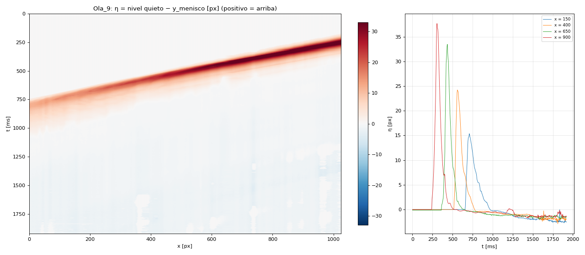
- Video de control (pedido del usuario): =Día 2/Videos/control/menisco_Ola_9.mp4=, la franja de la ola con el menisco en rojo (escala vertical ×3) y abajo el diagrama x–t. El usuario: "dentro de todo bastante decente; alguna cosa en el punto de máxima amplitud" → se agregó la continuidad y suavidad.
- *Evolución del espectro* (pedido del usuario): E(k) de η(x) un cuadro cada 10, coloreado por tiempo (Blues), y el mapa E(k, t). También E(f) en una columna cada 10 px. La energía en k chico cae a medida que la ola avanza y se achica. Por encima de k ≈ 0,1 ciclos/px manda el suavizado de la línea. Todo en px: falta calibrar con el patrón de 4 mm.
#+ATTR_ORG: :width 900
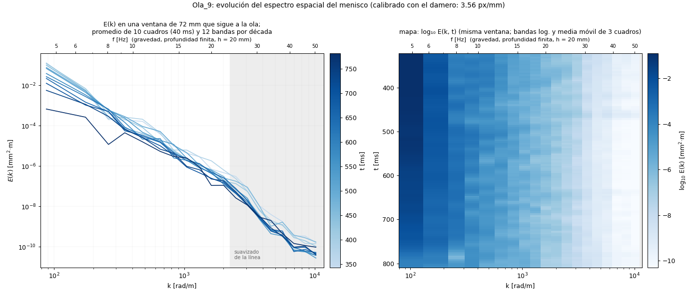
#+ATTR_ORG: :width 900
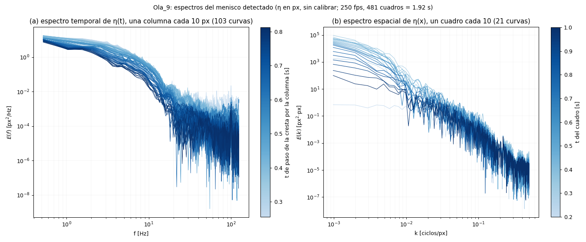
- Tomas nuevas: Ola_10 (1024×256, 500 fps, 15:49), Ola_11 (1024×1024, 250 fps, 15:52) y Ola_12 (1024×256, 250 fps, 15:54), copiadas a la carpeta local. "Medio horribles sin fondo": era sobre todo un error del visor (al abrir en el cuadro 1 el contraste quedaba en ±1 cuenta), corregido. La cámara no se movió (< 0,15 px). Lo que sí: parpadeo de 100 Hz de ±2,4 a ±5,4 % (más fuerte con obturador 1/500 s), distinto según la zona de la imagen. Sugerido: apagar la luz conectada a la red de 220 V y usar solo luz que no parpadee.
** [16:17] Calibración con el damero y evolución del espectro en una ventana que sigue a la ola
- *Calibración:* damero de 4 mm en la pared de adelante (mismo plano que el menisco), cuadro 1 de Ola_9: 2 cuadros = 28,78 px en x y 28,24 px en y → *3,56 px/mm* (0,281 mm/px). La imagen tiene 288 mm de ancho. η máx de Ola_9 ≈ 10,6 mm. La cresta avanza a 0,49 m/s, así que la profundidad en la zona filmada es de ~14–25 mm (√(g(h + A))). Se usa h = 20 mm hasta saber en qué parte de la rampa está la cámara.
- *Evolución del espectro*, rehecha a pedido del usuario ("hay que suavizarlo; zoom alrededor de la ola; un segundo eje arriba con la frecuencia de gravedad con profundidad finita"): ventana de 72 mm (256 px) que sigue a la ola (un poco más ancha que la franja roja del diagrama x–t), promedio de 10 cuadros (40 ms) y 12 bandas por década; eje de arriba f = √(g k tanh(k h))/2π con h = 20 mm. =Códigos/evolucion_espectro.py=.
#+ATTR_ORG: :width 900

** [16:31] Encuadres, collage tipo Fig. 2a, videos crudos y JONSWAP h20
- *Dos encuadres de cámara* (por correlación del cuadro 1): A, más lejos (Ola_1–6, Ola_11, H20_1, muchos forzados, h3_5), *2,20 px/mm* (465 mm de ancho); B (Ola_7, 9, 10, 12), *3,56 px/mm* (288 mm). Ambos calibrados con el damero.
- *Collage tipo Figura 2a con Ola_9* (pedido del usuario): misma receta que el del manuscrito (sin fondo, rotado 1,08° ≈ 1,047° del manuscrito, espejado, CLAHE). Replica el aspecto, pero en Ola_9 la ola no se da vuelta mientras está en cuadro: falta la etapa de rotura. Se limpió el grano y las manchas del parpadeo (el usuario: "¿por qué la resolución es tan fea?": la tira tiene 1024 px contra 1666 en el manuscrito y la resta deja grano).
#+ATTR_ORG: :width 900
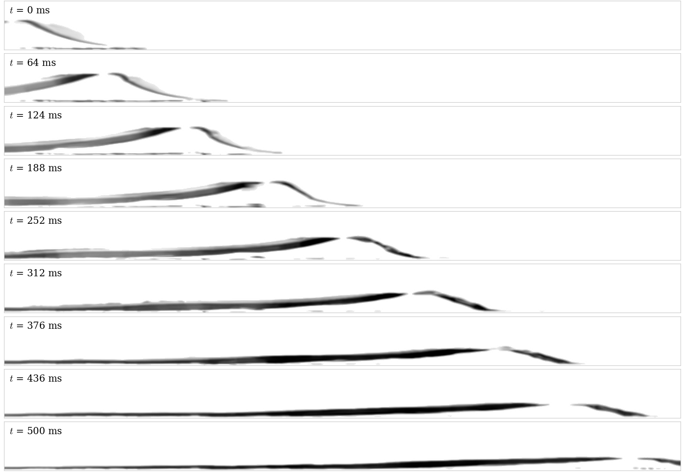
- *Videos crudos* de cada rompimiento (pedido del usuario: 60 fps, ROI alrededor de la ola, sin compensar la luz): =Día 2/Videos/crudo/Ola_*.mp4= (11 tomas).
- *JONSWAP h20 (H20_1)*: las olas acá son de décimas de mm, así que se sigue el borde claro→oscuro del menisco con precisión subpíxel (ruido ±0,03 mm) en las 21 813 imágenes. Welch como en el manuscrito (Hann 12 s, solapamiento 6 s), una columna cada 25 px: pico en *0,93 Hz* (T_p de diseño 1,07 s) y armónico en ~1,9 Hz; *H_m0 ≈ 2,1 mm en la entrada y cae al ruido (~0,1 mm) a ~330 mm*: en el último tercio de la imagen ya no queda ola. La línea de 100 Hz es el parpadeo.
#+ATTR_ORG: :width 900
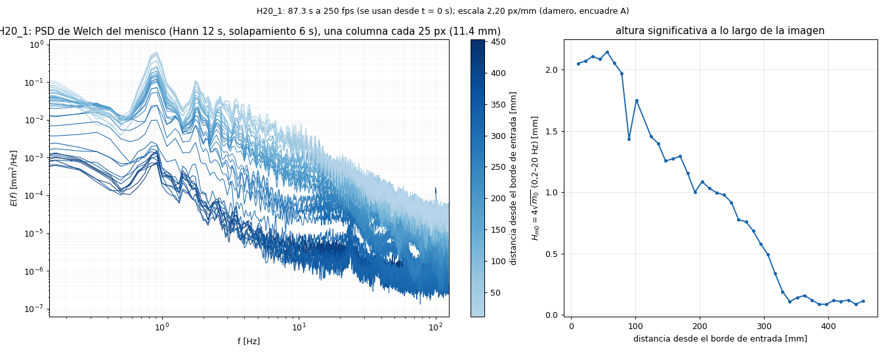
- Animación de la PSD a lo largo de x (pedido del usuario): =Día 2/Videos/control/psd_espacio_H20_1.mp4=.
#+ATTR_ORG: :width 800
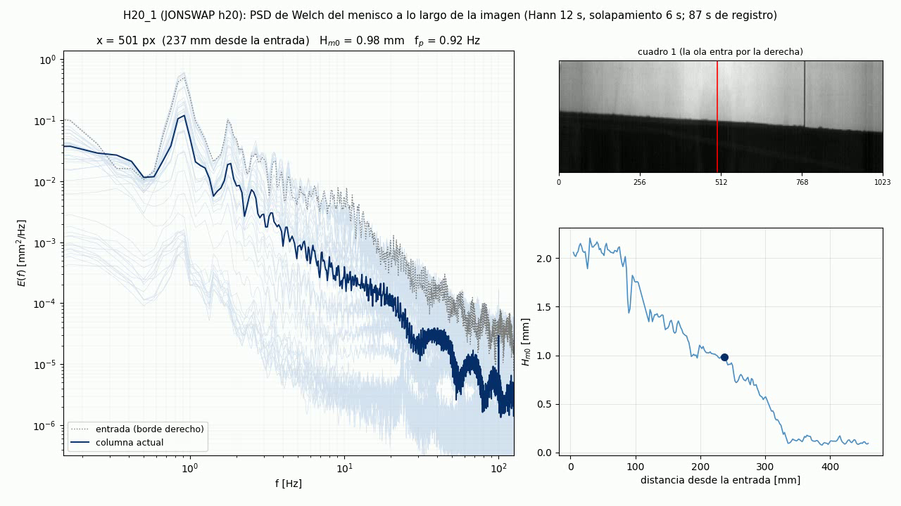
** [16:49] Tomas nuevas Ola_13, Ola_14 y Ola_15
- Ola_13 (16:43), Ola_14 (16:45) y Ola_15 (16:46): tiras de 1024×128 (fila del sensor 448), 250 fps, 297, 256 y 444 cuadros. Copiadas a =Día 2/Videos/Una ola/= (verificadas por nombre y tamaño) y con su video crudo a 60 fps en =Día 2/Videos/crudo/=.
- La varilla aparece en x ≈ 626, 621 y 596 px (en el encuadre A estaba en 775 y en el B en 652): la cámara cambió de lugar, así que es otro encuadre y *falta una foto del damero* en esta posición para calibrar.
** [17:24] Olas individuales sincronizadas, en dos columnas
- Pedido del usuario: sincronizar las olas para que rompan en la misma posición y en el mismo momento, en dos columnas. =Día 2/Videos/control/olas_sincronizadas.mp4=: las 14 tomas con las imágenes originales, llevadas a 3 px/mm, τ = t − t_rotura de −150 a +600 ms, a 60 fps.
- Rotura = cuadro en que el frente está más empinado (máximo de la pendiente de la envolvente de arriba de la ola, sin la varilla, que daba falsos), en los primeros 0,25 s desde que entra la ola; la rotura queda a 3/4 del ancho de cada celda (marca blanca). Tabla: =Día 2/Resultados/rotura_tomas.txt=.
- Casi todas rompen apenas entran a la imagen. Dudosas: Ola_3 y Ola_4 (olas más chicas). Después de romper, las del encuadre C avanzan más rápido que las demás: puede ser la escala supuesta (2,20 px/mm) o que estén en otra profundidad; falta el damero en esa posición.
#+ATTR_ORG: :width 900
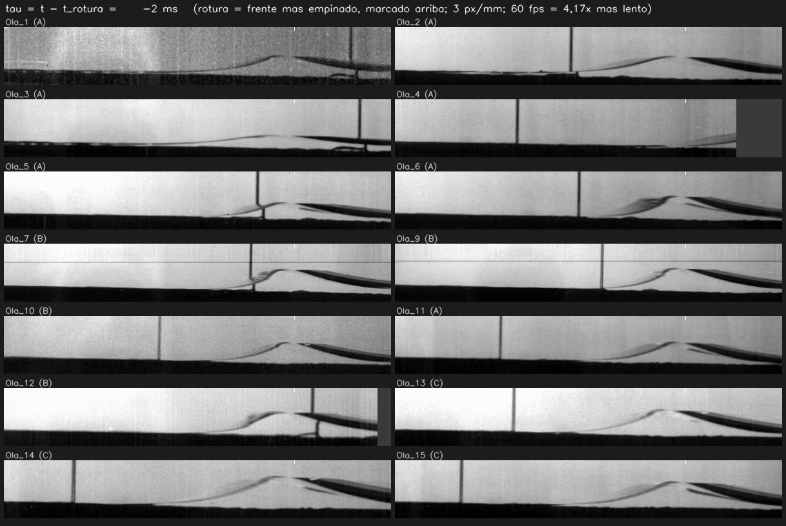
** [17:31] Idea a hacer: FFT 2D en ventanas
- El usuario: hacer la FFT 2D de η(x, t) en ventanas y ver a partir de qué punto las ondas son de agua somera, con velocidad de propagación constante √(g h_local), o si hace falta la relación de profundidad finita.
- Plan: E(k, f) en ventanas de x que se corren a lo largo de la imagen; comparar la cresta del espectro con f = k √(g h)/2π y con f = √(g k tanh(k h))/2π, ajustando h en cada ventana y comparándolo con la pendiente de la rampa (0,035). La JONSWAP h20 (87 s, estacionaria) es la toma más limpia para esto.
** [17:38] Todas las olas individuales analizadas
- Detector de menisco en las 14 tomas, espacio-temporal con el gradiente debajo para cada una (pedido del usuario: x horizontal, t vertical; ★ = rotura = frente más empinado; ● = altura máxima) y video de control con la línea superpuesta para cada una (=Día 2/Videos/control/menisco_Ola_*.mp4=).
- *Ola_1 falló* (imagen oscura: la línea no sigue el frente). Las demás salen bien.
- Velocidad de la cresta (recta en el diagrama x–t, R² 0,98–0,998): *0,46–0,51 m/s* en los encuadres A y B. En el C (Ola_13–15) da 0,57–0,67 m/s: o la escala supuesta está mal o es otra profundidad (falta el damero).
- La cresta más alta está casi siempre a la entrada de la imagen (la ola entra ya alta). El frente más empinado cae más adentro; en Ola_10 y Ola_12, cerca del borde izquierdo: el frente se sigue empinando al subir por la playa.
#+ATTR_ORG: :width 1000
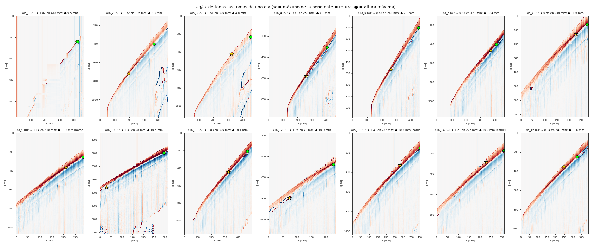
- *FFT 2D / dispersión local de la JONSWAP h20* (idea de las 17:31): primer intento *no concluyente*. La onda del pico (~0,5 m) es más larga que la imagen entera (465 mm), el canal cerrado devuelve onda reflejada y en el último tercio ya no queda ola. Con un ajuste de onda incidente más reflejada por tramos sale h ≈ 12–25 mm y k_p h ≈ 0,2–0,3 (somera) entre 85 y 285 mm desde la entrada, pero con mucha dispersión. Haría falta un campo más largo (varias posiciones de cámara) o usar las frecuencias más altas.
- JONSWAP: el borde del menisco de todas las imágenes está guardado en local; el video de control con la línea necesita las imágenes, y el disco quedó en el Labo.
** [17:41] Forma de una ola: video contra sensor
- Pedido del usuario: comparar la forma de una ola del video con la que se midió con el sensor. Sensor: medición "muchos forzados" del 13/10 (3,95 cm; los mismos saltos triangulares de donde sale el salto único de hoy), 31–37 olas por sensor alineadas en el pico. Video: Ola_9 y Ola_6 en tres columnas cada una.
- *Misma altura:* η máx mediana 10,7 / 11,8 / 12,5 mm en S1 / S2 / S3, contra 10,5 mm a la entrada de la imagen en el video.
- *Forma distinta:* la ola del video es mucho más angosta (la cresta dura ~100 ms contra ~200–300 ms en los sensores) y no tiene el valle de después (−5 a −7 mm en S1 y S2). En la medición vieja la paleta volvía enseguida (rampa lineal); hoy queda quieta 3 s arriba (meseta), y eso explica al menos el valle. Además el sensor mide a través de todo el ancho del canal y el video mira el menisco contra la pared.
- Falta saber dónde estaba la cámara sobre la rampa para compararla con el sensor que esté en el mismo lugar.
#+ATTR_ORG: :width 1000
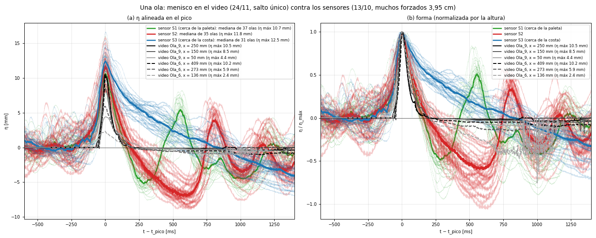
** [17:45] Video contra S3 con la hipótesis de Taylor
- El usuario: hay que pasar de espacio a tiempo (o al revés) con la hipótesis de Taylor para comparar bien, y solo con el sensor 3. Ola congelada que va hacia x chico: ξ = x − x_cresta = c (t − t_pico), con c = 0,50 m/s, la velocidad de la cresta medida en el video. Las olas de S3 (13/10) se pasan al espacio y se comparan con perfiles instantáneos del video (Ola_9 y Ola_6).
- *Control de Taylor dentro del video:* la serie en una columna de Ola_9 pasada al espacio coincide con el perfil instantáneo cuando la cresta pasa por esa columna. Taylor vale.
- *Resultado:* la ola del video es unas 4 veces más angosta que la de S3. El frente sube en ~25 mm (S3: ~100 mm) y la espalda vuelve a 0 en ~100 mm (S3: ~400 mm, sin valle). Altura: 10,3 mm a la entrada de la imagen contra 12,9 mm en S3 (mediana de 31 olas).
- Diferencias que pueden explicarlo: el forzado (hoy la paleta queda 3 s quieta arriba; el 13/10 volvía enseguida), el lugar (no se sabe dónde está la cámara respecto de S3) y que el sensor mide de lado a lado del canal y el video el menisco en la pared.
#+ATTR_ORG: :width 1000
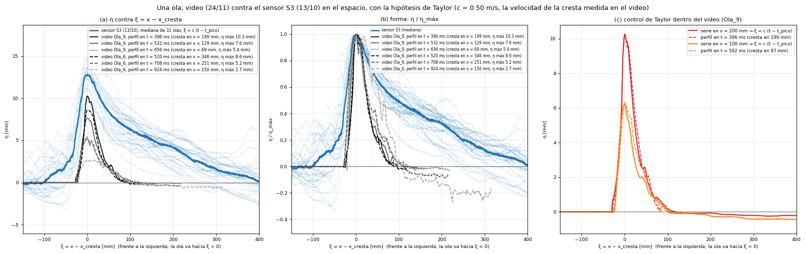
** [17:47] El instante del video más parecido a la ola de S3
- Pedido del usuario: la forma normalizada por la altura y con Taylor, y la correlación del sensor con el espacio-temporal para encontrar el instante más parecido. Se compara la forma de S3 (mediana de 31 olas, Taylor con c = 0,50 m/s) con el perfil normalizado de cada cuadro de cada toma (todas menos Ola_1), con la correlación de Pearson en el tramo donde hay imagen.
- *El más parecido:* Ola_7, t = 476 ms, con la cresta en x = 61 mm y η máx 4,3 mm: *r = 0,94*. El frente y la cresta coinciden bien, pero la espalda del video vuelve a 0 mucho antes (rms 0,32). En todas las tomas r sube a medida que la ola avanza y se achica: ~0,7–0,8 a la entrada de la imagen, ~0,9 al final.
#+ATTR_ORG: :width 900
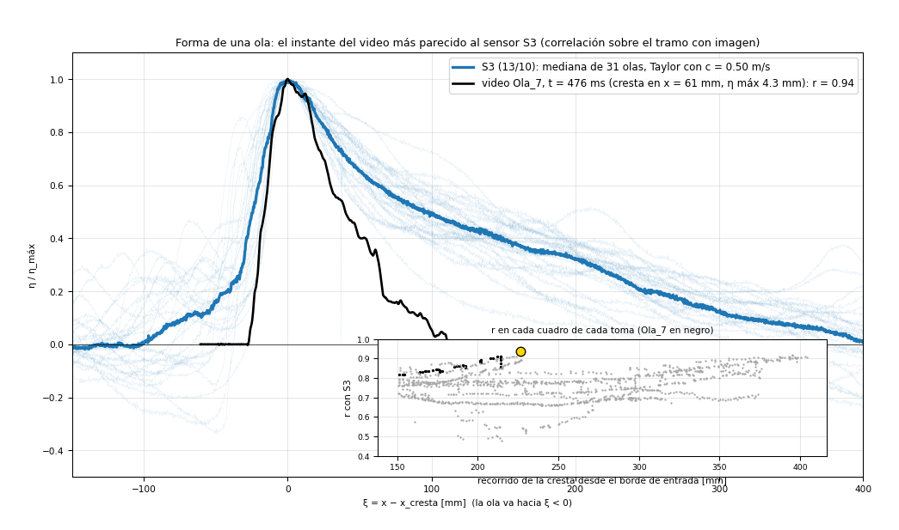
** [17:48] Forma normalizada en altura y en ancho: video y S3 tienen la misma forma
- El usuario: "también horizontalmente hay que compensar". Cada perfil se normaliza por su altura y por su ancho a media altura W½: u = ξ/W½ (en u ya no importa el c de Taylor).
- *La forma es casi la misma:* r = 0,96–0,99 en todas las tomas. La más parecida: Ola_2, t = 736 ms, cresta en x = 196 mm, η máx 6,4 mm: *r = 0,99, rms 0,04*. Lo que cambia es la escala: W½ = 39 mm en el video contra 119 mm en S3 (con c = 0,50 m/s), unas 3 veces más angosta.
#+ATTR_ORG: :width 900
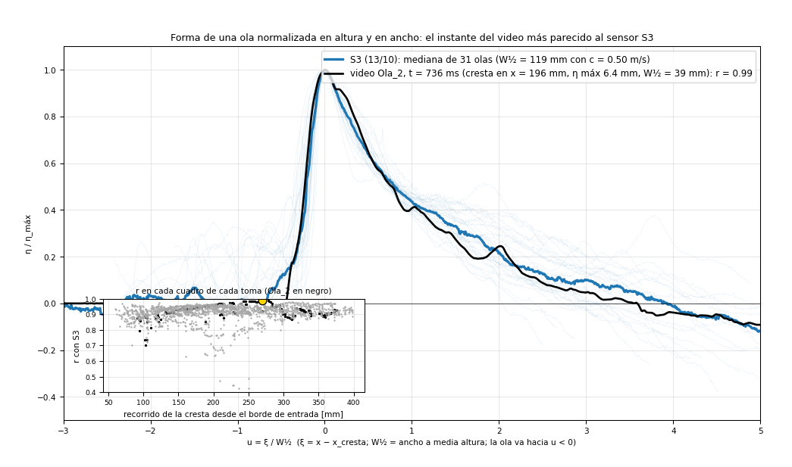
** [17:52] Autosimilaridad tipo Cole–Hopf y el borde negro delante de la ola
- *Autosimilaridad* (pedido del usuario): una joroba de Burgers en fondo plano conserva el área y da η_máx ∝ t^−1/2 y ancho ∝ t^1/2 (onda triangular o difusiva). Entonces 1/η_máx² y W½² deberían ser lineales en t y η_máx·W½ constante.
  - La *forma* sí es autosimilar: los perfiles η/η_máx contra ξ/W½ colapsan.
  - Las *leyes de escala* no: 1/η_máx² y W½² no son lineales (la altura cae cada vez más rápido), η_máx·W½ baja y el área ∫η dx baja ~60 % en 700 ms. Esperable con la rampa (Burgers con coeficientes variables), la subida a la playa y la parte de la ola que queda fuera de la imagen.
#+ATTR_ORG: :width 1000
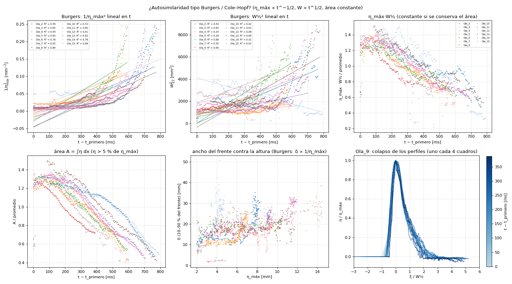
- *Borde negro bajo el nivel quieto* (el usuario: oscurece la panza/valle delante de la ola; idea: pared de atrás blanca). En el fondo, bajo el nivel quieto hay una franja gris de 0,5 a 2 mm y después negro. Delante del frente esa franja se oscurece claramente (−20 a −27 cuentas contra ±5 de ruido), desde ~100 ms antes de que la ola entre a la imagen y hasta más de 100 mm delante del pie. Se detecta que algo pasa ahí, pero no se puede medir la posición de la superficie: el borde claro→oscuro casi no se mueve y el cambio puede ser de nivel o de la forma del menisco. Con la pared de atrás blanca se vería el menisco también por debajo del nivel quieto.
- Ojo: el paso del detector que fija el nivel quieto antes de que llegue la ola borraba detecciones de −0,6 a −1,1 mm al pie del frente que pueden venir de esto.
#+ATTR_ORG: :width 900
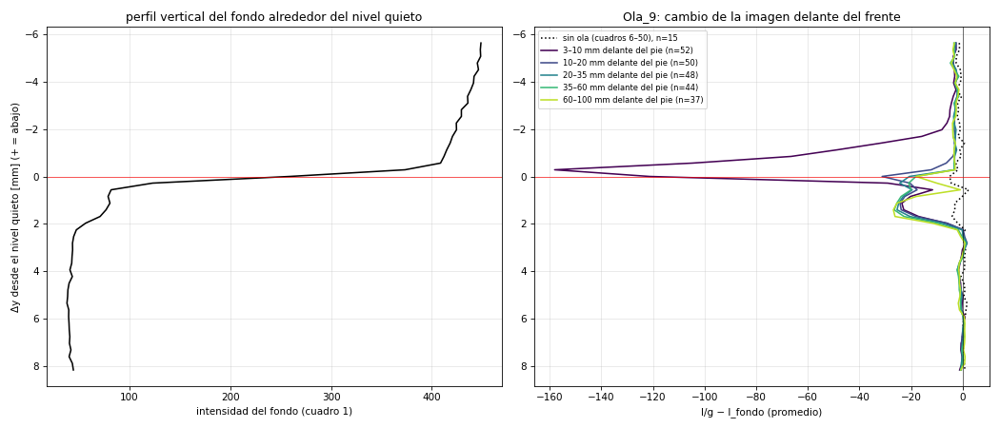
** [17:53] Estado al cierre del día
- El usuario: todo lo de los videos es preliminar; la idea es seguir midiendo estas cosas y mejorar el método de medición. Lo principal era tener el *collage con la misma inclinación que el resto de los datos* y *algún espectro espacial*. Probablemente haya que *reorganizar la parte de resultados espectrales* del manuscrito para incluir algo de esto.
- Pendientes: posición de la cámara sobre la rampa; foto del damero en el encuadre C (Ola_13–15); pared de atrás blanca; con el DEX5 (quedó en el Labo): video de control de la JONSWAP h20 y procesar h3_5 y muchos forzados; Ola_1 (falló el detector).
** [17:58] Cómo ubicar la cámara sobre la rampa
- El usuario: la ubicación se puede sacar (1) siguiendo la rampa, porque el quiebre entre la rampa y la playa plana debería estar en cuadro, o (2) con la línea vertical donde se unen los dos paneles de acrílico (88 cm cada uno; el último queda a un par de cm del borde de la cuba). Él puede medir la distancia de esa unión al inicio de la playa.
- La línea vertical que yo llamaba "varilla" es esa unión: una referencia fija en todas las tomas. Campo de cada encuadre respecto de la unión (negativo = hacia la playa): A de −352 a +113 mm; B de −183 a +104 mm; C (Ola_13–15, escala supuesta) de ~−285 a ~+190 mm. Con la distancia unión–playa queda ubicada cada toma.
- Seguir la rampa: debajo del agua se ve una línea tenue inclinada, pero el ajuste automático del quiebre todavía no es confiable (se engancha en una línea blanca horizontal). Queda pendiente.
#+ATTR_ORG: :width 900
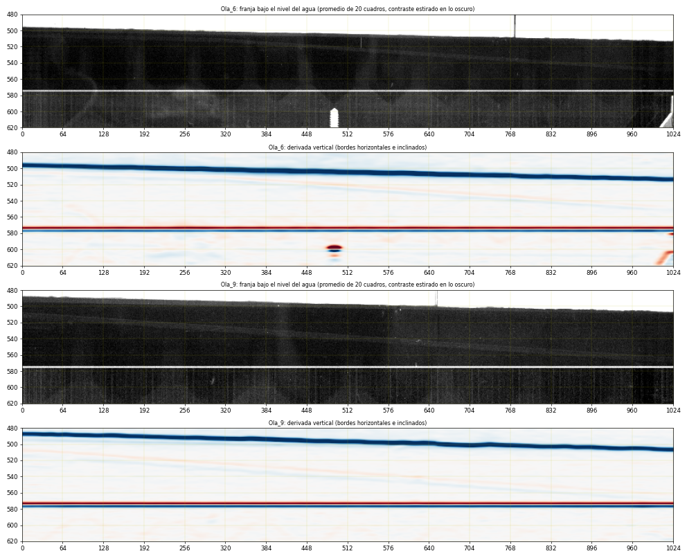
** [18:00] Calibración de todas las tomas: la cámara se movió 9 veces
- El usuario pregunta si ya calibré con los cuadrados, y nota que tendría que haber sacado una foto cada vez que movió la cámara.
- Con el damero (solo en las tomas de cuadro entero): Ola_1–6 *2,202 px/mm*; Ola_7 *3,625*; Ola_9 *3,604*; Ola_11 *2,051*. Ola_5 (tira) tiene el mismo encuadre que Ola_1–6.
- La unión de los paneles de acrílico aparece en *9 posiciones distintas*: 775 px (Ola_1–6), 752 (Ola_7), 652 (Ola_9), 559 (Ola_10), 636 (Ola_11), 904 (Ola_12), 626 / 621 / 596 (Ola_13 / 14 / 15). Las tiras Ola_10, 12 y 13–15 no tienen damero: por el ancho de la unión (7–8 px contra 4–6 px), Ola_10 y 12 estarían cerca de 3,6 px/mm y Ola_13–15 cerca de 2,05–2,2.
- Hasta ahora usé 2,20 en Ola_11 (es 2,05: los mm de esa toma están 7 % corridos) y supuse escalas en las tiras. Otras pistas para calibrar todo junto: el ancho de la unión, las formas repetidas de la franja oscura del canal (el período todavía no da consistente), los tornillos y la línea blanca (solo en cuadro entero).
- Pendiente: calibración única por toma (escala y posición de la unión) y rehacer las figuras con eso; para la próxima, una foto del damero cada vez que se mueva la cámara.
** [18:03] Tiras calibradas con la ola de Ola_11
- El usuario: el forzado es el mismo en todas las olas sueltas; las últimas seis (Ola_10–15) tienen que ser idénticas en todo sentido (en las demás pudo cambiar levemente la altura del agua o la posición de la rampa). Si alguna tiene damero, suponer la misma ola y calibrar con eso.
- Referencia: Ola_11 (damero, 2,051 px/mm). En el cuadro en que la cresta pasa por la unión de los paneles (punto fijo de la cuba) se miden su altura y su velocidad en px; la escala de cada tira sale de comparar las dos con Ola_11. Las dos estimaciones coinciden entre 1 y 8 %.
  | Toma   | Escala [px/mm] | Incerteza |
  |--------+----------------+-----------|
  | Ola_10 |           3,27 | ±1,8 %    |
  | Ola_12 |           4,35 | ±3,3 %    |
  | Ola_13 |           2,55 | ±0,8 %    |
  | Ola_14 |           3,28 | ±4,1 %    |
  | Ola_15 |           2,63 | ±3,8 %    |
- Con eso las seis quedan coherentes en todo el cuadro: η máx 10,0–10,6 mm y velocidad de la cresta 0,48–0,52 m/s (con las escalas supuestas, Ola_12–15 daban 0,56–0,67 m/s). Todos los análisis usan ahora =Códigos/calibracion.py=; se rehicieron los espacio-temporales, el resumen, la autosimilaridad y las comparaciones con S3. Falta rehacer el video sincronizado.
#+ATTR_ORG: :width 1000

** [18:08] Seguir el fondo (rampa → playa): primer intento y visor para ajustar el realce
- El usuario: el fondo debería ser constante (playa, salvo los 0,1° de la cuba) y después bajar hacia la derecha con tan α = 0,035 (rampa); promediar muchas imágenes, porque ese fondo no cambia, y jugar con la exposición y la saturación para que resalte.
- Primer intento (=Día 2/Códigos/fondo_rampa.py=: media de 60 cuadros y un modelo de playa más rampa con esas pendientes): en Ola_7 y Ola_9 la rampa sigue bien una línea tenue inclinada, pero el resultado todavía *no es confiable*. En las tiras da ~12 mm de agua sobre el fondo en la unión, coherente entre tomas, con el quiebre casi siempre fuera de cuadro; en las de cuadro entero se engancha en otras estructuras.
- Visor interactivo para que el usuario pruebe el realce: =Día 2/Códigos/ajustar_fondo.py [toma]= (negro, blanco, gamma, suavizado y cuatro modos de realce).
** [18:12] Fondo encontrado en Ola_9 y Ola_7: la playa empieza ~24 cm antes de la unión de paneles
- El usuario, con el visor: en Ola_9 la línea del fondo arranca en y ≈ 512 a la izquierda y lo que se ve es solo la rampa. Con eso: recta de pendiente tan α = 0,035 respecto del agua que mejor sigue la línea tenue en la media de 60 cuadros: y = 510 en x = 0 (Ola_9) y 504,5 (Ola_7). Sigue la línea en todo el ancho.
- *Agua sobre la rampa:* 6,5 → 16,5 mm (Ola_9) y 5,3 → 15,2 mm (Ola_7); *en la unión de paneles 12,8 y 12,6 mm*, coherente con las tiras (~12 mm) y con la velocidad de la cresta (√(g(h + A)) ≈ 0,48 m/s).
- Con 4,35 mm de agua sobre la playa plana, *la playa empezaría a ~24 cm de la unión hacia la playa* (243 y 236 mm; ±3 cm por la altura de la rampa). A verificar midiendo la distancia de la unión al inicio de la playa.
- *Columnas del canal* (otra regla que propuso el usuario): con damero, separadas ~40,6 mm (39,2–41,6 según la toma). A verificar en la cuba; serviría para calibrar las tiras.
#+ATTR_ORG: :width 900
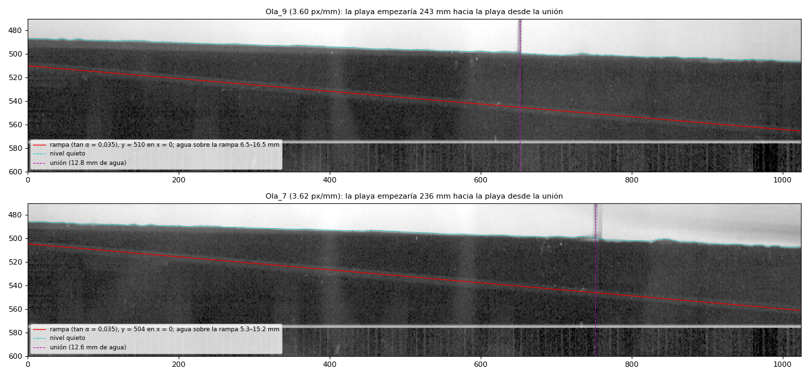
** [18:18] Fotos: altura del agua y montaje completo
- Fotos que pasó el usuario (originales en =Cuarta iteración/Día 2/Fotos/=).
- *Altura del agua* (16:10): regla de acero contra la pared de acrílico, con el 0 hacia abajo. El agua la cruza en *~6,0 cm en los bordes de la regla* y ~6,3 cm en el medio, donde la capilaridad entre la regla y el acrílico la sube. Falta saber dónde apoya la regla para pasarlo a nivel desde el piso original (el usuario había dado 5,60 cm).
#+ATTR_ORG: :width 700
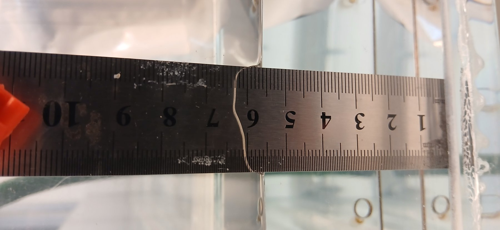
#+ATTR_ORG: :width 400
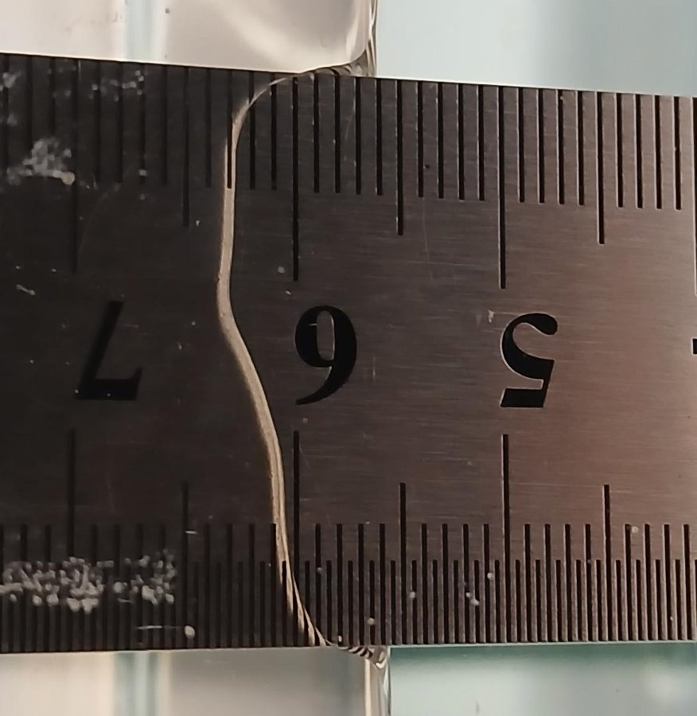
- *Montaje completo* (16:47): el canal negro dentro de la cuba, el panel LED arriba, el damero blanco sostenido con pinzas, la cámara Photron sobre la mesa y el motor a la derecha.
#+ATTR_ORG: :width 900
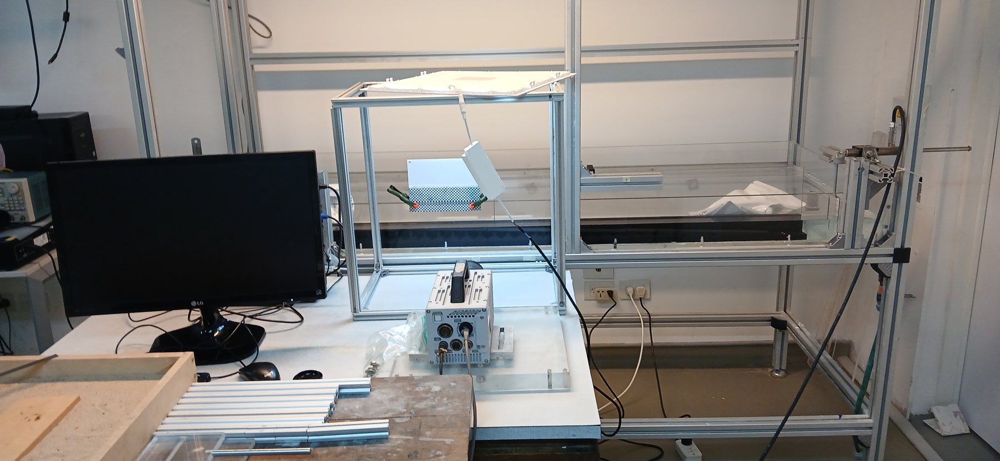
** [18:19] El valle detrás de la pared negra y las columnas: primeros intentos
- El usuario: delante de la ola, el valle queda tapado por la pared negra del canal; con el realce adecuado se debería poder ver, y también ubicar las columnas para calibrar cada video por separado. Empezar por los últimos videos, que son los mejores.
- *Valle:* promediando los cuadros alineados en la cresta (=Códigos/valle_comovil.py=; el fondo fijo se borronea y lo que viaja con la ola se refuerza), en la imagen sin fondo aparece delante del frente una franja clara justo debajo del nivel quieto (de ~50 mm antes a ~50 mm después de la cresta) y una línea oscura tenue en el nivel quieto más adelante. Es la señal de lo que pasa dentro de la zona negra; falta convertirla a altura.
#+ATTR_ORG: :width 900
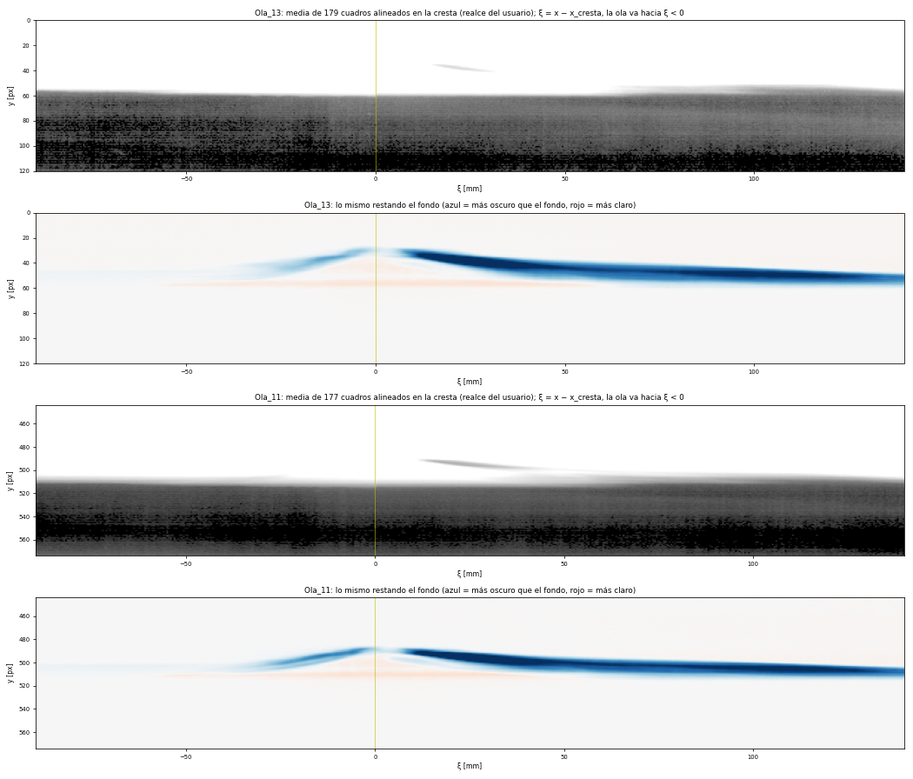
- *Columnas:* con el realce se ven, pero medir su separación por autocorrelación se confunde con las rayas fijas del sensor de la cámara (cada 64–128 px). Da coherente (~39–42 mm) en Ola_6, 10, 11 y 14 y no en las demás. Falta ubicar las columnas una por una.
** [18:31] Videos de la línea detectada, y refinar la detección
- Para las 14 tomas: =Día 2/Videos/linea/= (solo la línea detectada en mm, con x desde la unión de paneles, la rampa y la playa de fondo y el nivel quieto y el medio de la toma) y =Día 2/Videos/crudo_linea/= (los videos crudos con el menisco detectado en rojo encima).
- El usuario: antes de seguir con los análisis probablemente haya que *refinar la detección de la línea*.
** [18:36] Búsqueda: cómo detectar bien la superficie libre en videos laterales
- Pedido del usuario: cada video tiene sus problemas; búsqueda intensiva de la mejor manera de detectar la línea.
- *Procesamiento:*
  - El método más cercano al nuestro es el /continuous maximum gradient/ (CMG; Cao, Padilla, Callaghan et al., IEEE J. Oceanic Eng. 50, 2025): máximo del gradiente de intensidad en cada columna con una restricción de continuidad que descarta sensores, gotas en el vidrio, etc. Da R² = 0,997 contra sondas. Falla cuando la cresta se da vuelta; para esa parte, SDBW-I: región alrededor de la cresta, umbral de Otsu y borde de la región.
  - Gradiente + programación dinámica sembrada con la línea del cuadro anterior (ondas gravito-capilares, arXiv 1606.00457). Es lo que ya usa el collage del manuscrito (=detectar_linea= de fig2_collage.py) y resolvería los cortes de la cresta y la unión de paneles. Hay versiones que lo hacen en (x, t) a la vez para sacar el temblor entre cuadros.
  - Posición subpíxel: ajuste de una función error al perfil del borde (lo más preciso), o parábola en el máximo del gradiente.
  - Realce previo: contraste y nitidez antes de buscar el borde, y la línea de contacto aire–agua–vidrio como aproximación de la superficie (arXiv 2412.12348; ahí las crestas rotas se marcaron a mano).
  - Aprendizaje: U-Net semisupervisada para la elevación en videos laterales de canal (Sci. Rep. 2021), U-Net con rotura y salpicaduras en un tanque (Dice > 0,94), SAM/SAM2 ajustados para interfaces en experimentos de fluidos (Exp. Fluids 2024; VideoSAM). Necesitan cuadros etiquetados: podrían salir del detector actual corregido a mano.
- *Medición (lo que más mejora):*
  - Hoja de luz láser con fluoresceína en el medio del canal: mide lejos de la pared y de su menisco. Con eso el grupo de Duncan encuentra el borde automáticamente a ±1 px (±0,2 mm).
  - Mirando por la pared, lo que se ve es la línea de contacto, que no es la superficie: el menisco, el anclaje y la histéresis la alteran. En canales angostos la línea de contacto aumenta la disipación y la velocidad de fase (Jiang et al., JFM 1996).
  - Luz de fondo difusa (LED detrás) o pared de atrás blanca, como planea el usuario; luz que no parpadee; cámara con el eje a la altura del agua para evitar paralaje; una foto del damero cada vez que se mueve la cámara; un objetivo telecéntrico evitaría la perspectiva.
- *Plan propuesto para la v4 del detector:* (1) corregir el parpadeo y las rayas fijas del sensor; (2) mapa de costo con el gradiente vertical en el borde de abajo de la barra; (3) programación dinámica de izquierda a derecha, con penalidad por pendiente y por apartarse de la línea del cuadro anterior, sin la unión de paneles; (4) ajuste subpíxel con función error; (5) validar con algunos cuadros marcados a mano en cada toma.
** [18:46] Detector v4 (programación dinámica) en las últimas seis tomas
- Implementado lo que salió de la búsqueda (=Códigos/menisco_v4.py=): el borde de abajo de la barra oscura de la imagen sin fondo, buscado como el camino continuo de costo mínimo de izquierda a derecha (programación dinámica), con penalidad por pendiente, continuidad con el cuadro anterior y posición subpíxel. Donde la barra desaparece (la cresta, la unión de paneles) el camino sigue por continuidad; donde no hay ola, el nivel quieto.
- Tres iteraciones: la primera deambulaba antes de que llegara la ola y en el frente se iba al borde de la franja clara de debajo; la segunda caía al nivel quieto en la cresta; la tercera sigue la ola igual que la v3, sin los parches de la v3.
- *Diferencia con la v3:* delante del frente, por tramos, la v4 encuentra el borde 1,5–2,5 mm por debajo del nivel quieto, justo en la zona que tapa la pared negra (¿el valle?), con escalones donde aparece y desaparece. A decidir con el usuario.
- Videos con las dos líneas (rojo v3, verde v4): =Día 2/Videos/crudo_linea_v3_v4/=.
#+ATTR_ORG: :width 900
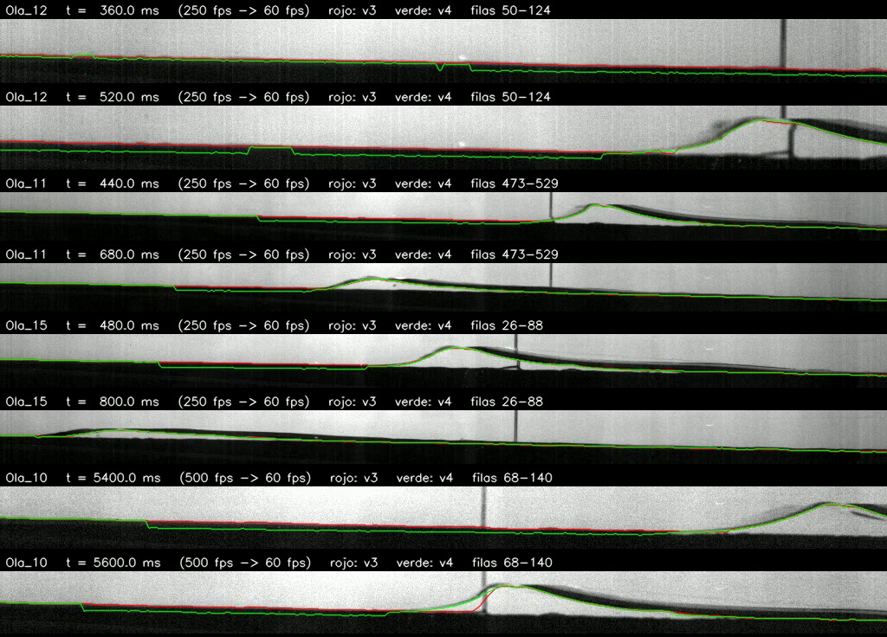
** [18:50] v4 ruidosa antes de la ola; plan para hacerlo con una red
- El usuario: la v4 tiene muchísimo ruido antes de que aparezca la ola. Pregunta cómo sería con una red, local y lo más estándar posible.
- Plan propuesto: U-Net (PyTorch en CPU; esta máquina no tiene GPU utilizable) que segmenta agua/aire en recortes de la franja de la ola, con el cuadro crudo y la imagen sin fondo como entradas. La línea es el borde de la máscara en cada columna, y la continuidad la sigue poniendo la misma programación dinámica, ahora sobre la probabilidad de la red. Etiquetas: la v3 como punto de partida, corregida a mano en ~150–200 cuadros de distintas tomas y momentos con una herramienta propia; validación con dos tomas que la red no ve.
** [19:10] Muesca detrás de la cresta: dos barras; el usuario dibuja la línea a mano
- La oscilación espuria en el pico de η(t) cerca de la entrada (el usuario: "hasta 75 mm") viene de que, detrás de la cresta, hay dos barras oscuras (una tenue arriba, continua con la cresta, y otra muy oscura 4–8 px abajo; ¿el menisco en cada pared?) y el detector saltaba a la de abajo.
- Probé tomar la primera barra desde arriba (v3c) y combinarla con la continuidad de la v4 (v4d): cada una arregla una parte y rompe otra. El usuario: "se rompió lo que estaba bien y viceversa; dejá que te dibuje yo esa línea para la Ola_15". Volví a la v3 original.
- Herramienta para marcar la línea a mano (=Día 2/Códigos/etiquetar.py=): la v3 como guía, el usuario marca puntos donde hace falta corregir y la línea pasa por ellos; queda en =Resultados/etiquetas_Ola_15.json= y =menisco_manual_Ola_15.npz=. Servirá de referencia y de etiquetas para la red.
** [19:20] Espectros de la Ola_15 con la línea corregida a mano
- Antes de la corrección: animaciones del espectro de la ola, pedidas por el usuario.
  - Espectro espacial E(k) en función del tiempo, en una ventana de 72 mm que sigue a la ola, para Ola_10–15. Eje de arriba: f con gravedad y profundidad finita (h = 12,7 mm, la de la unión de paneles).
  - Espectro temporal E(f) en función del espacio para la Ola_15, columna por columna desde la entrada hacia la playa. Eje de arriba: k con la profundidad local de la rampa.
  - Videos en =Día 2/Videos/espectro/= y =Día 2/Videos/espectro_temporal/=.
- La red (U-Net, entrenada con la v3 de Ola_14 y Ola_15) la corté a mitad del entrenamiento: sus etiquetas tenían el mismo error de la cresta. Se reentrena con la línea dibujada por el usuario.
- *Corrección:* la línea a mano (cuadros 35–68 cada 3, más el 89 y el 95) se pasó a los cuadros intermedios siguiendo a la ola. La diferencia con la v3 se interpola en el tiempo corriéndola con la velocidad de la cresta. Así quedan 49 cuadros corregidos; en el resto, la v3 (=Códigos/corregir_con_manual.py= → =Resultados/menisco_corr_Ola_15.npz=).
- Videos corregidos: =Videos/espectro/Ola_15_corregido.mp4= y =Videos/espectro_temporal/Ola_15_corregido.mp4=.
- *Efecto cerca de la entrada (x > 75 mm de la unión):*
  - La oscilación en el pico de η(t) desaparece: la rugosidad del pico baja de 0,89 mm (v3) y 0,54 mm (v3 con filtros) a 0,21 mm.
  - La energía entre 20 y 125 Hz baja entre 4 y 8 veces: era ruido de la línea.
  - Entre 5 y 20 Hz sube 40–90 %: la cresta, ahora sobre la barra de arriba, es más alta y más aguda.
#+ATTR_ORG: :width 900
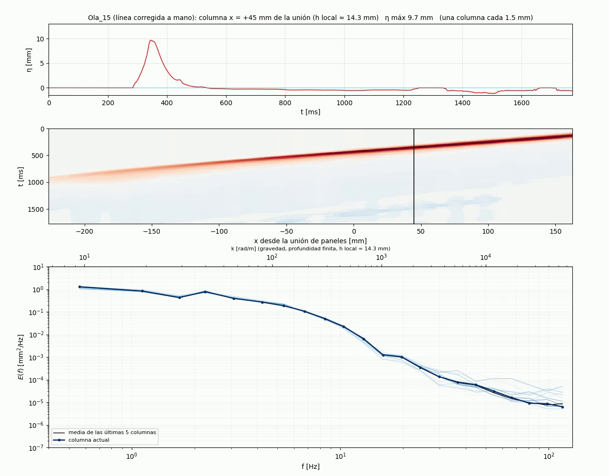
** [19:29] Bonneton en el espectro temporal de la ola sola; los videos quedan solo para el collage
- Pedido del usuario: ajustar el espectro temporal corregido de la Ola_15 con el modelo de Bonneton (2023), igual que la Fig. 11 del manuscrito: E/Ẽ = csch²(f/f_ν)/[f_ν(coth(f_m/f_ν) − 1)], con f_ν como único parámetro libre, en ln E entre f_m y 11,1 Hz.
- Para una ola sola tomé f_m = 1/T, con T la duración de la ola en cada columna; un diente del tren de frentes de Bonneton dura el tiempo entre frentes.
- *Resultado (bloques de 10 mm):*
  - f_ν ≈ 4 Hz desde la entrada hasta x ≈ +50 mm. La rotura (frente más empinado) está en x ≈ +97 mm.
  - Sube a 6–10 Hz entre x ≈ +30 y −110 mm y queda en 5–8 Hz cerca de la playa.
  - R² 0,70–0,99 (mediana 0,91). χ²_ν mediana 14, con σ = dispersión entre columnas: el csch² no describe el espectro dentro de esa dispersión.
  - f_ν = C h^a con a = −0,57 ± 0,08 (R² 0,61, χ²_ν 3,0, 35 g.l.). Se parece al ω_ν ∝ h^−0,53 del barrido del 14/10, pero acá es más un escalón entre antes y después de romper que una ley de potencias.
- El usuario: a una ola sola le falta estadística; debería salir bien del JONSWAP.
- *JONSWAP h20 (H20_1, la única en local):* no ajusta. El espectro va como f⁻² hasta ~30 Hz, sin corte, y f_ν se va al límite. Son olas de ~2 mm con armónicos marcados de 0,93 Hz.
- *El usuario: para este paper, los videos quedan como anécdota, solo para el collage.* Se cortó acá.
- Archivos: =Día 2/Figuras/bonneton_temporal_Ola_15.png= y =Videos/espectro_temporal/Ola_15_corregido_bonneton.mp4=.
#+ATTR_ORG: :width 900
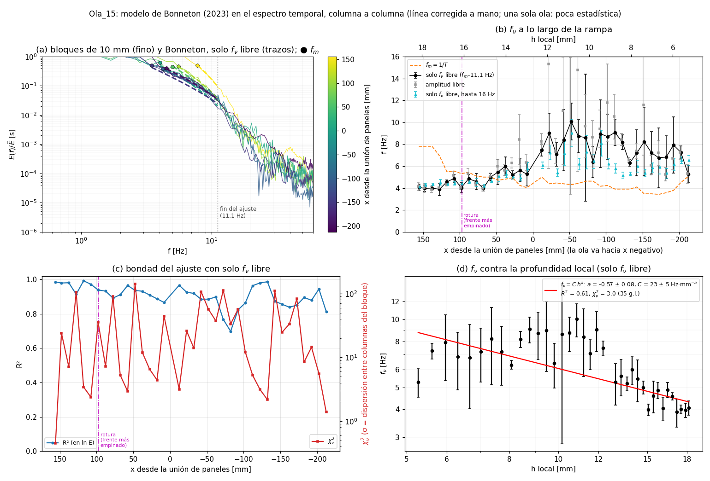
** [19:53] Collages tipo Fig. 2a con las distintas olas; versión con los cuadros crudos
- Pedido del usuario: opciones de collage como el de la Figura 2 con las distintas olas.
  - Primero, la receta del collage de la Ola_9 (sin fondo, CLAHE) para todas las tomas, con la cresta recorriendo todo el ancho, y una variante con la proporción de las tiras del manuscrito. Además, un gadget con sliders para el contraste.
  - Para Ola_13 y Ola_14, una versión que copia el collage del manuscrito: tamaño de tira, posición de la cresta en cada tira, fracción saturada, CLAHE y gris y grano del fondo (medidos en el manuscrito: gris 243, σ 5,9; aquí 244–247, σ 5,6–5,9).
- *Pedido final del usuario:* los collages solo con los cuadros *sin procesar*, bien recortados. Cada tira es el cuadro original recortado y espejado, con el mismo estiramiento lineal de gris para las nueve; sin restar fondo, sin rotar ni filtrar (=Día 2/Figuras/collages/F2a_crudo_Ola_13.png=, =F2a_crudo_Ola_14.png= y =F2a_crudo_<toma>_recorte.png= para todas las tomas).
- La red quedó entrenándose con la línea corregida de la Ola_15. Al terminar detecta Ola_10–15; se revisa mañana.
- El usuario: es lo último de hoy. El montaje queda como está hasta nuevo aviso; quizás mañana otra medición.
#+ATTR_ORG: :width 900
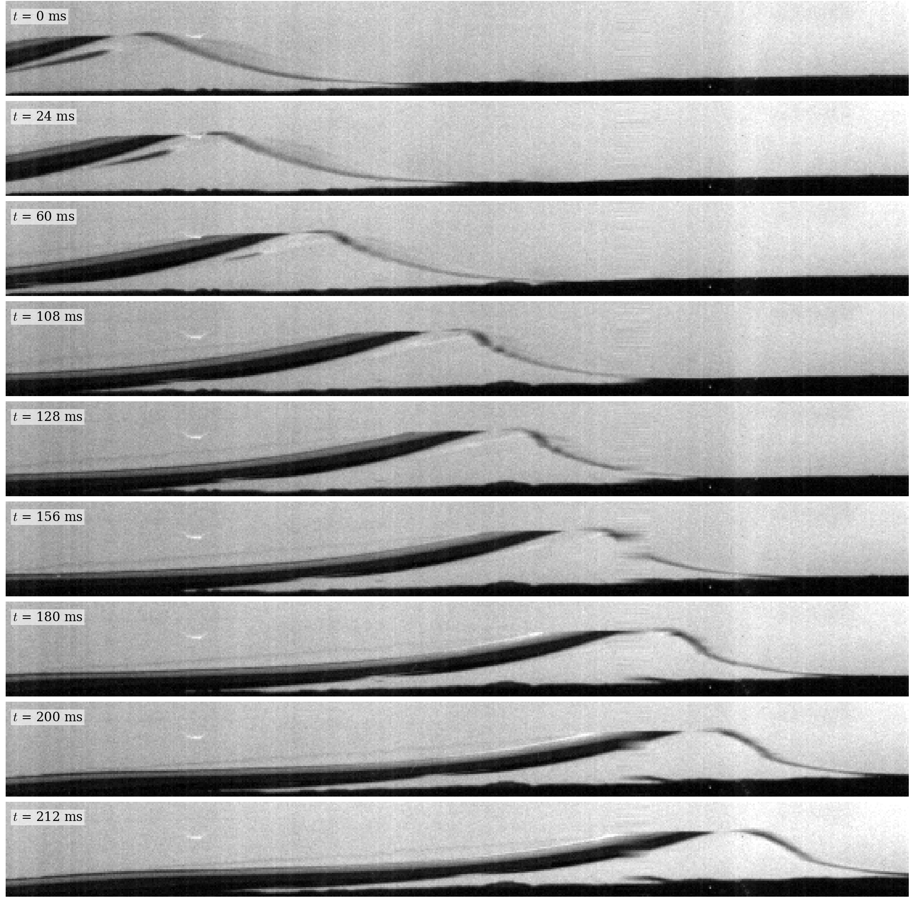
** [19:56] Collages crudos sin la unión de paneles
- El usuario: borrar a mano la línea negra vertical (la unión de los paneles), "es horrible". Las columnas de la unión se rellenan interpolando entre las vecinas, con el ruido de fondo del cuadro. Es lo único que se le toca a los cuadros crudos. Regenerados todos los collages crudos (=Día 2/Figuras/collages/F2a_crudo_*=); la figura de las 19:53 ya es la nueva.
** [19:58] Collages crudos emprolijados; seguimos mañana
- El usuario: falta rotar bien, eliminar lo negro y recortar mejor la ola (quedaba mucho espacio arriba). Ahora cada cuadro se rota para dejar horizontal la línea de agua (~1°). Abajo se corta donde empieza la franja negra del agua quieta y arriba a 1,25 veces la cresta más alta.
- Ola_13 y Ola_14 quedan en 178 × 14,5 y 171 × 13,4 mm. Para revisar juntos el 25/11, junto con la red (si da algo coherente).
- El usuario se quedó sin batería; seguimos mañana.
* 2026-11-25
** [09:10] Videos nuevos, mejor enfocados y con el damero; nivel 5,9 cm
- El usuario filmó dos videos nuevos de la ola rompiendo, mejor enfocados y con el patrón de calibración (damero de 4 mm) en el cuadro.
- Agregó un par de mm de agua: el nivel quedó en ≈ 5,9 cm desde el piso original (ayer, 5,60 cm). Eso da ≈ 4,4 cm en la paleta y ≈ 4,2 cm sobre el piso de la rampa (unidad y forzado a confirmar).
- Todo lo de hoy va en =Cuarta iteración/Día 3/=.
- La red del 24/11 se cortó en la iteración ~800 al quedarse la compu sin batería; no hay modelo guardado.
** [09:15] Amplitud al 75 % y wizard a −50 mm
- El usuario bajó el factor de amplitud del forzado al 75 %, para que las olas no rompan apenas las genera la paleta y pierdan energía ahí.
- Cambió el wizard del LinMot a −50 (ayer: homing en −25 mm; a confirmar si es el homing o la distancia A).
- Mide ahora con esa configuración.
** [09:25] Ola_18: amplitud al 75 %, cambió poco
- La toma con el factor de amplitud al 75 % y el wizard en −50 es la Ola_18. Según el usuario, la ola cambió poco.
- Las dos tomas anteriores de hoy serían Ola_16 y Ola_17 (a confirmar).
** [09:30] Vuelta a la configuración original; medición con un forzado Bonneton
- El usuario volvió todo a lo original (amplitud 100 %, wizard como ayer) y mide con un forzado Bonneton (JONSWAP; cuál h, a confirmar: la curva de ayer es bonneton_C3_h_4.1cm y el nivel de hoy daría ≈ 4,4 cm en la paleta).
** [09:40] La Bonneton fue el JONSWAP h20, con el wizard en −50
- *Corrige la entrada de las 09:30:* el forzado Bonneton que midió el usuario es el JONSWAP h20 (bonneton_C3_h_20cm, el principal, el mismo del 20/11), con amplitud al 100 % y el wizard en −50, para que la paleta quede bien adentro del canal.
** [09:45] Fondo blanco de acrílico
- El usuario puso un fondo blanco de acrílico detrás del canal (era un pendiente del 24/11: pared de atrás blanca). Desde qué toma, a confirmar (¿desde la h20?).
** [09:50] Cámara más abajo
- El usuario bajó la cámara del acrílico donde estaba apoyada, para que se vea mejor el menisco.
- La cámara se movió: hace falta una toma del damero en la posición nueva para calibrar (px/mm e inclinación).
** [09:55] Plan del resto de la mañana
- Con el fondo blanco y todo como al principio (amplitud 100 %; wizard, a confirmar si vuelve a −25), el usuario toma un par de olas individuales más.
- Después baja un poco el nivel y toma una más. Por ahora, eso sería todo.
** [10:05] Nivel bajado a ~5,5–5,6 cm, wizard en −25
- El usuario bajó el nivel a ≈ 5,5–5,6 cm (desde el piso original): ≈ 4,0–4,1 cm en la paleta y ≈ 3,8–3,9 cm sobre el piso de la rampa.
- Wizard de vuelta en −25 (como el 24/11).
- Con eso mide la última toma de la mañana.
