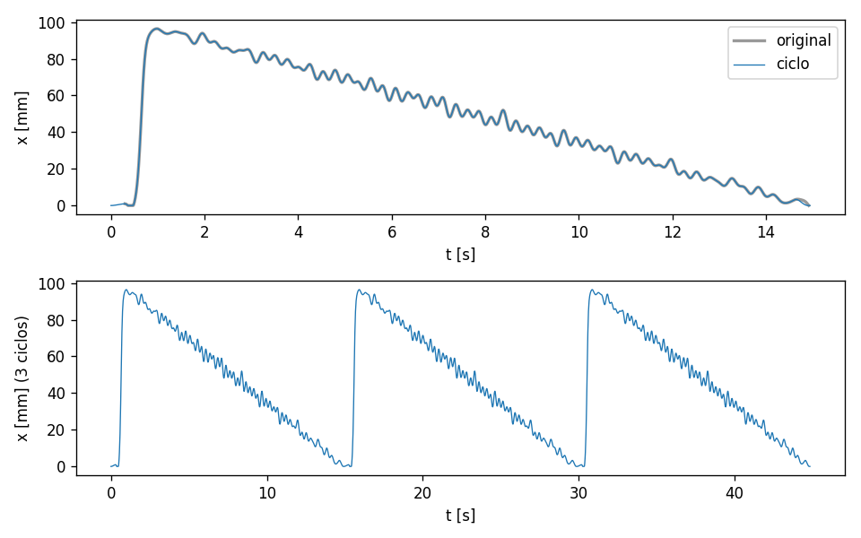

#+TITLE: Journal Week 48
#+OPTIONS: toc:2
#+BIBLIOGRAPHY: ../../../references.bib
#+CITE_EXPORT: csl chicago-author-date.csl

* Table of Contents :TOC:noexport:

* Referencias
#+PRINT_BIBLIOGRAPHY:

* 2026-11-24
** [09:45] Reunión de Labo de hoy: PDF de los incrementos y cumulantes
- Pedido del usuario: solo los gráficos de las PDF, prolijos, y lo de los cumulantes. Presentación en =~/Documentos/Reuniones de Labo/2026-11-24/labo_2026-11-24.pdf= (6 diapositivas).
- Paneles nuevos, hechos a la medida de la diapositiva, en =Códigos/= (=pdfs_panel.py=, =cumulantes_panel.py=). Son versiones limpias de las figuras del 17/11 (Día 15, PDF pesadas) y del 20/11 (Día 17), con los mismos datos (S3, JONSWAP principal) y los mismos números.
- Diapositivas: (1) P(z) en log en 1/2f_ν, centro y 1/2f_m, dato contra IAAFT y gaussiana; (2) |z|^p P(z) para p = 2, 4, 6, con la fracción que ponen los frentes; (3) convergencia: integrandos normalizados, |z| máximo y eventos con |z| > 4,5 (9 / 0 / 1); (4) κ3–κ6 contra τ y tabla en los tres τ; (5) log-cumulantes C2, C3 y ζ_p (c2 = −0,23 ± 0,02 en el dato contra 0,00 ± 0,02 en el IAAFT).
** [11:25] Integral parcial de la PDF pesada, sin normalizar
- Pedido del usuario, sobre la integral acumulada del 20/11 (=Tercera iteración/Día 17/Figuras/integral_acumulada.pdf=): la misma integral, pero sin dividir por ⟨|z|^p⟩. Script =~/Documentos/Reuniones de Labo/2026-11-24/Códigos/integral_panel.py= → =Figuras/P_integral_sin_normalizar.pdf= (todavía no está en la presentación).
- Arriba M_p(Z) = ∫_{|z|<Z} |z|^p P(z) dz, que llega a la meseta ⟨|z|^p⟩ = S_p/σ_τ^p; abajo lo que falta, ⟨|z|^p⟩ − M_p(Z). Gris: la gaussiana exacta, ⟨|z|^p⟩_G · P((p+1)/2, Z²/2). Punteada: |z| máximo medido. S3, JONSWAP principal; τ = 115 / 206 / 371 ms.
- Así se ven directamente las mesetas contra la gaussiana. En 1/2f_ν: p = 6 llega a 50 (gaussiana 15) y p = 4 a 5,5 (gaussiana 3). En 206 ms: 20 y 3,4. En 1/2f_m quedan por debajo de la gaussiana (12 contra 15; 2,7 contra 3), con el escalón del evento único en |z| ≈ 4,5.
#+ATTR_ORG: :width 700
[[file:../../../Assets/2026/11/Day_24/integral_sin_normalizar.png]]
** [11:27] Cuarta iteración, Día 2: llenado de la cuba para los videos
- Se está llenando la cuba con *agua destilada* (el plan del Día 1 decía agua de la canilla). Arrancamos temprano; el llenado tarda aproximadamente una hora más (lista hacia las 12:30).
- Hoy se filma la ola rompiendo con la rampa nueva (plan en =Cuarta iteración/Día 1/README.md=). Todo lo de hoy va en =Cuarta iteración/Día 2/= (=Videos/=, =Códigos/=, =Figuras/=; registro en el README).
** [11:35] Curvas de forzado para los videos, en el pendrive
- En =KINGSTON/Posgrado/Pruebas rampa impresa 3D cuba grande/Cuarta iteración/Día 2 (24-11) Videos/= (verificadas byte a byte; una columna en mm, sin encabezado):
  1. =639960ms_bonneton_C3_h_20cm_Tp_1.07_Hm0_42.9mm_seed_1_una_curva.csv=: JONSWAP principal ("h20"), el mismo del 20/11.
  2. =599962ms_bonneton_C3_h_3.5cm_Tp_0.45_Hm0_7.5mm_seed_1_fhi_2.5fp_una_curva.csv=: JONSWAP con la profundidad real (el de =Bonneton_bien_profundidad_360=, 13/10). Se escaló para h = 3,5 cm en la paleta, que era el nivel 3,60 cm en el punto de referencia de ese montaje. *A confirmar* con el nivel de hoy.
  3. =14940ms_un_salto_random_3_curva_04.csv=: *un solo salto* de los muchos forzados (curva 04 de Curvas_random_3: A = 96,6 mm, subida en ~0,7 s, vuelta lineal). Empieza y termina en x = 0, así que se puede repetir en loop (período 14,94 s). =119520ms_…_x8.csv= es el mismo ciclo 8 veces (≈ 2 min). Generador: =Cuarta iteración/Día 2/Curvas forzado/generador_un_salto.py=.
  4. =267740ms_quieto_90s_triangulares_random_3_177s.csv=: 90 s quieto (sirve de fondo para el video) + 177 s de muchos forzados (12 triangulares), la curva corta del 14/10.
- Plan de tomas: un video por cada JONSWAP, uno de muchos forzados y después varios solo del rompimiento del salto único, a más resolución, para ahorrar espacio y tiempo.
#+ATTR_ORG: :width 600

** [11:50] Disco externo para los videos: DEX5
- Se probaron los discos externos del Labo (catálogo DEX). Espacio libre y escritura secuencial medida con 1 GB (=dd= con =conv=fdatasync=, archivo temporal borrado):
  | Disco | Modelo                         | Libre   | Escritura [MB/s] |
  |-------+--------------------------------+---------+------------------|
  | DEX1  | Seagate Expansion 1 TB         | 170 GB  |             37,6 |
  | DEX2  | Seagate Backup+ SL 1 TB        | 40 GB   |  no confiable    |
  | DEX3  | Seagate Backup Plus Slim 2 TB  | 405 GB  |             46,6 |
  | DEX5  | WD Elements 2 TB               | 1,3 TB  |             43,4 |
- Los cuatro son HDD con NTFS y USB 3.0; ninguno informa la velocidad por sí mismo. DEX4 estaba en uso.
- DEX2 se desconectó del USB durante la prueba (errores de escritura y reset). Se desmontó, se volvió a montar (limpio) y se borró el archivo de prueba; sin errores nuevos.
- *Elegido: DEX5* (el que tiene más espacio; la velocidad es parecida a la de DEX3).
** [11:58] Salto único con meseta y bajada lineal
- Pedido del usuario: el frente tal cual, pero que una vez arriba la paleta quede quieta un rato y después baje linealmente, sin el ruido sumado. La interfaz periodiza sola, así que alcanza con un ciclo.
- =17920ms_un_salto_random_3_curva_04_meseta_3s_bajada_lineal.csv=: frente de la curva 04 original (con su ruido) hasta su máximo (96,4 mm a los 0,68 s, donde la velocidad pasa por cero), *3 s quieta* y bajada lineal sin ruido hasta 0 en 13,92 s (6,9 mm/s, la misma pendiente que la original). Período 17,92 s; |v| ≤ 525 mm/s.
- En el pendrive (=Cuarta iteración/Día 2 (24-11) Videos/=) reemplaza a la versión anterior. Generador: =generador_un_salto.py --meseta 3=.
#+ATTR_ORG: :width 600
[[file:../../../Assets/2026/11/Day_24/un_salto_meseta_control.png]]
