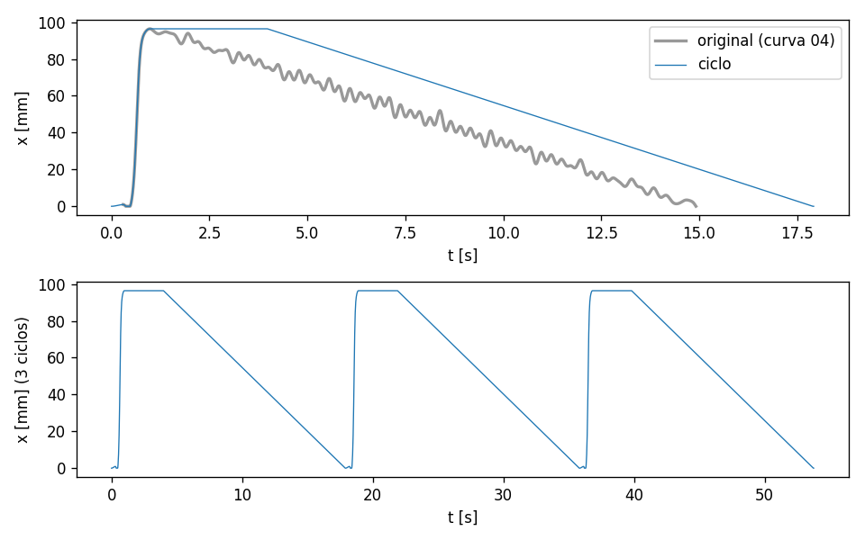
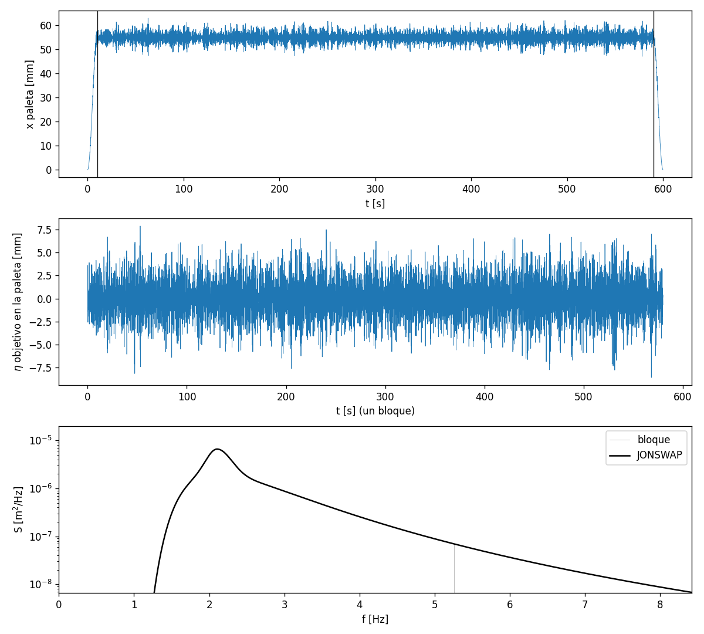
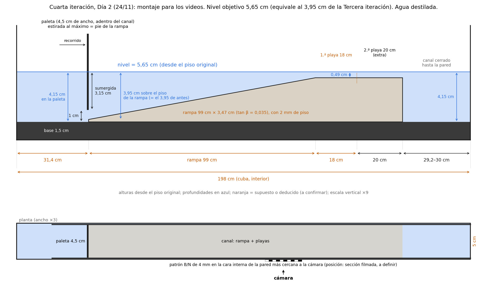

#+TITLE: Journal Week 48
#+OPTIONS: toc:2
#+BIBLIOGRAPHY: ../../../references.bib
#+CITE_EXPORT: csl chicago-author-date.csl

* Table of Contents :TOC:noexport:

* Referencias
#+PRINT_BIBLIOGRAPHY:

* 2026-11-24
** [09:45] Reunión de Labo de hoy: PDF de los incrementos y cumulantes
- Pedido del usuario: solo los gráficos de las PDF, prolijos, y lo de los cumulantes. Presentación en =~/Documentos/Reuniones de Labo/2026-11-24/labo_2026-11-24.pdf= (6 diapositivas).
- Paneles nuevos, hechos a la medida de la diapositiva, en =Códigos/= (=pdfs_panel.py=, =cumulantes_panel.py=). Son versiones limpias de las figuras del 17/11 (Día 15, PDF pesadas) y del 20/11 (Día 17), con los mismos datos (S3, JONSWAP principal) y los mismos números.
- Diapositivas: (1) P(z) en log en 1/2f_ν, centro y 1/2f_m, dato contra IAAFT y gaussiana; (2) |z|^p P(z) para p = 2, 4, 6, con la fracción que ponen los frentes; (3) convergencia: integrandos normalizados, |z| máximo y eventos con |z| > 4,5 (9 / 0 / 1); (4) κ3–κ6 contra τ y tabla en los tres τ; (5) log-cumulantes C2, C3 y ζ_p (c2 = −0,23 ± 0,02 en el dato contra 0,00 ± 0,02 en el IAAFT).
** [11:25] Integral parcial de la PDF pesada, sin normalizar
- Pedido del usuario, sobre la integral acumulada del 20/11 (=Tercera iteración/Día 17/Figuras/integral_acumulada.pdf=): la misma integral, pero sin dividir por ⟨|z|^p⟩. Script =~/Documentos/Reuniones de Labo/2026-11-24/Códigos/integral_panel.py= → =Figuras/P_integral_sin_normalizar.pdf= (todavía no está en la presentación).
- Arriba M_p(Z) = ∫_{|z|<Z} |z|^p P(z) dz, que llega a la meseta ⟨|z|^p⟩ = S_p/σ_τ^p; abajo lo que falta, ⟨|z|^p⟩ − M_p(Z). Gris: la gaussiana exacta, ⟨|z|^p⟩_G · P((p+1)/2, Z²/2). Punteada: |z| máximo medido. S3, JONSWAP principal; τ = 115 / 206 / 371 ms.
- Así se ven directamente las mesetas contra la gaussiana. En 1/2f_ν: p = 6 llega a 50 (gaussiana 15) y p = 4 a 5,5 (gaussiana 3). En 206 ms: 20 y 3,4. En 1/2f_m quedan por debajo de la gaussiana (12 contra 15; 2,7 contra 3), con el escalón del evento único en |z| ≈ 4,5.
#+ATTR_ORG: :width 700
[[file:../../../Assets/2026/11/Day_24/integral_sin_normalizar.png]]
** [11:27] Cuarta iteración, Día 2: llenado de la cuba para los videos
- Se está llenando la cuba con *agua destilada* (el plan del Día 1 decía agua de la canilla). Arrancamos temprano; el llenado tarda aproximadamente una hora más (lista hacia las 12:30).
- Hoy se filma la ola rompiendo con la rampa nueva (plan en =Cuarta iteración/Día 1/README.md=). Todo lo de hoy va en =Cuarta iteración/Día 2/= (=Videos/=, =Códigos/=, =Figuras/=; registro en el README).
** [11:35] Curvas de forzado para los videos, en el pendrive
- En =KINGSTON/Posgrado/Pruebas rampa impresa 3D cuba grande/Cuarta iteración/Día 2 (24-11) Videos/= (verificadas byte a byte; una columna en mm, sin encabezado):
  1. =639960ms_bonneton_C3_h_20cm_Tp_1.07_Hm0_42.9mm_seed_1_una_curva.csv=: JONSWAP principal ("h20"), el mismo del 20/11.
  2. =599962ms_bonneton_C3_h_3.5cm_Tp_0.45_Hm0_7.5mm_seed_1_fhi_2.5fp_una_curva.csv=: JONSWAP con la profundidad real (el de =Bonneton_bien_profundidad_360=, 13/10). Se escaló para h = 3,5 cm en la paleta, que era el nivel 3,60 cm en el punto de referencia de ese montaje. *A confirmar* con el nivel de hoy.
  3. =14940ms_un_salto_random_3_curva_04.csv=: *un solo salto* de los muchos forzados (curva 04 de Curvas_random_3: A = 96,6 mm, subida en ~0,7 s, vuelta lineal). Empieza y termina en x = 0, así que se puede repetir en loop (período 14,94 s). =119520ms_…_x8.csv= es el mismo ciclo 8 veces (≈ 2 min). Generador: =Cuarta iteración/Día 2/Curvas forzado/generador_un_salto.py=.
  4. =267740ms_quieto_90s_triangulares_random_3_177s.csv=: 90 s quieto (sirve de fondo para el video) + 177 s de muchos forzados (12 triangulares), la curva corta del 14/10.
- Plan de tomas: un video por cada JONSWAP, uno de muchos forzados y después varios solo del rompimiento del salto único, a más resolución, para ahorrar espacio y tiempo.
#+ATTR_ORG: :width 600
[[file:../../../Assets/2026/11/Day_24/un_salto_control.png]]
** [11:50] Disco externo para los videos: DEX5
- Se probaron los discos externos del Labo (catálogo DEX). Espacio libre y escritura secuencial medida con 1 GB (=dd= con =conv=fdatasync=, archivo temporal borrado):
  | Disco | Modelo                         | Libre   | Escritura [MB/s] |
  |-------+--------------------------------+---------+------------------|
  | DEX1  | Seagate Expansion 1 TB         | 170 GB  |             37,6 |
  | DEX2  | Seagate Backup+ SL 1 TB        | 40 GB   |  no confiable    |
  | DEX3  | Seagate Backup Plus Slim 2 TB  | 405 GB  |             46,6 |
  | DEX5  | WD Elements 2 TB               | 1,3 TB  |             43,4 |
- Los cuatro son HDD con NTFS y USB 3.0; ninguno informa la velocidad por sí mismo. DEX4 estaba en uso.
- DEX2 se desconectó del USB durante la prueba (errores de escritura y reset). Se desmontó, se volvió a montar (limpio) y se borró el archivo de prueba; sin errores nuevos.
- *Elegido: DEX5* (el que tiene más espacio; la velocidad es parecida a la de DEX3).
** [11:58] Salto único con meseta y bajada lineal
- Pedido del usuario: el frente tal cual, pero que una vez arriba la paleta quede quieta un rato y después baje linealmente, sin el ruido sumado. La interfaz periodiza sola, así que alcanza con un ciclo.
- =17920ms_un_salto_random_3_curva_04_meseta_3s_bajada_lineal.csv=: frente de la curva 04 original (con su ruido) hasta su máximo (96,4 mm a los 0,68 s, donde la velocidad pasa por cero), *3 s quieta* y bajada lineal sin ruido hasta 0 en 13,92 s (6,9 mm/s, la misma pendiente que la original). Período 17,92 s; |v| ≤ 525 mm/s.
- En el pendrive (=Cuarta iteración/Día 2 (24-11) Videos/=) reemplaza a la versión anterior. Generador: =generador_un_salto.py --meseta 3=.
#+ATTR_ORG: :width 600

** [12:10] Montaje de la Cuarta iteración (lo que contó el usuario)
- *Nivel:* faltaba llenar ~1 cm (iba en ~4,8–4,9 cm). El setup tiene una base de *1,5 cm* y encima la rampa con *2 mm* de piso, así que el nivel equivalente a 3,95 cm es *3,95 + 1,7 = 5,65 cm* desde el piso original. Lista en media hora a una hora.
- *Paleta:* la del motor nuevo, de *4,5 cm de ancho*, entra adentro del canal (antes era la paleta grande). El canal ocupa casi todo el ancho de la cuba. Con la paleta lo más estirada posible queda al borde de la rampa. Queda a ~1 cm del piso nuevo, o sea a *2,5 cm del piso original*.
- *Canal y playas:* hay una playa extra de *20 cm* y el canal llega hasta el otro extremo de la cuba (antes quedaba abierto). El final de la segunda playa queda a *~29,2–30 cm* de la pared opuesta.
- *Cámara:* cuando se sepa dónde rompen las olas, el usuario pasa qué sección filma y la calibración: foto de un patrón de cuadrados blancos y negros de *4 mm*, pegado a la cara interna de la pared de acrílico más cercana a la cámara.
** [12:20] JONSWAP con la profundidad correcta para este montaje
- Con el piso nuevo a 1,7 cm y nivel 5,65 cm, la profundidad en la paleta es *3,95 cm* (a confirmar: si debajo de la paleta el piso está a 1,5 cm, serían 4,15 cm). La curva de 3,5 cm que estaba en el pendrive era la del montaje de octubre.
- Nueva: =Cuarta iteración/Día 2/Curvas forzado/Curvas_jonswap/bonneton_C3_h_3.95cm_Tp_0.48_Hm0_8.5mm_seed_1_fhi_2.5fp_una_curva/599962ms_…csv= (escalada de vN03-C3: *T_p = 0,475 s, H_m0 = 8,5 mm*, k_p h = 0,951, ξ0 = 0,226; 600 s; x de 0 a 63 mm, |v| ≤ 109 mm/s). Generador copiado del Día 1 de la Tercera iteración, sin cambios.
- *Falta copiarla al pendrive* (estaba desconectado); va en lugar de la de 3,5 cm.
#+ATTR_ORG: :width 600

** [12:24] Corrección: la paleta se mueve sobre la base de 1,5 cm → JONSWAP de 4,15 cm
- El usuario da las alturas desde el piso original, por consistencia, pero la paleta, adentro del canal, se mueve sobre la base de *1,5 cm* (no sobre el piso de 2 mm de la rampa). Con nivel 5,65 cm, la profundidad en la paleta es *4,15 cm*, no 3,95 (la entrada de las 12:20 queda corregida; esa curva se borró).
- Curva: =bonneton_C3_h_4.15cm_Tp_0.49_Hm0_8.9mm_seed_1_fhi_2.5fp_una_curva= (*T_p = 0,487 s, H_m0 = 8,9 mm*, k_p h = 0,951, ξ0 = 0,226). Regenerada hoy en =Cuarta iteración/Día 2/Curvas forzado/=: es idéntica byte a byte a la de 4,15 cm del 13/10, que ya está en el pendrive en =Tercera iteración/Curvas forzado/Curvas_jonswap/= (la que en octubre quedó como "obsoleta" porque el punto de referencia estaba del otro lado).
- Falta pasarla a =Cuarta iteración/Día 2 (24-11) Videos/= del pendrive, en lugar de la de 3,5 cm. Si el nivel final no es 5,65 cm, la profundidad en la paleta es nivel − 1,5 cm y hay que regenerarla.
** [12:32] Esquema del montaje nuevo y por qué el JONSWAP de 4,15 cm
- Esquema (=Cuarta iteración/Día 2/Códigos/esquema_montaje.py=): vista lateral (escala vertical ×9, alturas desde el piso original) y planta (ancho ×3). En negro, lo que contó el usuario; en *naranja, lo supuesto o deducido, a confirmar*: cuba de 198 cm y 5 cm de ancho, rampa de 99 cm con tan β = 0,035 y primera playa plana de 18 cm (como en octubre), segunda playa plana. Con eso, el pie de la rampa (= paleta estirada al máximo) queda a ~31 cm de la pared del lado de la paleta.
- Profundidades con nivel 5,65 cm: *4,15 cm en la paleta* (sumergida 3,15 cm, 1 cm libre abajo), 3,95 cm sobre el piso de la rampa (= el 3,95 de la Tercera iteración), ~0,5 cm sobre la playa, 4,15 cm entre el fin de la segunda playa y la pared.
#+ATTR_ORG: :width 800

- *Por qué el JONSWAP "con h correcta" es el de 4,15 cm:* el generador escala vN03-C3 (h = 0,70 m en la paleta, T_p = 2 s) por Froude con la profundidad *en la paleta*: conserva k_p h = 0,951 (cuán somera es la ola donde se genera) y ξ0 = 0,226 (Iribarren con la pendiente). De ahí T_p = 2 s·√(h/0,70 m) y H_m0 sale de ξ0. Además, la carrera de la paleta se calcula con la transferencia de Biésel (pistón), que depende de k h en la paleta. La paleta se mueve sobre la base de 1,5 cm, así que h = 5,65 − 1,5 = 4,15 cm.
  | Curva     | T_p [s] | H_m0 [mm] | k_p h con h = 4,15 cm | H_m0/h |
  |-----------+---------+-----------+-----------------------+--------|
  | h 3,5 cm  |   0,447 |       7,5 |                  1,06 |   0,18 |
  | h 3,95 cm |   0,475 |       8,5 |                  0,98 |   0,21 |
  | h 4,15 cm |   0,487 |       8,9 |              *0,951* |   0,21 |
  | h 20 cm   |   1,069 |      42,9 |                  0,39 |   1,03 |
  - La de 3,5 cm era la del montaje de octubre con nivel 3,60 (=Bonneton_bien_profundidad_360=). La de 3,95 cm suponía el piso de 2 mm de la rampa también debajo de la paleta (equivocado). ξ0 da 0,226 en todas porque H_m0 se elige para conservarlo; lo que cambia es k_p h.
  - La "h 20 cm" (la principal del manuscrito) es otro diseño: escalada como si la paleta estuviera en 20 cm de agua.
  - Salvedad: Biésel supone un pistón que llega al fondo. Acá la paleta deja 1 cm libre abajo, así que las olas salen algo más chicas que lo nominal (igual que en octubre).
